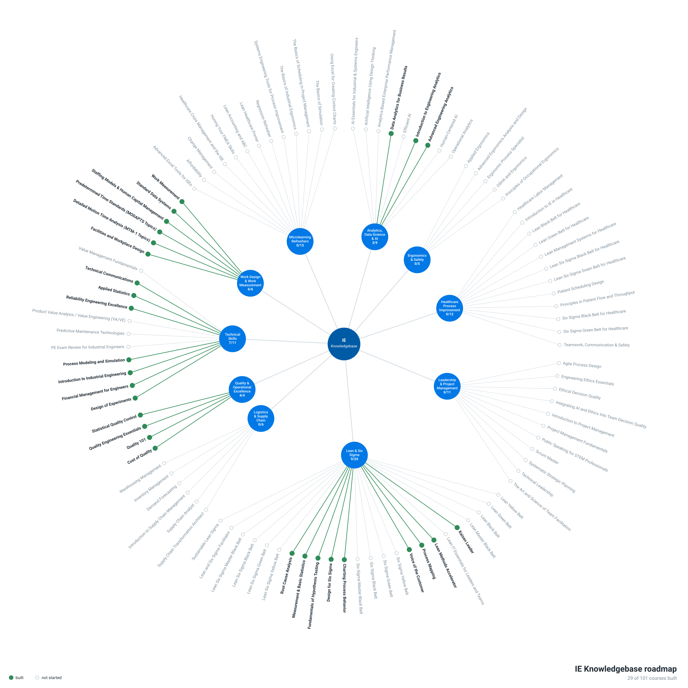

# IE Knowledgebase

Free, open courses on industrial engineering, quality and continuous improvement. Courses are grouped into the same categories used by the IISE professional course catalog, under `courses/<category>/<course>/`.

## Courses

New to industrial engineering? Start with [Introduction to Industrial Engineering](courses/technical-skills/introduction-to-industrial-engineering/README.md), the broad entry point, then pick a category.

See [ROADMAP.md](ROADMAP.md) for a checklist of what is built and what is still open in each category.

**Interactive site:** <https://nidhy.dev/ie-knowledgebase/> has a catalog by category, a learning path ordered by prerequisites with local progress tracking, a mind map, and an on-site reader for every course and module. It is generated into `public/` by `python tools/roadmap_graph.py`; GitHub Pages publishes the repo root, so the site reads the course files in place.

Suggested order: Measurement & Basic Statistics, Process Mapping and Voice of the Customer, then Charting Process Behavior, then Fundamentals of Hypothesis Testing, then Design for Six Sigma, then Root Cause Analysis. Kaizen Leader and Lean Methods Accelerator have no prerequisites and can be taken at any point.

### [Analytics, Data Science & AI](courses/analytics-data-science-ai/README.md)

| Course | Topic | Length | Status |
|---|---|---|---|
| [Introduction to Engineering Analytics](courses/analytics-data-science-ai/engineering-analytics/README.md) | Analytics types and process; visualization and dashboards; data models, star schema, SQL; k-means segmentation, ABC classification, logistic and tree classifiers, accuracy measures; regression case study; PCA; forecasting; Big Data technology and enterprise data models; linear-programming optimization; strategy | ~2 days | v1.0 |
| [Advanced Engineering Analytics](courses/analytics-data-science-ai/advanced-engineering-analytics/README.md) | Business impact of data science; managing and merging multi-source data (Excel + exports); data preparation; descriptive statistics; ANOVA; regression; nonparametric tests and bootstrap; DOE; improving prediction accuracy (CV, features, leakage); dashboards | ~2 days | v1.0 |

### [Ergonomics & Safety](courses/ergonomics-safety/README.md)

_No courses yet._

### [Healthcare Process Improvement](courses/healthcare-process-improvement/README.md)

_No courses yet._

### [Leadership & Project Management](courses/leadership-project-management/README.md)

_No courses yet._

### [Lean & Six Sigma](courses/lean-six-sigma/README.md)

| Course | Topic | Length | Status |
|---|---|---|---|
| [Measurement & Basic Statistics](courses/lean-six-sigma/measurement-and-basic-statistics/README.md) | Data types, accuracy vs precision, Pareto charts, histograms, center, spread, the normal distribution | ~6 h | v1.0 |
| [Process Mapping](courses/lean-six-sigma/process-mapping/README.md) | SIPOC, flow charts, swim lanes, value-added flow charts, spaghetti diagrams, VSM, VOC, affinity diagrams, CTQ trees, VOC as specifications | ~6 h | v1.0 |
| [Voice of the Customer](courses/lean-six-sigma/voice-of-the-customer/README.md) | Customers and segments, Kano, surveys and margin of error, affinity and CTQ trees, operational definitions, VOC as specifications, cause-and-effect matrix | ~7 h | v1.0 |
| [Lean Methods Accelerator](courses/lean-six-sigma/lean-methods-accelerator/README.md) | Standalone Lean toolkit: COPQ, VSM, takt, balancing, heijunka, benchmarking, flow and cells, SMED, TOC, pull (kanban, CONWIP), 5S, visual management, TPM, standard work | ~18 h | v1.0 |
| [Charting Process Behavior](courses/lean-six-sigma/charting-process-behavior/README.md) | Statistical Process Control: run charts, XmR, X̄–R, attribute charts, capability | ~12 h + capstone | v1.0 |
| [Fundamentals of Hypothesis Testing](courses/lean-six-sigma/fundamentals-of-hypothesis-testing/README.md) | Hypotheses, errors, power, CIs; t, ANOVA, proportion, chi-square, variance and nonparametric tests | ~14 h + capstone | v1.0 |
| [Design for Six Sigma](courses/lean-six-sigma/design-for-six-sigma/README.md) | DCDOV: VOC, QFD, Pugh, FMEA, error-proofing, scorecards, DOE, tolerance stack-up, flow simulation, line balancing, reliability | ~45 h incl. capstone | v1.0 |
| [Root Cause Analysis & Problem Solving](courses/lean-six-sigma/root-cause-analysis/README.md) | Problem statements, Pareto, process maps, fishbone, 5-Why, root cause trees, stratification, regression, logistic regression, corrective actions | ~14 h | v1.0 |
| [Kaizen Leader](courses/lean-six-sigma/kaizen-leader/README.md) | Planning and leading kaizen events: charter, VSM, takt, TOC, flow, balancing, kanban, SMED, 5S, TPM, standard work, A3; includes a one-day team-member track | ~22 h | v1.0 |

### [Logistics & Supply Chain](courses/logistics-supply-chain/README.md)

_No courses yet._

### [Quality & Operational Excellence](courses/quality-operational-excellence/README.md)

| Course | Topic | Length | Status |
|---|---|---|---|
| [Statistical Quality Control](courses/quality-operational-excellence/statistical-quality-control/README.md) | Descriptive statistics; common vs special cause; X̄–R, I–MR, p, c and short-run charts; Cp/Cpk; acceptance sampling: risks, OC curves, AOQ/AOQL, ASN, ATI, ANSI/ASQ Z1.4 use | ~3 days | v1.0 |
| [Cost of Quality](courses/quality-operational-excellence/cost-of-quality/README.md) | CoQ models (PAF, process cost, activity-based); prevention, appraisal, internal and external failure; hidden costs and quality loss; cost assessments; cost drivers; project selection and savings; CoQ reports; Excel tracker | ~2 days | v1.0 |
| [Quality Engineering Essentials](courses/quality-operational-excellence/quality-engineering-essentials/README.md) | DMAIC quality toolkit: charter, 8 wastes, basic statistics, distribution ID, data cleansing, gauge R&R and attribute MSA, baseline/DPMO, SPC with transformations and stage variables, capability, root cause (fishbone, 5-Why, stratification, regression), FMEA, reliability, error-proofing, pilots, change management, control plans, 5S, standard work | ~39 h | v1.0 |

### [Technical Skills](courses/technical-skills/README.md)

| Course | Topic | Length | Status |
|---|---|---|---|
| [Introduction to Industrial Engineering](courses/technical-skills/introduction-to-industrial-engineering/README.md) | What IEs do; methods and motion study; time study, work sampling and standards; ergonomics; layout; job analysis, evaluation and pay; Lean, Six Sigma, RCA; basic statistics | ~3 days | v1.0 |
| [Applied Statistics](courses/technical-skills/applied-statistics/README.md) | Data collection systems; descriptive statistics; hypergeometric, binomial, Poisson, normal, exponential, t, chi-square, F; CIs and tests; non-normal data; correlation; linear and multiple regression | ~2 days | v1.0 |
| [Design of Experiments](courses/technical-skills/design-of-experiments/README.md) | Completely randomized, randomized block and Latin square designs; two-factor ANOVA and interaction; balanced vs unbalanced; replication and power; 2^k full and fractional factorials; operating levels with cost | ~2 days | v1.0 |
| [Financial Management for Engineers](courses/technical-skills/financial-management-for-engineers/README.md) | Business organization; balance sheet, income statement, cash flow; ratios and dashboards; budgets and variances; time value of money; sources and cost of capital; ROI, NPV, IRR; lease vs buy; sensitivity and Monte Carlo; break-even; valuation and M&A | ~2 days | v1.0 |
| [Technical Communications](courses/technical-skills/technical-communications/README.md) | Presenting quantitative work to managers: common errors, audience analysis, purpose and one-sentence message, answer-first structure, listening and Q&A, data visualization, process-improvement tools for presentations, quality presentations, capstone | 9 × 2 h | v1.0 |
| [Reliability Engineering Excellence](courses/technical-skills/reliability-engineering-excellence/README.md) | Reliability role and program; risk and criticality; design for reliability, RBD, reliability growth; MTBF/MTTR/availability; RCM and TPM; Pareto, exponential, normal and Weibull (with suspensions); LCC and optimum reliability cost; RCA, FRACAS, FMECA; PM optimization; five PdM technologies | ~5 days | v1.0 |
| [Process Modeling and Simulation](courses/technical-skills/process-modeling-and-simulation/README.md) | Discrete-event process models: build to think, validation, design exploration, resilience testing, operating procedures, model-based FMEA, business case, teaching Lean | ~7 h | v1.0 |

### [Work Design & Work Measurement](courses/work-design-work-measurement/README.md)

| Course | Topic | Length | Status |
|---|---|---|---|
| [Work Measurement](courses/work-design-work-measurement/work-measurement/README.md) | Need for and impact of standards; standard practice; documentation and charting; methods analysis and work design; defining work; time study, elemental analysis, rating, allowances, computations; labor reporting; job analysis; work sampling; standard data and PMTS; learning curves and staffing | ~2 days | v1.0 |
| [Standard Data Systems](courses/work-design-work-measurement/standard-data-systems/README.md) | Microscopic vs macroscopic data; advantages and disadvantages; element structure and data sheets; correlation and regression (Excel LINEST/ToolPak); developing models with dummies, transformations and VIF; evaluating with residuals, intervals and hold-out validation; quoting, capacity and maintenance | ~2 days | v1.0 |

| [Staffing Models & Human Capital Management](courses/work-design-work-measurement/staffing-models/README.md) | Staffing models in the HCM framework; terminology; seven data types; work measurement for staffing; available hours and relief factors; workload, coverage, queueing (Erlang C), ratio and benchmark models; forecasting; supply, attrition and hiring plans; development phases, back-testing and sensitivity; budgets and executive summaries | ~2 days | v1.0 |
| [Predetermined Time Standards (MODAPTS Topics)](courses/work-design-work-measurement/predetermined-time-standards/README.md) | Follows the MODAPTS practitioner outline item by item: PMTS basics, acronym, code symbol, history, modular concept, movement classes and rules, get vs put, conscious control, GET/PUT elements, auxiliary activities, practice analyses with an original teaching code card (not the official card), method and ergonomic improvement | ~3 days | v1.0 |
| [Facilities and Workplace Design](courses/work-design-work-measurement/facilities-and-workplace-design/README.md) | Facilities strategy and levels of design; layout planning and project plan; P-Q, inventory, usage, flow and processes; planning units, affinities, space constraints, configuration diagrams; material flow and layout exchange; cellular and workstation layouts; process charting, time estimates, cell capacity, people and machines; ergonomics, motion economy; infrastructure, scheduling, containers, balancing, supervision, rewards; cell configurations and layout procedures | ~2 days | v1.0 |
| [Detailed Motion Time Analysis (MTM-1 Topics)](courses/work-design-work-measurement/detailed-motion-time-analysis/README.md) | Methods analysis and two-handed charts; reach, move, turn, apply pressure, grasp, position, release, disengage, eye and body motions; simultaneous motions; writing analyses; SIMO-based improvement; developing standards; 11 labs. Original teaching data card (not MTM data) | ~10 days with labs | v1.0 |
### [Microlearning Refreshers](courses/microlearning-refreshers/README.md)

_No courses yet._

## Adding a course

1. Pick the category folder under `courses/` that fits, and create `courses/<category>/<course-name>/` (lowercase, hyphenated).
2. Include `README.md` (objectives + syllabus), `modules/`, and `solutions/`, `data/`, `tools/` as needed.
3. Follow the module structure in [CONTRIBUTING.md](CONTRIBUTING.md), then add a row to the category README and to the table above.

## License

Content: CC BY 4.0. Code: MIT. See [LICENSE](LICENSE).
