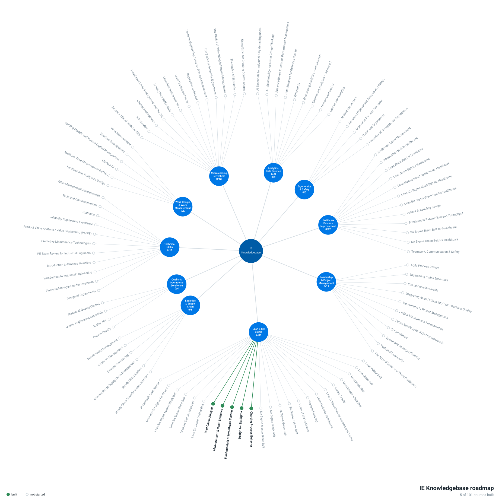

# Course Roadmap

Coverage checklist for the IE Knowledgebase. The categories and course topics follow the public IISE course catalog (2026 overview); every course built here is original content, not IISE material.

**Progress: 24 of 101 topics covered.**

- [x] = course exists in this repo (linked); "folded into" marks a topic covered inside another course rather than built on its own
- [ ] = not started
- To claim a topic you are working on, add your name after it, e.g. `- [ ] Root Cause Analysis — _Nidhin, in progress_`
- After editing this file, run `python tools/roadmap_graph.py` to redraw the graph below and rebuild the [interactive map](https://nidhy.dev/ie-knowledgebase/).

## Analytics, Data Science & AI (2/9)

Folder: [`courses/analytics-data-science-ai/`](courses/analytics-data-science-ai/README.md)

- [ ] AI Essentials for Industrial & Systems Engineers
- [ ] Artificial Intelligence Using Design Thinking
- [ ] Analytics-Based Enterprise Performance Management
- [ ] Data Analytics for Business Results
- [ ] Efficient AI
- [x] [Introduction to Engineering Analytics](courses/analytics-data-science-ai/engineering-analytics/README.md)
- [x] [Advanced Engineering Analytics](courses/analytics-data-science-ai/advanced-engineering-analytics/README.md)
- [ ] Human-Centered AI
- [ ] Operational Analytics

## Ergonomics & Safety (0/5)

Folder: [`courses/ergonomics-safety/`](courses/ergonomics-safety/README.md)

- [ ] Applied Ergonomics
- [ ] Advanced Ergonomics Analysis and Design
- [ ] Ergonomic Process Specialist
- [ ] OSHA and Ergonomics
- [ ] Principles of Occupational Ergonomics

## Healthcare Process Improvement (0/12)

Folder: [`courses/healthcare-process-improvement/`](courses/healthcare-process-improvement/README.md)

- [ ] Healthcare Labor Management
- [ ] Introduction to IE in Healthcare
- [ ] Lean Black Belt for Healthcare
- [ ] Lean Green Belt for Healthcare
- [ ] Lean Management Systems for Healthcare
- [ ] Lean Six Sigma Black Belt for Healthcare
- [ ] Lean Six Sigma Green Belt for Healthcare
- [ ] Patient Scheduling Design
- [ ] Principles in Patient Flow and Throughput
- [ ] Six Sigma Black Belt for Healthcare
- [ ] Six Sigma Green Belt for Healthcare
- [ ] Teamwork, Communication & Safety

## Leadership & Project Management (0/11)

Folder: [`courses/leadership-project-management/`](courses/leadership-project-management/README.md)

- [ ] Agile Process Design
- [ ] Engineering Ethics Essentials
- [ ] Ethical Decision Quality
- [ ] Integrating AI and Ethics Into Team Decision Quality
- [ ] Introduction to Project Management
- [ ] Project Management Fundamentals
- [ ] Public Speaking for STEM Professionals
- [ ] Scrum Master
- [ ] Systematic Strategic Planning
- [ ] Technical Leadership
- [ ] The Art and Science of Team Facilitation

## Lean & Six Sigma (9/24)

Folder: [`courses/lean-six-sigma/`](courses/lean-six-sigma/README.md)

- [ ] Lean Yellow Belt
- [ ] Lean Green Belt
- [ ] Lean Black Belt
- [ ] Lean Master Black Belt
- [x] [Kaizen Leader](courses/lean-six-sigma/kaizen-leader/README.md)
- [ ] Lean IT Essentials for Leaders and Teams
- [x] [Lean Methods Accelerator](courses/lean-six-sigma/lean-methods-accelerator/README.md)
- [x] [Process Mapping](courses/lean-six-sigma/process-mapping/README.md)
- [x] [Voice of the Customer](courses/lean-six-sigma/voice-of-the-customer/README.md)
- [ ] Six Sigma Yellow Belt
- [ ] Six Sigma Green Belt
- [ ] Six Sigma Black Belt
- [ ] Six Sigma Master Black Belt
- [x] [Charting Process Behavior](courses/lean-six-sigma/charting-process-behavior/README.md)
- [x] [Design for Six Sigma](courses/lean-six-sigma/design-for-six-sigma/README.md)
- [x] [Fundamentals of Hypothesis Testing](courses/lean-six-sigma/fundamentals-of-hypothesis-testing/README.md)
- [x] [Measurement & Basic Statistics](courses/lean-six-sigma/measurement-and-basic-statistics/README.md)
- [x] [Root Cause Analysis](courses/lean-six-sigma/root-cause-analysis/README.md)
- [ ] Lean Six Sigma Yellow Belt
- [ ] Lean Six Sigma Green Belt
- [ ] Lean Six Sigma Black Belt
- [ ] Lean Six Sigma Master Black Belt
- [ ] Lean and Six Sigma Facilitator
- [ ] Sustainable Lean Sigma

## Logistics & Supply Chain (0/6)

Folder: [`courses/logistics-supply-chain/`](courses/logistics-supply-chain/README.md)

- [ ] Supply Chain Transformation Architect
- [ ] Supply Chain Analyst
- [ ] Introduction to Supply Chain Management
- [ ] Demand Forecasting
- [ ] Inventory Management
- [ ] Warehousing Management

## Quality & Operational Excellence (4/4)

Folder: [`courses/quality-operational-excellence/`](courses/quality-operational-excellence/README.md)

- [x] [Cost of Quality](courses/quality-operational-excellence/cost-of-quality/README.md)
- [x] Quality 101 — folded into [Quality Engineering Essentials](courses/quality-operational-excellence/quality-engineering-essentials/README.md) as Module 00, Foundations of Quality
- [x] [Quality Engineering Essentials](courses/quality-operational-excellence/quality-engineering-essentials/README.md)
- [x] [Statistical Quality Control](courses/quality-operational-excellence/statistical-quality-control/README.md)

## Technical Skills (7/11)

Folder: [`courses/technical-skills/`](courses/technical-skills/README.md)

- [x] [Design of Experiments](courses/technical-skills/design-of-experiments/README.md)
- [x] [Financial Management for Engineers](courses/technical-skills/financial-management-for-engineers/README.md)
- [x] [Introduction to Industrial Engineering](courses/technical-skills/introduction-to-industrial-engineering/README.md)
- [x] [Process Modeling and Simulation](courses/technical-skills/process-modeling-and-simulation/README.md)
- [ ] PE Exam Review for Industrial Engineers
- [ ] Predictive Maintenance Technologies
- [ ] Product Value Analysis / Value Engineering (VA/VE)
- [x] [Reliability Engineering Excellence](courses/technical-skills/reliability-engineering-excellence/README.md)
- [x] [Applied Statistics](courses/technical-skills/applied-statistics/README.md)
- [x] [Technical Communications](courses/technical-skills/technical-communications/README.md)
- [ ] Value Management Fundamentals

## Work Design & Work Measurement (2/6)

Folder: [`courses/work-design-work-measurement/`](courses/work-design-work-measurement/README.md)

- [ ] Facilities and Workplace Design
- [ ] Methods Time Measurement (MTM-1)
- [ ] MODAPTS
- [ ] Staffing Models and Human Capital Management
- [x] [Standard Data Systems](courses/work-design-work-measurement/standard-data-systems/README.md)
- [x] [Work Measurement](courses/work-design-work-measurement/work-measurement/README.md)

## Microlearning Refreshers (0/13)

Folder: [`courses/microlearning-refreshers/`](courses/microlearning-refreshers/README.md)

- [ ] Advanced Excel Tools for ISEs
- [ ] Affordability
- [ ] Change Management
- [ ] Healthcare Crisis Management and the ISE
- [ ] Honing Your FMEA Skills
- [ ] Lean Accounting and ABC
- [ ] Lean Healthcare Primer
- [ ] Regression Refresher
- [ ] Systems Engineering Tools for Process Improvement
- [ ] The Basics of Industrial Ergonomics
- [ ] The Basics of Scheduling in Project Management
- [ ] The Basics of Simulation
- [ ] Using Excel for Creating Control Charts
