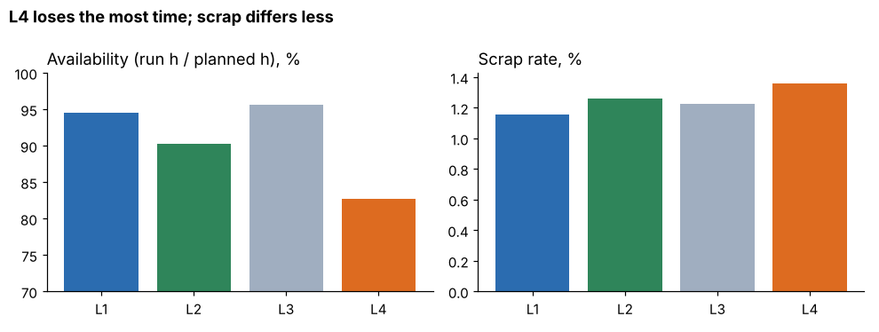
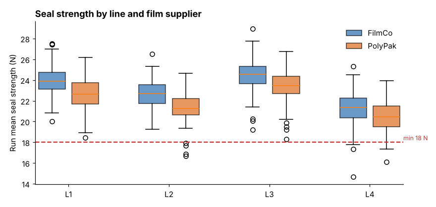

# Module 04 — Descriptive Statistics for Operations

## Objectives

- Summarize operations data by group: utilization, scrap, quality, cost, delivery.
- Choose summaries suited to the data's shape.
- Turn descriptive results into questions for deeper analysis.

## Corbin by line (1,000 runs, Jan–Jun)

| Line | Runs | Availability | Scrap rate | Seal strength (mean of run means) | Cost per 1,000 good (median) | Unplanned downtime per run |
|---|---|---|---|---|---|---|
| L1 | 250 | 94.6 % | 1.16 % | 23.33 N | $314 | 24 min |
| L2 | 250 | 90.3 % | 1.26 % | 22.23 N | $339 | 44 min |
| L3 | 251 | 95.6 % | 1.23 % | 24.00 N | $369 | 20 min |
| L4 | 249 | **82.7 %** | 1.36 % | **20.94 N** | $335 | **79 min** |



Overall: run-mean seal strength 22.63 N (SD 1.92); **5.9 %** of runs had at least one test below the 18 N minimum.

**On-time delivery** (1,200 orders): 78.8 % overall — L1 84.5 %, L2 78.1 %, L3 91.8 %, **L4 58.6 %** (chi-square p < 0.001).

**Reading the table:**

- **L4** loses the most time (availability 82.7 %), makes the weakest seals and drives late deliveries. It is the priority.
- **L3** has the best availability and seal strength, but the **highest cost per 1,000** — its line cost rate is highest ($430/h, newest equipment). Descriptive statistics show *where* to look; they don't explain *why*.
- Scrap rates are close (1.16–1.36 %) — not the main lever here.



Within every line, PolyPak film gives lower seal strength than FilmCo — a pattern to test formally (Module 05).

## Choosing the summary

| Data shape | Center | Spread |
|---|---|---|
| Roughly symmetric (seal strength) | mean | standard deviation |
| Skewed (downtime, cost, repair time) | median | IQR, percentiles |
| Proportions (scrap, on-time) | rate | confidence interval; sample size |

Always look at distributions (box plots, histograms) by group before comparing means.

## In a BI tool

Drag line to rows and measures to columns; use average/median aggregations; add a box-plot or distribution view; color by supplier. Make sure ratios (scrap rate, availability) are computed as **sum of numerators / sum of denominators** at the level shown, not as averages of row-level ratios, unless that is what you intend.

## Run it

```bash
python tools/aeakit.py describe
python tools/aeakit.py delivery
```

## Check yourself

1. Why report median cost per 1,000 rather than the mean?
2. What three questions would you take to Modules 05–07 from this table?

<details><summary>Answers</summary>

1. Cost per 1,000 is skewed by short runs with long downtime; the median represents a typical run.
2. E.g. Are line differences in seal strength real (ANOVA)? What settings and factors drive seal strength (regression)? Is L4's breakdown downtime really longer (nonparametric test on skewed data)?

</details>
