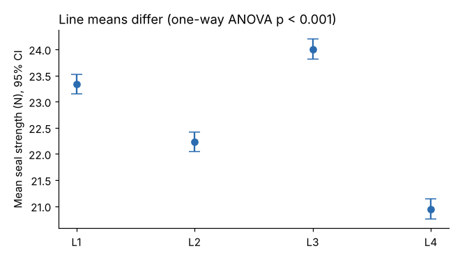

# Module 05 — Analysis of Variance (ANOVA)

## Objectives

- Test whether group means differ with one-way and two-way ANOVA.
- Identify which groups differ with Tukey's HSD.
- Check assumptions and report effect size, not just p-values.

## One-way ANOVA: do lines differ in seal strength?

ANOVA compares variation **between** group means with variation **within** groups. F = between / within; a large F means the group means differ more than chance explains.

Corbin, run-mean seal strength by line:

| Result | Value |
|---|---|
| F | 192.1 |
| p | < 0.001 |
| η² (share of variation explained by line) | **0.367** |
| Levene test for equal variances | p = 0.94 (no evidence of unequal spread) |



**Effect size matters.** With 1,000 runs, even tiny differences are "significant." η² = 0.37 says line explains about **37 %** of run-to-run variation in seal strength — a large, practically important effect.

## Which lines differ? Tukey HSD

| Pair | Difference (second − first, N) | Significant |
|---|---|---|
| L1 – L2 | −1.10 | yes |
| L1 – L3 | +0.67 | yes |
| L1 – L4 | −2.39 | yes |
| L2 – L3 | +1.77 | yes |
| L2 – L4 | −1.29 | yes |
| L3 – L4 | −3.06 | yes |

All pairs differ; L3 is strongest and L4 weakest, 3 N apart.

## Two-way ANOVA: line × film supplier

| Term | p |
|---|---|
| Line | < 0.001 |
| Supplier | < 0.001 |
| Line × supplier interaction | 0.20 |

PolyPak film averages **0.99 N** weaker than FilmCo, and the effect is about the same on every line (no significant interaction). So the supplier effect can be discussed on its own: a supplier conversation or a seal-setting adjustment for PolyPak would help all lines equally.

## Assumptions

- **Independence** — runs are separate; watch for time trends (plot in time order).
- **Normality of residuals** — ANOVA is robust with large samples; check a residual plot.
- **Equal variances** — Levene p = 0.94 here; if violated, use Welch's ANOVA or a nonparametric test (Module 07).

**ANOVA on observational data shows association, not cause.** L4 might differ because of its age, its products or its operators. A designed experiment (Module 08) establishes cause.

## In a spreadsheet or BI tool

Spreadsheet: the Analysis ToolPak's "ANOVA: Single Factor" and "Two-Factor With Replication" (balanced data only). BI tools generally don't run ANOVA natively; compute it in Python/R (some BI tools can call them) and visualize the results.

## Run it

```bash
python tools/aeakit.py anova
```

## Check yourself

1. Why report η² as well as p?
2. If the line × supplier interaction had been significant, how would that change the recommendation?
3. Why is "L4 makes weaker seals because it's older" not proven by the ANOVA?

<details><summary>Answers</summary>

1. With large samples, p is tiny for trivial differences; η² shows how much of the variation the factor actually explains.
2. The supplier effect would depend on the line — e.g. PolyPak might only be a problem on L4 — so supplier actions would need to be line-specific.
3. Line is confounded with age, product mix, settings and crews; observational data can't separate them. Test with an experiment or regression with those factors.

</details>
