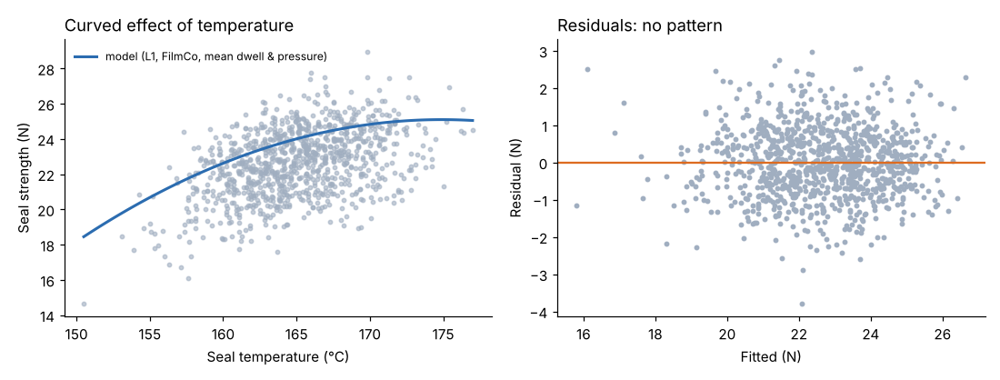

# Module 06 — Linear Regression Analysis

## Objectives

- Fit multiple regression with continuous and categorical predictors.
- Model curvature and find an optimum setting.
- Diagnose the model: residuals, multicollinearity, influential points.

## The model

Seal strength (run mean) as a function of seal temperature, dwell time, pressure, film supplier and line (998 runs with complete data):

| Term | Coefficient |
|---|---|
| Seal temperature (°C) | +3.909 |
| Seal temperature² | −0.0112 |
| Dwell time (ms) | +0.0066 (≈ +0.66 N per 100 ms) |
| Pressure (bar) | +1.42 |
| Film supplier: PolyPak (vs FilmCo) | −1.10 |
| Line L2 / L3 / L4 (vs L1) | −1.22 / +0.64 / −2.45 |

R² = **0.760** (0.743 without the squared term); residual SD **0.94 N**. The squared term is highly significant (p < 0.001).



## Finding the best temperature

With a squared term, strength peaks where the slope is zero: T* = −b₁ / (2 b₂) = **174.9 °C**. Current settings average about 165 °C — so raising temperature helps, with diminishing returns near 175 °C. (Check other constraints — film distortion, energy — before changing the setting, and confirm with a designed experiment, Module 08.)

## Interpreting coefficients

- Each coefficient is the change in seal strength for a one-unit change **holding the other predictors constant**.
- Categorical predictors are coded as indicator variables against a baseline (L1, FilmCo).
- After adjusting for settings and supplier, L4 is still **2.45 N** weaker than L1 — something about L4 itself (jaw wear, heater condition) remains. That points to maintenance, which the failure data supports (Module 09).

## Diagnostics

| Check | Corbin result | Why it matters |
|---|---|---|
| Residuals vs fitted | no pattern (figure) | curvature or missing terms would show as a pattern |
| Residual SD vs measurement noise | 0.94 N vs lab-test noise of about 0.92 N for a 3-test mean | the model explains almost everything that isn't measurement noise |
| Multicollinearity (VIF) | temp 1.0, dwell 1.0, pressure 1.0 | VIF > 5–10 would make coefficients unstable |
| Influential points | check Cook's distance / leverage | a few extreme runs shouldn't drive the conclusion |
| Extrapolation | data covers 150–177 °C | don't predict at 190 °C |

## In a spreadsheet or BI tool

Spreadsheet: LINEST or the Regression tool, with indicator columns for categories and a temperature² column. BI tools often show simple trend lines; multiple regression is better done in Python/R and the results visualized.

## Run it

```bash
python tools/aeakit.py regression
```

## Check yourself

1. Predict the change in strength from raising pressure by 0.5 bar.
2. Why include line in the model when the question is about settings?
3. The squared-term coefficient is negative. What does that mean physically?

<details><summary>Answers</summary>

1. 0.5 × 1.42 ≈ +0.71 N.
2. Lines differ in average strength and may run different settings; leaving line out would bias the setting coefficients and inflate the residual error.
3. Strength rises with temperature at first, then levels off and would fall beyond about 175 °C (e.g. film thinning or degrading).

</details>
