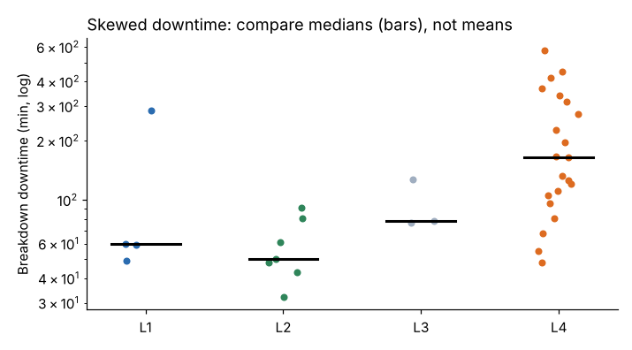

# Module 07 — Nonparametric Analysis

## Objectives

- Recognize when normal-theory methods are inappropriate.
- Apply Mann-Whitney, Kruskal-Wallis and Spearman correlation.
- Use the bootstrap for confidence intervals on medians and other statistics.

## When to go nonparametric

- strongly skewed data (downtime, repair time, cost), especially with small samples;
- ordinal data (ratings, severity scores);
- outliers you can't remove because they're real.

Nonparametric tests use **ranks** instead of raw values, so a few huge values don't dominate. They compare distributions/medians rather than means.

## Corbin examples

**Breakdown downtime by line** (35 breakdowns — L4 21, L2 7, L1 4, L3 3; skewness 1.41):

| Line | Median breakdown minutes |
|---|---|
| L1 | 59.5 |
| L2 | 50.0 |
| L3 | 78.0 |
| L4 | **164.0** |

Kruskal-Wallis (the rank-based one-way ANOVA): H = 13.09, **p = 0.0045** → downtime per breakdown differs by line; L4's breakdowns last longer, not just occur more often. With only 3–4 breakdowns on L1 and L3, their medians are very uncertain — the conclusion rests mainly on L4 vs the rest.



**Bootstrap confidence interval** for L4's median breakdown: resample L4's breakdowns with replacement 5,000 times and take the median each time → 95 % interval **111 to 273 minutes**. The bootstrap works for medians, percentiles, ratios — statistics without simple formulas.

**Scrap rate, FilmCo vs PolyPak** (Mann-Whitney, the rank-based two-sample test): p = 0.016; medians 1.21 % vs 1.25 %. Statistically detectable with 1,000 runs, but a 0.04-point difference is **practically negligible** — report both.

**Spearman rank correlation**, vibration vs breakdown-within-7-days: ρ = 0.54 (p < 0.001). Spearman measures monotonic association without assuming linearity. Caution: part of this association comes from L4 — which has both higher normal vibration and more breakdowns — not only from vibration rising before a failure. Module 09 separates the two.

## Choosing a test

| Situation | Parametric | Nonparametric |
|---|---|---|
| 2 independent groups | two-sample t | Mann-Whitney (Wilcoxon rank-sum) |
| 2 paired measurements | paired t | Wilcoxon signed-rank |
| 3+ groups | one-way ANOVA | Kruskal-Wallis |
| Association | Pearson r | Spearman ρ |
| CI for an awkward statistic | — | bootstrap |

Nonparametric tests have somewhat less power when data really are normal; with skewed data they are often **more** powerful.

## Run it

```bash
python tools/aeakit.py nonparametric
```

See also the [Fundamentals of Hypothesis Testing](../../fundamentals-of-hypothesis-testing/README.md) course.

## Check yourself

1. Why compare median downtime rather than mean downtime?
2. Mann-Whitney p = 0.016 for scrap by supplier. Should Corbin drop PolyPak because of scrap?
3. How does the bootstrap estimate uncertainty?

<details><summary>Answers</summary>

1. Downtime is right-skewed; a few very long breakdowns pull the mean up, so the median better represents a typical breakdown.
2. Not on scrap alone — the difference is tiny (0.04 points). Seal strength (≈ 1 N lower) is the more important supplier issue.
3. By treating the sample as a stand-in for the population, resampling it many times, and looking at how much the statistic varies across resamples.

</details>
