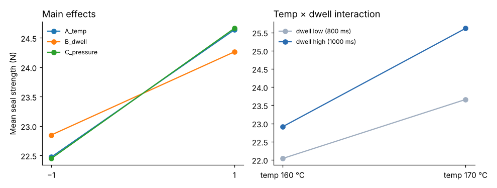

# Module 08 — Design of Experiments

## Objectives

- Explain why designed experiments establish cause where observational data cannot.
- Analyze a 2³ factorial experiment: main effects and interactions.
- Combine experimental and observational results into a recommendation.

## Why experiment?

Modules 05–06 found associations in production data: higher temperature, longer dwell and higher pressure go with stronger seals. But in production, settings change together with lines, products and crews. A **designed experiment** changes factors deliberately, in a balanced, randomized pattern, so their effects can be separated cleanly.

## The experiment

Factors and levels on one line, one film lot:

| Factor | Low (−1) | High (+1) |
|---|---|---|
| A: seal temperature | 160 °C | 170 °C |
| B: dwell time | 800 ms | 1,000 ms |
| C: pressure | 3.5 bar | 4.5 bar |

2³ = 8 combinations × 2 replicates = 16 runs, in random order (`data/seal_doe.csv`).

## Results

| Effect (high − low) | Estimate (N) | p |
|---|---|---|
| A temperature | +2.16 | < 0.001 |
| C pressure | +2.21 | < 0.001 |
| B dwell | +1.41 | < 0.001 |
| AB temp × dwell | +0.54 | 0.08 |
| AC, BC, ABC | ≤ 0.40 | ≥ 0.18 |

R² = 0.954. Best cell: all three high, mean **26.91 N**.



**Interpretation:** all three settings matter, roughly additively; the temperature × dwell interaction is small and not clearly significant at 5 %. Moving from the current typical settings (about 165 °C, 900 ms, 4.0 bar) toward 170 °C, 1,000 ms and 4.5 bar should raise strength by about 2–3 N — enough to move most L4 runs comfortably above 18 N.

## Putting it together

- Regression on production data suggested a temperature optimum near 175 °C; the experiment confirms temperature's effect within 160–170 °C. A follow-up experiment could test 170–180 °C (response-surface methods).
- Settings alone won't close L4's 2.4 N gap — the regression showed a line effect after adjusting for settings, so L4's condition (jaws, heaters) needs maintenance attention (Module 09).

For the full treatment of factorial, fractional and blocked designs, see the [Design of Experiments](../../design-of-experiments/README.md) course.

## Run it

```bash
python tools/aeakit.py doe
```

## Check yourself

1. Why randomize the run order?
2. Why 2 replicates rather than 1?
3. Why can the experiment's conclusions be stated more confidently than the regression's?

<details><summary>Answers</summary>

1. So drifts (warm-up, film lot changes, operator learning) don't line up with a factor and masquerade as its effect.
2. Replicates give an estimate of pure error, so effects can be tested, and they improve precision.
3. Factors were set deliberately and independently in a balanced design, so their effects aren't confounded with line, product or crew.

</details>
