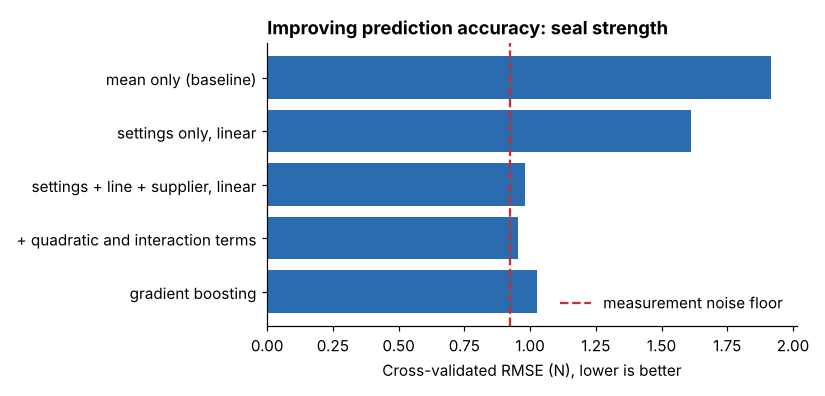

# Module 09 — Improving Prediction Accuracy

## Objectives

- Measure prediction accuracy honestly with cross-validation.
- Improve accuracy step by step: benchmarks, better features, better models.
- Recognize the limits: noise floors, leakage, overfitting and thresholds.

## Rule 1: measure on data the model hasn't seen

Accuracy on the training data always flatters. Use **k-fold cross-validation**: split the data into k parts, fit on k − 1, test on the held-out part, rotate, and average. Report the spread across folds too.

Always compare against a **baseline** (predict the average, or "never fails").

## Example 1: predicting seal strength

Cross-validated RMSE (lower is better), 998 runs, 5 folds:

| Model | CV RMSE (N) |
|---|---|
| Predict the overall mean (baseline) | 1.918 |
| Settings only (temp, dwell, pressure), linear | 1.612 |
| + line and film supplier | 0.982 |
| + quadratic and interaction terms | **0.956** |
| Gradient boosting (same inputs) | 1.025 |
| *Noise floor: lab test SD / √3* | *0.924* |



Lessons:

- **The biggest gain came from adding the right information** (line and supplier), not from a fancier algorithm.
- **The right form** (curvature) added a little more.
- **The "advanced" model did worse** — gradient boosting overfits small structure when the true relationship is smooth and nearly linear.
- **There is a floor.** The lab measures each run with error; no model can predict better than about 0.92 N. The best model is within 0.03 N of it — further modeling effort is wasted; better measurement would be the next lever.

## Example 2: predicting breakdowns within 7 days

488 line-days (after a 3-day warm-up for trend features); 29.7 % are followed by a breakdown within 7 days.

| Model | CV AUC (sd) |
|---|---|
| Logistic, raw sensor values | 0.841 (0.033) |
| Logistic, + trend features | **0.856** (0.036) |
| Random forest, + trend features | 0.848 (0.047) |
| Gradient boosting, + trend features | 0.843 (0.033) |

**Feature engineering:** lines have very different "normal" vibration and heater current, so a raw value of 3.0 mm/s means trouble on L3 but is normal on L4. The **trend feature** — today minus the line's average over the previous 14 days — measures change from the line's own normal. It added about 0.015 AUC here — a modest gain, inside the fold-to-fold spread, so it should be confirmed on new data before claiming it. Again, the simple logistic model did as well as the complex ones.

**Thresholds turn scores into actions:**

| Threshold | Precision (flags that are real) | Recall (breakdowns caught) |
|---|---|---|
| 0.5 | 75.4 % | 59.3 % |
| 0.3 | 59.9 % | 73.1 % |

Choose the threshold from costs: an unnecessary inspection is cheap; a missed breakdown on L4 costs 2–3 hours of production. Here the lower threshold is likely better.

## Pitfalls

- **Leakage** — using information not available at prediction time (e.g. a maintenance work-order opened *after* the failure). The trend features here use only **past** days (`shift(1)`).
- **Overfitting** — complex models tuned on small data. Cross-validate and keep a final hold-out.
- **Unbalanced classes** — judge by precision/recall/AUC, not accuracy.
- **Drift** — processes change; monitor accuracy after deployment and retrain.
- **Time order** — for forecasting future periods, validate with time-ordered splits rather than random folds.

## Run it

```bash
python tools/aeakit.py predict_strength
python tools/aeakit.py predict_failure
```

## Check yourself

1. Why did gradient boosting do worse than linear regression for seal strength?
2. A colleague reports 99 % accuracy predicting breakdowns using "work orders opened that week." What's wrong?
3. What would most improve seal-strength prediction now?

<details><summary>Answers</summary>

1. The true relationship is smooth and nearly additive; boosting's flexible trees fit noise and approximate smooth curves with steps, so they generalize slightly worse on ~1,000 runs.
2. Leakage: the work order is created because of the breakdown, so the "predictor" contains the answer and won't be available in advance.
3. Better measurement (more or more precise lab tests per run) — the model is already near the measurement noise floor.

</details>
