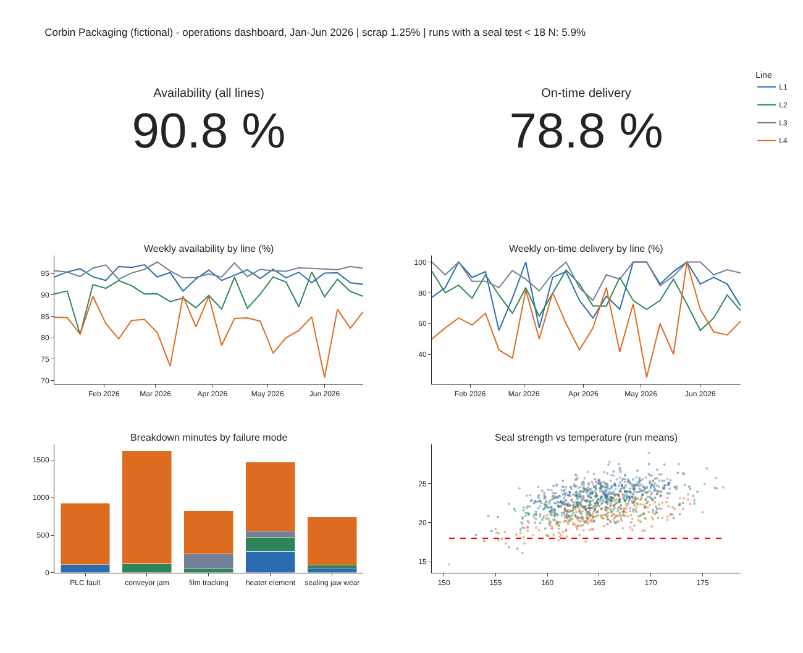

# Module 10 — Data Visualization and Dashboards

## Objectives

- Design an operations dashboard that answers specific questions.
- Build an interactive dashboard from merged data.
- Communicate analysis results clearly to decision makers.

## Start from questions, not charts

Corbin's plant manager asks every week:

1. Are the lines available? (utilization)
2. Are we delivering on time?
3. What is causing breakdowns?
4. Is seal quality safe?

Each question gets one view; the headline KPIs go top-left.

## The Corbin dashboard

`python tools/build_dashboard.py` writes `dashboard/corbin_operations_dashboard.html` — an interactive Plotly dashboard (hover for details, click legend items to filter lines, zoom):



| Panel | Question | Design choice |
|---|---|---|
| KPI tiles | overall status | two numbers; details in the title bar (scrap, % runs < 18 N) |
| Weekly availability by line | utilization | lines in consistent colors; L4 stands out low |
| Weekly on-time delivery by line | customer service | same colors as above |
| Breakdown minutes by failure mode, stacked by line | cause of downtime | stacked by line; L4 dominates every failure mode (21 of 35 breakdowns) |
| Seal strength vs temperature | quality and its driver | 18 N limit drawn; points colored by line |

(The HTML loads the charting library from a public CDN; to use it offline, set `include_plotlyjs=True` in the script.)

## Design rules

- **One page, five to nine views**, ordered by importance.
- **Consistent color for the same thing** across views (each line keeps its color).
- **Show targets and limits** (18 N line; on-time target).
- **Trends over snapshots** — weekly series show whether things are improving.
- **Interactivity for exploration** — filters by line, product and date; tooltips with run IDs.
- **Data freshness and definitions** — state the period and how KPIs are calculated.
- **Performance** — pre-aggregate large data.

## Building the same in a BI tool

1. Connect to the cleaned analysis table and the orders and maintenance files (Module 02 — watch the grain).
2. Create calculated fields with the agreed definitions (availability, scrap rate, on-time).
3. Build each view as its own sheet; arrange them on a dashboard; add a line filter applied to all views.
4. Publish with a refresh schedule.

## Communicating results

A dashboard monitors; a **story** persuades. For the improvement proposal, present:

1. **The ask** — e.g. "Approve a jaw and heater overhaul on L4 and the new seal settings."
2. **The evidence** — L4's availability, seal strength and delivery gaps (Module 04); ANOVA and regression showing the line effect remains after settings (05–06); the DOE showing the settings gain (08); the failure model flagging L4 (09).
3. **The expected value** and the uncertainty.

See the [Technical Communications](../../technical-communications/README.md) course for structuring the presentation.

## Run it

```bash
pip install plotly
python tools/build_dashboard.py
python tools/make_figures.py
```

## Check yourself

1. Why keep the same color for each line across all panels?
2. What would you add to make this dashboard actionable for the maintenance planner?

<details><summary>Answers</summary>

1. So viewers can follow one line across views without re-reading legends; inconsistent colors cause misreading.
2. The breakdown-risk score per line from Module 09 (today's probability), open work orders and next planned PM, with a threshold that flags lines to inspect.

</details>
