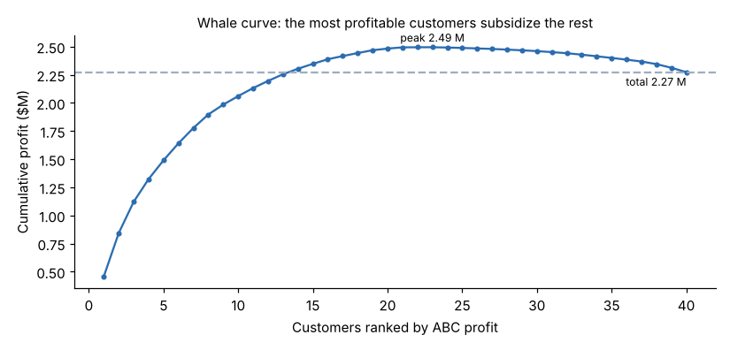
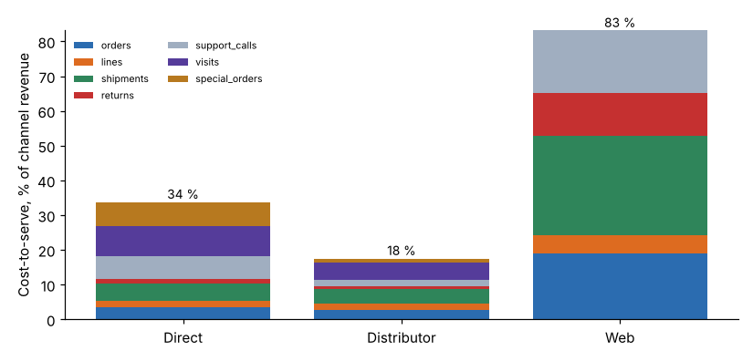

# Module 05 — Customer Profitability and Value Management

## Objectives

- Analyse customer and channel profitability, including cost-to-serve.
- Compute customer lifetime value (CLV) using predicted retention.
- Link customer value to shareholder value and the supply chain.

## From products to customers

Product margins (Module 03) say what we make. Customer profitability says **who we make it for, and how**. Two customers buying the same products can differ in profit because of discounts, order size, returns, support and sales effort.

## Whale curve

Rank customers by ABC profit and plot the cumulative profit:



- **23 of 40** customers are profitable.
- Cumulative profit peaks at **$2.49 M**, which is **110 %** of the $2.27 M total profit.
- The loss-making customers give back **$0.22 M**.

## Cost-to-serve by channel



| Channel | Customers | Revenue | Cost-to-serve | % of revenue | ABC profit |
|---|---|---|---|---|---|
| Direct | 8 | $3.79 M | $1.28 M | 34 % | $0.36 M |
| Distributor | 18 | $10.32 M | $1.81 M | 18 % | $2.06 M |
| Web | 14 | $0.43 M | $0.35 M | **83 %** | **−$0.15 M** |

- Web orders are tiny (about $410 on average) but each one carries a full order, shipment and support cost.
- Direct is profitable overall but carries heavy sales-visit and special-order costs.

Actions that follow:

- **Web:** minimum order value or a shipping fee; better self-service content to cut support calls; consolidated shipments. Module 08 values one of these.
- **Direct:** price specials properly; plan visits by account value.
- **Distributors:** protect them. They carry most of the profit, so retention matters.

## Customer lifetime value

CLV = Σₜ (annual profit × retentionᵗ⁻¹) ÷ (1 + r)ᵗ over 10 years, with r = 10 %. Retention comes from the churn model (Module 02):

| Channel | Avg. annual profit | Predicted retention | CLV | CLV with retention +5 points |
|---|---|---|---|---|
| Direct | $45,568 | 73.7 % | $123,290 | $140,526 |
| Distributor | $114,348 | 87.7 % | **$460,211** | $542,380 |
| Web | −$10,643 | 79.1 % | −$33,187 | −$38,310 |

- Five points more retention is worth **$82,000 per distributor**.
- For unprofitable web accounts, longer relationships make value **worse** until cost-to-serve is fixed.

## Shareholder value and the supply chain

- Customer value adds up to company value. Growing profitable customers and fixing unprofitable ones raises economic profit.
- **Supply-chain partners:** cost-to-serve depends on the distributors' and customers' own behaviour (order patterns, forecasting, returns). Sharing cost-to-serve data with partners (for example, the cost of a rush order) lets both sides cut cost. This extends EPM beyond the company's own walls.

## Run it

```bash
python tools/epmkit.py customers
python tools/epmkit.py clv
```

## Check yourself

1. Compute CLV over 3 years for a customer with $10,000 annual profit, 80 % retention and a 10 % discount rate.
2. Why can raising retention lower value for some customers?

<details><summary>Answers</summary>

1. 10,000/1.1 + 8,000/1.21 + 6,400/1.331 = 9,091 + 6,612 + 4,808 = **$20,511**.
2. If a customer is unprofitable, keeping them longer adds more losses. Fix the cost-to-serve or the price first.

</details>
