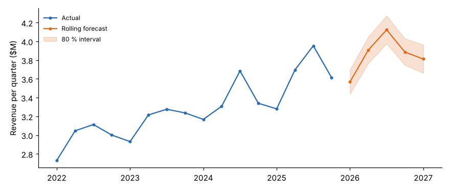
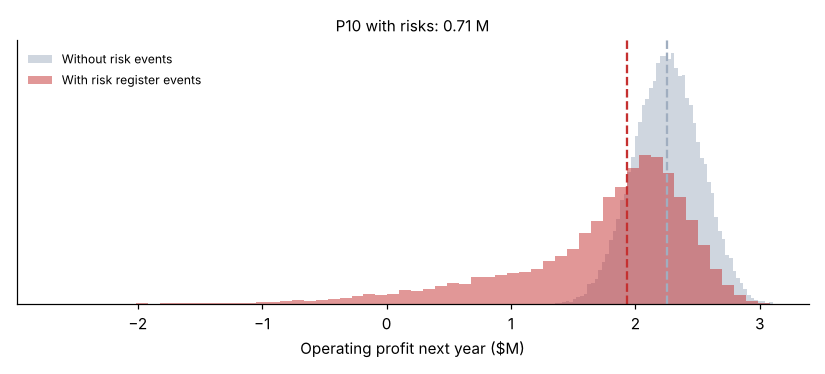

# Module 07 — The shift to "predictive accounting" for Decision Making and Budgeting

## Objectives

- Explain the problems with annual budgets.
- Build a driver-based, capacity-based operational budget.
- Use rolling forecasts, what-if and probabilistic (risk-adjusted) scenarios.
- Use activity costs for outsourcing decisions.

## Problems with the annual budget

| Problem | Effect |
|---|---|
| Built once a year on assumptions that go stale | Out of date within months |
| Incremental ("last year + x %") | Locks in inefficiency; ignores changes in mix |
| A negotiation, not a plan | Sandbagging and gaming; time wasted |
| A single number | Hides the range of outcomes and risks |
| Disconnected from operations | Staffing and capacity don't follow the volume drivers |

## Separate budgets for different purposes

| Budget | Driven by |
|---|---|
| **Strategy budget** | Initiatives on the strategy map (new channel, analytics capability) |
| **Risk budget** | Mitigations for top risks (second source for a key component) |
| **Capital budget** | Investments, judged on return **and** risk |
| **Operational budget** | Forecast volume drivers × activity rates, by capacity |

## Driver-based, capacity-based operational budget

Forecast the drivers, convert them to the capacity needed, and cost the capacity in **whole steps** (people):

- Next year: volume +8 %.
- Web activity grows 20 % faster still, which means more, smaller orders.

| Activity | Driver now → next | Capacity per FTE | FTE now → next | Staff (separate teams) | Cost next |
|---|---|---|---|---|---|
| Process orders | 6,201 → 6,921 orders | 1,095 | 5.66 → 6.32 | 7 | $420,000 |
| Enter order lines | 19,337 → 21,196 lines | 4,802 | 4.03 → 4.41 | 5 | $280,000 |
| Pick and ship | 8,201 → 9,148 shipments | 809 | 10.12 → 11.29 | 12 | $576,000 |
| Support customers | 4,364 → 4,713 calls | 649 | 6.72 → 7.25 | 8 | $480,000 |
| **Total** | | | **26.53 → 29.27** | **32** | **$1,756,000** |

- An incremental budget (+8 %) would give **$1,570,320**. It misses the web mix shift and the step costs.
- **Pooling** the four teams (cross-training) needs 30 people instead of 32. Step costs reward flexible capacity.
- The driver-based budget also tells management what to change: fewer, larger web orders cut the budget directly.

## Rolling forecasts

Instead of one fixed annual budget, forecast **five quarters ahead every quarter** (trend + seasonality on log revenue, 16 quarters of history; R² 0.96):



| Quarter | Forecast | 80 % range |
|---|---|---|
| 2026 Q1 | $3.57 M | $3.44–3.70 M |
| 2026 Q2 | $3.91 M | $3.77–4.05 M |
| 2026 Q3 | $4.12 M | $3.98–4.27 M |
| 2026 Q4 | $3.89 M | $3.75–4.03 M |
| 2027 Q1 | $3.81 M | $3.66–3.97 M |

FY2026: **$15.48 M** (a static "2025 + 6 %" gives $15.41 M). The point isn't the small difference. The forecast is **refreshed every quarter**, shows a **range**, and always looks five quarters ahead.

## Probabilistic scenario planning with risk (ERM in the plan)

Monte Carlo simulation (20,000 runs) of next year's operating profit:

- growth 0–11 % (most likely 6 %)
- price −2 % to +3 %
- material inflation 0–9 %
- the six events in the **risk register**, each with its probability and impact



| Operating profit | Without risk events | With risk events |
|---|---|---|
| P10 | $1.91 M | **$0.71 M** |
| P50 | $2.26 M | $1.93 M |
| P90 | $2.60 M | $2.45 M |

- Expected risk loss: about **$0.52 M** a year.
- Probability that operating profit falls below $1 M: **14.9 %**. Probability of a loss: **3.3 %**.
- The risk register's top expected losses are supplier failure ($135k), loss of the top distributor ($112k) and metal prices ($105k). That is where the risk budget should go.

## What-if: outsourcing pick and ship

A third-party logistics provider (3PL) offers **$58 per shipment**. The ABC full cost is **$89.99**, but not all of it disappears if you outsource:

| Item | $ |
|---|---|
| Avoidable cost: 85 % of warehouse labour + 50 % of the facilities share | 510,600 ($62.26 per shipment) |
| 3PL cost: 8,201 × $58 | 475,658 |
| **Net saving** | **34,942** |
| IT cost that remains | 57,000 |

- Break-even price: **$62.26**.
- Compare with **avoidable** cost, never full cost. At full cost the decision looks like a $262,000 saving.
- The real saving is small, so service level, control and risk should decide.

## Run it

```bash
python tools/epmkit.py budget
python tools/epmkit.py rolling
python tools/epmkit.py montecarlo
python tools/epmkit.py risk
python tools/epmkit.py outsource
```

## Check yourself

1. Why compare the 3PL price with avoidable cost rather than the ABC full cost?
2. Which number would you give the board for next year's profit, and why?

<details><summary>Answers</summary>

1. Some activity costs (IT, part of facilities) remain after outsourcing. Comparing with full cost overstates the saving, here by more than $220,000 ($738,000 vs $510,600 avoidable).
2. A range, for example P50 $1.93 M with P10 $0.71 M and P90 $2.45 M, together with the main risks that drive the downside and what is being done about them.

</details>
