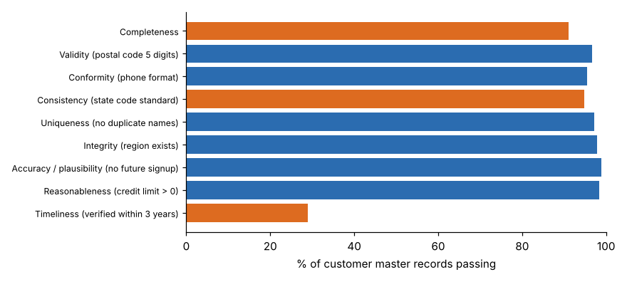

# Module 01 — Foundations of Data Analytics

What analytics is, the kinds of questions it answers, how a project runs from question to result, and what the data underneath has to look like. The source outline gives this module no title, so the title here is the course's.

## Objectives

- Explain what data analytics is and find business opportunities and use cases for it.
- Map a business process and mark where data is created and where value is added.
- Place a question in the right analytics type and choose a family of techniques for it.
- Describe the phases of an analytics project and who is involved in each.
- Use the MAD framework to decide what a dashboard should show.
- Classify business data by structure, role and measurement scale.
- Distinguish the three types of IT systems analytics draws on.
- Score a data set on the data-quality dimensions and decide which problem to fix first.

## Introduction to Data Analytics

**Data analytics** turns recorded facts about a business into decisions that change results. The decisions matter more than the reports: an analysis that doesn't change what someone does has cost money and returned nothing.

Three tests for a good analytics use case:

1. **A decision is waiting on it.** Someone will act differently depending on the answer (price, stock, staff, call, invest).
2. **The value is bigger than the effort.** Estimate it roughly: (volume affected) × (improvement) × (value per unit).
3. **The data exists, or can be collected cheaply.** If it doesn't, the first project is collecting it.

### Running case: Pinecrest Supply

**Pinecrest Supply** (fictional) distributes industrial maintenance, repair and operations (MRO) supplies (gloves, safety glasses, cutting tools, batteries and so on) from five branches. Its leaders want to grow sales, keep customers and decide with evidence. The course data is simulated and generated by `tools/dalkit.py` with a fixed seed.

| Data set | Rows | Used in |
|---|---|---|
| `customers.csv` (customer master) + `regions.csv` | 412 | Data quality (this module) |
| `orders.csv` | 4,000 orders | EDA, segmentation |
| `order_lines.csv` | 12,318 order lines, 12 categories | Association rules |
| `ab_test.csv` | 2 × 1,200 customers | Hypothesis testing |
| `branch_monthly.csv` | 5 branches × 24 months | Regression |
| `churn.csv` | 1,500 customers | Classification, bias |

### Map the process first: where value and data are created

Analytics finds opportunities faster when you know the process the data comes from. Here is Pinecrest's order-to-cash flow, with the data each step creates. **VA** marks steps the customer would pay for, **NVA-R** steps that are needed but add no value (for example, regulatory or financial control), and **NVA** pure waste.

| # | Step | Class | Data created | Analytics opportunity |
|---|---|---|---|---|
| 1 | Customer request (phone, email, web) | VA | Quote request, channel | Demand signals by channel |
| 2 | Re-key email orders into ERP | NVA | Order header and lines | Automate entry; measure keying errors |
| 3 | Credit check | NVA-R | Credit limit, hold flag | Score risk; release low-risk orders automatically |
| 4 | Pick and pack | VA | Pick times, short picks | Slotting; stock-out prediction |
| 5 | Wait for carrier | NVA | Ship timestamps | Lead-time analysis |
| 6 | Ship and deliver | VA | Proof of delivery | On-time delivery tracking |
| 7 | Invoice and collect | NVA-R | Invoice, payment date | Days-sales-outstanding drivers |

Two lessons from the map. The **NVA steps are where cheap wins hide**: analytics can measure them and often remove them. And **every step writes data**, so a question such as "why are East's orders larger?" can be traced back to the step and system that recorded the answer. For mapping technique, see [Process Mapping](../../../lean-six-sigma/process-mapping/README.md).

### Working with business, IT and data teams

Adoption depends on the people around the analysis as much as on the analysis. A simple split of roles:

| Group | Brings | Needs from analytics |
|---|---|---|
| Business owner | The decision, the value, the authority to act | A clear answer, in their terms, in time |
| Process experts | How the work and the data really happen | To be asked early; to see their input used |
| IT | Systems, access, security, integration | Clear data requests; no unmanaged copies |
| Data team | Pipelines, models, data quality | A defined question and success measure |

Agree the decision, the success measure and the data owner **before** any modelling starts.

## Types of Analytics and Data Science Techniques Taxonomy

Four types of analytics, ordered by the question each one answers. The four-level ladder is widely attributed to Gartner (training memory; unverified).

| Type | Question | Pinecrest example | Typical techniques |
|---|---|---|---|
| **Descriptive** | What happened? | Revenue by branch last year | Summaries, EDA, dashboards, association rules |
| **Diagnostic** | Why did it happen? | Why are East's orders 22 % larger? | Drill-down, hypothesis tests, comparisons, root cause |
| **Predictive** | What will happen? | Which customers will churn next quarter? | Regression, classification, forecasting |
| **Prescriptive** | What should we do? | How should the marketing budget be split? | Optimization, simulation, decision analysis |

Value and difficulty both increase down the table, but most of the value in most companies still comes from good descriptive and diagnostic work done reliably.

**Data science techniques taxonomy** (the course's own grouping):

| Family | Learns from | Output | Examples in this course |
|---|---|---|---|
| Summarization | All records | Statistics, charts | EDA (Module 02) |
| Association | Transactions | "If A then B" rules | Apriori (Module 02) |
| Inference | A sample | Evidence about a population or effect | A/B test, *t*-test (Module 02) |
| Regression | Labelled data, numeric target | A number | Sales model (Module 03) |
| Classification | Labelled data, category target | A class or probability | Churn model (Module 03) |
| Clustering | Unlabelled data | Groups | RFM segments (Module 03) |
| Optimization / simulation | A model of the system | A best or robust choice | Mentioned; see [Process Modeling and Simulation](../../../technical-skills/process-modeling-and-simulation/README.md) |

## Phases of the Data Analytics Lifecycle

Several published lifecycles exist; they differ in names but agree on the shape. Two common ones (both quoted from training memory; unverified):

| Generic phase | Data analytics lifecycle (EMC Education Services, 2015) | CRISP-DM (1999/2000) |
|---|---|---|
| Frame the question | 1 Discovery | Business understanding |
| Get and fix the data | 2 Data preparation | Data understanding; data preparation |
| Choose the approach | 3 Model planning | (within modelling) |
| Build and test | 4 Model building | Modelling; evaluation |
| Tell people | 5 Communicate results | (within evaluation / deployment) |
| Put it to work | 6 Operationalize | Deployment |

In practice the phases loop: data preparation often sends you back to discovery when you learn what the data can't support. Data preparation is commonly reported to take most of a project's time; plan for it.

**Pinecrest churn project, by phase:**

1. *Discovery*: the decision is which customers the account team calls each month; success = more retained revenue per call hour.
2. *Data preparation*: join orders, tickets and discounts per customer; fix the customer-master problems found below.
3. *Model planning*: binary target (churned or not) → classification; compare a simple and a more flexible model.
4. *Model building*: train, then test on held-out customers (Module 03).
5. *Communicate*: a one-page story for the sales director (Module 04).
6. *Operationalize*: a monthly call list in the CRM, with a check that call outcomes are recorded.

## MAD Framework and Types of Business Insights

The **MAD framework** organizes a performance dashboard into three layers. It is usually attributed to Wayne Eckerson's *Performance Dashboards* (training memory; unverified). The layer names are given as **Monitor, Analyze, Drill to detail** (for example in a [useready.com article](https://www.useready.com/blog/mad-framework-for-dashboard-design) that we opened), but the same page's summary text expands it as "Metrics, Actions, Data". This course uses Monitor–Analyze–Detail.

| Layer | Who uses it | Shows | Pinecrest example | Insight type |
|---|---|---|---|---|
| **Monitor** | Executives, everyone | A few KPIs against target, with status colours | Revenue, margin, on-time delivery, churn rate | *Status*: is something off track? |
| **Analyze** | Managers, analysts | Dimensions to slice the KPI by | Revenue by branch × category × month | *Diagnostic*: where and why? |
| **Drill to detail** | Analysts, front line | The underlying records | The East orders over $1,000 last month | *Actionable*: which records to act on |

The rule of thumb is roughly 10 % of users need detail, 20 % need analysis, and all need monitoring; the proportions are illustrative, not measured.

**Types of business insights** that a good analysis produces (the course's grouping):

- **Status**: where we stand against target.
- **Trend**: direction and speed of change.
- **Comparison**: one group against another (branch, segment, period).
- **Driver / relationship**: which factor moves the result, and by how much.
- **Anomaly**: something that should not have happened.
- **Forecast**: what is likely next.
- **Recommendation**: what to do, with the expected effect.

## Types of Business Data and Data Types

**By structure**

| Structure | What it is | Pinecrest example |
|---|---|---|
| Structured | Fixed rows and columns | Orders table |
| Semi-structured | Tagged but flexible | Web order JSON, EDI messages |
| Unstructured | No fixed schema | Customer emails, call notes, photos of damaged goods |

**By business role**

| Role | Changes | Example |
|---|---|---|
| Transactional | Every event | Orders, invoices, shipments |
| Master | Slowly; describes the things involved | Customer, product, branch |
| Reference | Rarely; shared codes | State codes, units of measure |
| Metadata | Describes the data itself | Field definitions, load timestamps |

**By measurement scale** (Stevens, 1946, *Science*; training memory; unverified)

| Scale | Has | Allowed summaries | Example |
|---|---|---|---|
| Nominal | Categories | Counts, mode | Branch, product category |
| Ordinal | Order | Median, percentiles | Customer tier (bronze/silver/gold) |
| Interval | Equal steps, arbitrary zero | Mean, SD (not ratios) | Temperature in °C |
| Ratio | True zero | All, including ratios | Order value, days since last order |

The scale decides which statistics and charts make sense. Averaging a tier coded 1–3 is a common mistake.

## 3 types of IT Systems

The outline doesn't name the three types. This course uses the three-way split widely used by industry analysts (term origins not verified):

| Type | Purpose | Optimized for | Pinecrest systems |
|---|---|---|---|
| **Systems of record** | The authoritative record of transactions and master data | Accuracy, consistency, control | ERP (orders, invoices, inventory), finance |
| **Systems of engagement** | Interaction with customers and staff | Speed, usability | Web store, CRM, email, mobile app |
| **Systems of insight** | Turning data from the other two into decisions | Analysis, history, integration | Data warehouse, BI dashboards, models |

Some textbooks use an older split instead: **transaction processing systems**, **management information systems** and **decision support systems**. It maps onto the same three roles. Either way, analytics usually **reads** from systems of record and engagement, **builds** in systems of insight, and must **write results back** into a system of engagement (for example, a call list in the CRM) to change behaviour.

## Data Quality and its 12 key dimensions

There is no single standard list of data-quality dimensions; published lists range from about 6 to more than 15. For example, DAMA UK's 2013 paper lists six (completeness, uniqueness, timeliness, validity, accuracy, consistency; training memory; unverified). This course uses a compiled list of 12, of which 9 can be measured with simple rules on the Pinecrest customer master.

| # | Dimension | Question | Rule used on `customers.csv` | Score |
|---|---|---|---|---|
| 1 | Completeness | Is required data present? | E-mail not blank | 91.0 % |
| 2 | Validity | Does it obey the business rule? | Postal code is 5 digits | 96.6 % |
| 3 | Conformity | Is it in the standard format? | Phone matches `(nnn) nnn-nnnn` | 95.4 % |
| 4 | Consistency | Is it the same everywhere? | State uses the standard code (`IL`, not `Ill.`) | 94.7 % |
| 5 | Uniqueness | Is each thing recorded once? | No duplicate company names after normalizing | 97.1 % (12 duplicates) |
| 6 | Integrity | Do references resolve? | Region ID exists in `regions.csv` | 97.8 % |
| 7 | Accuracy | Does it match reality? | Proxy: sign-up date not in the future | 98.8 % |
| 8 | Reasonableness | Is the value plausible? | Credit limit > 0 | 98.3 % |
| 9 | Timeliness | Is it current enough? | Verified within the last 3 years | **28.9 %** |
| 10 | Relevance | Is it the data the decision needs? | Judged with the user | — |
| 11 | Accessibility | Can the right people get it? | Judged with IT | — |
| 12 | Precision | Is it detailed enough? | Judged (e.g. date vs timestamp) | — |



**Reading the result.** Eight measured dimensions are above 90 %, but **timeliness is 28.9 %**: almost three-quarters of customer records haven't been verified in three years. For a churn model that depends on current contacts, that matters more than the 12 duplicate records. The fix is a process fix (verify contacts at each order, or a periodic campaign), not a one-time clean-up. True accuracy can only be checked against the real world (calling the customer); the rule here is a proxy.

## Run it

```bash
python tools/dalkit.py quality
```

## Check yourself

1. Classify each question by analytics type: (a) "Which customers are likely to stop buying?" (b) "Why did West's margin drop in June?" (c) "How many orders did we ship last week?" (d) "How should we split the trade-show budget?"
2. Is customer tier (bronze/silver/gold) nominal, ordinal, interval or ratio? What summary would you use?
3. Which MAD layer should show "the 15 orders shipped late yesterday"?
4. The CRM and the ERP each hold the customer's phone number, and they differ. Which data-quality dimension is failing, and which system should win?
5. Which measured dimension is worst at Pinecrest, and why is it a process problem rather than a clean-up problem?

<details><summary>Answers</summary>

1. (a) predictive; (b) diagnostic; (c) descriptive; (d) prescriptive.
2. Ordinal. Use counts per tier and the median, not the mean of 1–3 codes.
3. Drill to detail: individual records to act on.
4. Consistency. The system of record (ERP), or whichever one the data owner names as master. Then fix the sync so the copy follows it.
5. Timeliness, at 28.9 %. Records go out of date continuously, so only a recurring verification step keeps them current.

</details>
