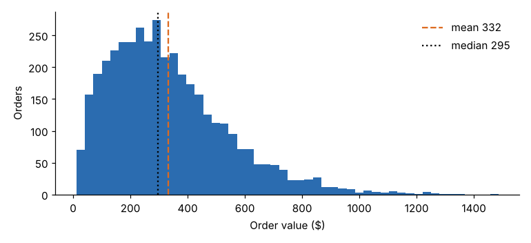

# Module 02 — Descriptive Analytics

Describe what happened, find what goes together, and test whether a difference is real before acting on it.

## Objectives

- Run an exploratory analysis that measures business performance.
- Choose and interpret measures of central tendency and variation for skewed business data.
- Explain associative analytics and compute support, confidence and lift.
- Run the Apriori algorithm and turn rules into business actions.
- Test a business hypothesis (A/B test, two-group comparison) and report the effect size, not only the *p*-value.

## Measuring Business Performance with Exploratory Data Analytics

**Exploratory data analysis (EDA)** means looking at the data, with simple summaries and charts, before modelling or deciding anything. The term comes from John Tukey's 1977 book *Exploratory Data Analysis* (training memory; unverified). For business performance it answers four questions in order:

1. **How big?** Totals and counts: Pinecrest shipped **4,000 orders** worth **$1,328,506** in the year.
2. **What is typical?** Centre: mean order **$332.13**, median **$295.06**.
3. **How much does it vary?** Spread: SD **$208.46**; **107** orders are high outliers (above Q3 + 1.5 × IQR).
4. **How do groups differ?** Break down by branch, category, customer and month.



**EDA checklist**

- Count rows, distinct keys and blanks before any statistic (Module 01's data-quality step).
- Plot the distribution of every key measure. Business amounts are almost always right-skewed.
- Look at the extremes. Is each outlier an error, a special customer or a different process?
- Break down by every dimension the business manages by (branch, product, channel, period).
- Write each finding as a sentence a manager can act on, with its size.

## Measures of Central Tendency and Variation

| Measure | Formula / meaning | Use when | Pinecrest order value |
|---|---|---|---|
| Mean | Σx / n | Totals matter (revenue = mean × count) | $332.13 |
| Median | Middle value | Skewed data; "the typical order" | $295.06 |
| Mode | Most frequent value | Categories, counts | Most frequent order size: 3 items |
| Range | max − min | Quick check for errors | — |
| Standard deviation (SD) | √(Σ(x − x̄)² / (n − 1)) | Roughly symmetric data; process capability | $208.46 |
| Interquartile range (IQR) | Q3 − Q1 | Skewed data; robust to outliers | see table |
| Coefficient of variation (CV) | SD / mean | Comparing spread between groups of different size | see table |

The mean is above the median and the skewness is **1.12**: a long right tail of large orders. Report the median as "typical order" and use the mean for revenue planning.

**By branch**

| Branch | Orders | Mean | Median | SD | IQR | CV |
|---|---|---|---|---|---|---|
| Central | 826 | $309.99 | $273.18 | $193.98 | $234.14 | 62.6 % |
| East | 811 | $371.26 | $333.96 | $231.66 | $287.85 | 62.4 % |
| North | 778 | $324.78 | $295.69 | $198.41 | $252.99 | 61.1 % |
| South | 787 | $305.06 | $274.83 | $193.55 | $250.60 | 63.5 % |
| West | 798 | $349.13 | $313.49 | $214.67 | $288.59 | 61.5 % |

East's average order is 22 % larger than South's ($371.26 / $305.06 = 1.217). The CVs are almost equal, so the branches differ in **level, not consistency**. That points to a difference in customer mix or pricing, not in how the branches operate. Whether the gap is real is tested below.

## Introduction to Associative Data Analytics

**Associative analytics** (association-rule mining, "market-basket analysis") finds items that occur together in transactions more often than chance. Typical uses: cross-sell prompts, bundles, store or warehouse layout, and promotions.

A rule **A → B** ("orders with A also contain B") is judged by three measures:

| Measure | Formula | Meaning |
|---|---|---|
| **Support** | P(A and B) = orders with A and B / all orders | How common the pair is: does it matter? |
| **Confidence** | P(B \| A) = support(A,B) / support(A) | How often B follows A: how reliable? |
| **Lift** | confidence / support(B) | How much more likely B is given A than in general. 1 = independent; > 1 = positive association |

Worked example, Batteries → Flashlights: support(Batteries) = 0.258, support(Flashlights) = 0.257, support(both) = 0.116.
Confidence = 0.116 / 0.258 = **0.45**; lift = 0.45 / 0.257 = **1.75**. A battery order is 1.75 times as likely as an average order to include a flashlight.

High confidence alone can mislead: if B is in most orders anyway, confidence will be high for any A. **Always check lift.**

## Apriori Techniques

Checking every combination of 12 categories means 4,095 itemsets. The **Apriori** algorithm (Agrawal and Srikant, 1994; training memory; unverified) prunes the search with one property: **every subset of a frequent itemset must itself be frequent.** If {Fasteners, Lubricants} is rare, no larger set containing both can be frequent, so it is never counted.

1. Count every single item; keep those with support ≥ the minimum (here 0.05).
2. Join the frequent sets of size *k* to make candidates of size *k* + 1; drop any candidate with an infrequent subset.
3. Count the candidates; keep the frequent ones. Repeat until no candidates remain.
4. From each frequent itemset, generate rules and keep those with confidence ≥ the minimum (here 0.5).

**Pinecrest result** (4,000 orders, minimum support 0.05, minimum confidence 0.5): 60 frequent itemsets (12 single items, 40 pairs, 8 triples) and **25 rules**. Top rules by lift:

| Rule | Support | Confidence | Lift |
|---|---|---|---|
| Safety glasses + Safety gloves → Hearing protection | 0.156 | 0.828 | 2.52 |
| Hearing protection + Safety gloves → Safety glasses | 0.156 | 0.809 | 2.49 |
| Hearing protection + Safety glasses → Safety gloves | 0.156 | 0.799 | 2.41 |
| Batteries + Hearing protection → Safety glasses | 0.050 | 0.657 | 2.02 |

Strongest pairs (any confidence):

| Pair rule | Support | Confidence | Lift |
|---|---|---|---|
| Hearing protection → Safety glasses | 0.196 | 0.596 | 1.83 |
| Batteries → Flashlights | 0.116 | 0.451 | 1.75 |
| Abrasives → Cutting tools | 0.149 | 0.520 | 1.74 |
| Adhesives → Tape | 0.100 | 0.412 | 1.67 |

**From rules to actions**

- **PPE kit.** 15.6 % of orders already contain gloves, glasses and hearing protection together. Offer a "PPE kit" SKU and prompt for the third item when two are in the cart.
- **Cutting tools ↔ abrasives** and **batteries ↔ flashlights**: cross-sell prompts and adjacent warehouse slots.
- **Adhesives → Tape** has lift 1.67 but confidence only 0.41, so it falls below the 0.5 cut-off. Thresholds are business choices; a cheap prompt can justify a lower confidence.

Association is **not causation**: the rules say what is bought together, not why, or what would happen if you changed prices. Test any change (next section).

## Hypothesis Testing

A **hypothesis test** asks whether an observed difference is larger than random variation would plausibly produce. The steps:

1. State the null (H₀: no difference) and the alternative (H₁: a difference).
2. Choose α, the risk of a false alarm you will accept (commonly 0.05), **before** looking.
3. Compute the test statistic and the *p*-value: the probability of a result at least this extreme if H₀ were true.
4. Decide, and report the **effect size with a confidence interval**, not only "significant".

### A/B test: reorder-reminder e-mail

Pinecrest sent a reorder reminder to 1,200 randomly chosen customers (B) and nothing to 1,200 others (A).

| Group | Customers | Converted | Rate |
|---|---|---|---|
| A control | 1,200 | 102 | 8.50 % |
| B reminder | 1,200 | 131 | 10.92 % |

Two-proportion *z*-test: lift **+2.42 points**, *z* = 2.00, ***p* = 0.046**; 95 % CI for the difference **[0.05, 4.78] points**.

Reading it honestly: at α = 0.05 the reminder works. But the interval runs from almost nothing to almost 5 points, so the size of the effect is uncertain. The e-mail costs almost nothing, so roll it out and keep measuring. If it were expensive, a larger test would come first.

### Two-group comparison: East vs South order value

Welch's *t*-test (does not assume equal variances): *t* = 6.21, *p* ≈ 7 × 10⁻¹⁰. The $66 difference in average order is real, not noise. The test doesn't tell you **why**. Next, drill down by customer and category (MAD "Analyze" layer).

**Common mistakes**: testing many things and reporting the one that is "significant"; stopping an A/B test as soon as *p* < 0.05; treating "not significant" as "no effect"; confusing statistical with practical significance. For more depth, see [Fundamentals of Hypothesis Testing](../../../lean-six-sigma/fundamentals-of-hypothesis-testing/README.md).

## Run it

```bash
python tools/dalkit.py eda
python tools/dalkit.py apriori
python tools/dalkit.py abtest
```

## Check yourself

1. Why is the median a better "typical order" than the mean for Pinecrest?
2. support(Safety glasses + Safety gloves) = 0.18875 and support(all three PPE items) = 0.15625. Compute the confidence of "glasses + gloves → hearing protection". Then compute its lift, given support(Hearing protection) = 0.328.
3. A rule has confidence 0.9 and lift 0.95. Is it useful for cross-selling?
4. Why can Apriori skip counting {Fasteners, Lubricants, Tape}?
5. The A/B *p*-value is 0.046. A manager says "so there's a 95.4 % chance the e-mail works." What's wrong with that?

<details><summary>Answers</summary>

1. Order values are right-skewed (skew 1.12): large orders pull the mean ($332) above the median ($295).
2. Confidence = 0.15625 / 0.18875 = 0.828. Lift = 0.828 / 0.328 = 2.52.
3. No. Lift < 1 means B is slightly *less* likely after A than in general; the high confidence only reflects that B is common.
4. {Fasteners, Lubricants} is not frequent (support < 0.05), so no superset can be frequent.
5. The *p*-value is P(data this extreme | no effect), not P(effect | data). It doesn't give the probability that the e-mail works.

</details>
