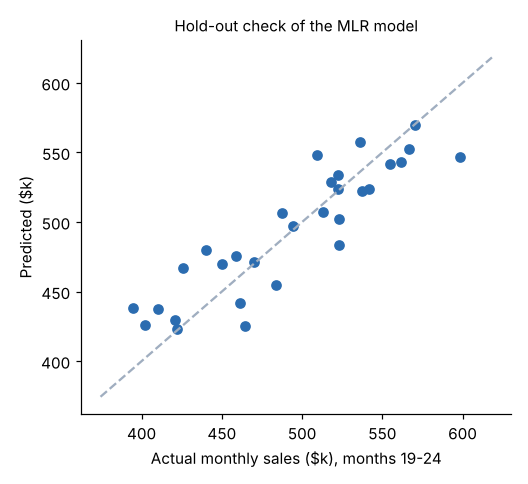

# Module 03 — Predictive Analytics

Use past data to predict a number or a class, check whether the prediction is good enough to act on, and know which kind of machine-learning algorithm fits which question.

## Objectives

- Explain what predictive analytics can and can't do, and frame a prediction around a decision.
- Fit and interpret simple and multiple linear regression models.
- Evaluate models on data they weren't trained on, and compare them with a naive baseline.
- Describe the key characteristics of machine-learning (ML) models and the trade-offs between them.
- Choose between supervised and unsupervised algorithms and interpret their output.

## Fundamentals of Predictive Analytics

A **predictive model** learns a relationship between **inputs** (features, predictors, *X*) and an **outcome** (target, *y*) from historical records, then applies it to new cases where the outcome is not yet known.

| Target type | Task | Pinecrest example |
|---|---|---|
| Number | Regression / forecasting | Next month's sales by branch |
| Category | Classification | Will this customer churn? |
| None (no target) | Clustering, association | Which customers are alike? |

**Before you build, frame it:**

- **The decision.** What changes depending on the prediction? Without a decision there's no value.
- **The horizon and timing.** Predict far enough ahead to act. Use only inputs that are **known at prediction time**. Using an input recorded after the outcome is called *leakage* and makes a model look much better than it is.
- **The success measure.** Error in business units (dollars, calls, stock-outs), and better than what the business does today.
- **Stability.** A model learned from the past assumes the future behaves similarly. Monitor it.

## Regression Models – Simple Linear Regression and Multiple Linear Regression

**Simple linear regression (SLR)** fits a straight line, ŷ = *b*₀ + *b*₁*x*, by least squares (minimizing the sum of squared errors).

Pinecrest's 5 branches × 24 months = 120 rows. Sales (in $k) against marketing spend (in $k):

ŷ = 409.68 + **4.169** × marketing, **R² = 0.317**

*Interpretation:* each extra $1k of marketing is associated with $4.17k more sales. Marketing explains about 32 % of the variation in monthly sales. The rest is due to other factors.

**Multiple linear regression (MLR)** adds inputs: ŷ = *b*₀ + *b*₁*x*₁ + … + *b*ₖ*x*ₖ.

ŷ = 120.97 + **3.91** × marketing + **22.56** × sales reps + **0.558** × active accounts
**R² = 0.754, adjusted R² = 0.748**; all coefficients *p* < 0.001.

*Interpretation:* holding reps and accounts constant, $1k of marketing goes with $3.91k of sales; one more rep goes with $22.6k a month; each active account goes with $558 a month. **Adjusted R²** penalizes extra inputs, so it only rises if a new input adds real explanatory power.

**Example prediction:** a branch with $20k marketing, 6 reps and 350 accounts:
120.97 + 3.91 × 20 + 22.56 × 6 + 0.558 × 350 = **$529.8k**.

**Cautions**

- **Correlation, not causation.** The data is observational. Branches with more reps may also have bigger territories. An experiment, or careful reasoning, is needed before claiming "hire a rep, gain $22.6k".
- **Stay in range.** The data has 3–7 reps and $8–30k of marketing. Predicting for 15 reps is extrapolation.
- **Check residuals.** Patterns in the errors (curvature, a funnel shape, clusters by branch) mean the model is missing something.
- **Multicollinearity.** Strongly related inputs make individual coefficients unstable, even when predictions are fine.

For a deeper treatment, see [Engineering Analytics](../../engineering-analytics/README.md) and [Applied Statistics](../../../technical-skills/applied-statistics/README.md).

## Evaluating Analytics Models

A model must be judged on **data it has not seen**. A model that fits its training data perfectly may have memorized noise (**overfitting**).

**Validation schemes**

| Scheme | How | Use when |
|---|---|---|
| Holdout | Train on one part, test on the rest | Enough data; quick check |
| Time-based holdout | Train on earlier periods, test on later | Anything over time (avoids using the future) |
| *k*-fold cross-validation | Split into *k* parts; each part is the test set once; average | Small data; more stable estimate |

**Regression metrics**

| Metric | Formula | Reads as |
|---|---|---|
| MAE | mean \|*y* − ŷ\| | Typical error, in the target's units |
| RMSE | √mean(*y* − ŷ)² | Typical error, penalizing big misses |
| MAPE | mean \|*y* − ŷ\| / *y* | Typical % error (breaks near *y* = 0) |
| R² | 1 − SSE / SST | Share of variation explained |

**Pinecrest regression:** train on months 1–18, test on months 19–24:

| Model | Test RMSE ($k) |
|---|---|
| Naive: always predict the training mean | 54.8 |
| MLR | **24.8** (MAE 20.4, MAPE 4.3 %) |
| MLR, 5-fold cross-validation | 26.2 |



The model more than halves the naive error, and cross-validation agrees with the holdout. **Always report a baseline**: a model is only worth running if it beats the simple rule the business already uses.

**Classification metrics** (from the confusion matrix):

| | Predicted churn | Predicted stay |
|---|---|---|
| **Actually churned** | True positive (TP) | False negative (FN) |
| **Actually stayed** | False positive (FP) | True negative (TN) |

- Accuracy = (TP + TN) / all
- Precision = TP / (TP + FP): of those we flag, how many are right
- Recall = TP / (TP + FN): of the real churners, how many we catch
- F1 = harmonic mean of precision and recall
- AUC = probability that the model ranks a random churner above a random stayer (0.5 = coin flip, 1 = perfect)

## Fundamentals of ML (Machine Learning) and key characteristics of ML Models

**Machine learning** is a set of methods that learn patterns from data instead of following hand-written rules. A common definition: a program learns from experience E on task T, as measured by P, if P improves with E (Mitchell, 1997; training memory; unverified).

**Key characteristics to weigh when choosing a model**

| Characteristic | Question | Trade-off |
|---|---|---|
| **Accuracy / generalization** | How well does it predict *new* cases? | Flexible models can fit better, but overfit more easily |
| **Bias–variance** | Too simple (misses patterns) or too complex (fits noise)? | Tune complexity on validation data |
| **Interpretability** | Can a manager see why it predicted this? | Linear models and small trees are clear; ensembles and neural networks less so |
| **Data needs** | How many labelled examples? | Flexible models need more |
| **Training and run cost** | Compute time, skills, tooling | Simple models are cheap to run and maintain |
| **Robustness and drift** | Does it hold up as the business changes? | All models need monitoring and retraining |
| **Fairness and compliance** | Could it treat groups unfairly or use data it shouldn't? | Check the inputs and outcomes by group |

## Supervised & Unsupervised ML Algorithms

| | Supervised | Unsupervised |
|---|---|---|
| Training data | Inputs **and** known outcomes (labels) | Inputs only |
| Goal | Predict the label for new cases | Find structure: groups, associations, unusual cases |
| Algorithms | Linear/logistic regression, decision trees, random forests, gradient boosting, *k*-nearest neighbours, neural networks | *k*-means, hierarchical clustering, Apriori, principal component analysis, anomaly detection |
| Evaluated by | Error against held-out labels | Usefulness and stability of the structure (no "right answer") |

### Supervised: predicting churn

`churn.csv`: 1,500 customers, 11.5 % churned. Inputs: tenure, orders last year, days since last order, support tickets, average discount. 30 % of customers are held out for testing (450 customers, 52 churners).

| Model | Test AUC |
|---|---|
| Logistic regression | **0.811** |
| Decision tree (depth 3) | 0.787 |

Logistic regression's standardized coefficients show the drivers. Days since last order (**+0.77**) and support tickets (+0.31) raise churn risk; orders last year (−0.40), tenure (−0.36) and discount (−0.20) lower it.

**The threshold is a business decision.**

| Rule | TP | FP | FN | TN | Accuracy | Precision | Recall |
|---|---|---|---|---|---|---|---|
| Predict "everyone stays" | 0 | 0 | 52 | 398 | **0.884** | — | 0 |
| Logistic, flag if *p* ≥ 0.50 | 5 | 1 | 47 | 397 | 0.893 | 0.833 | 0.096 |
| Logistic, flag if *p* ≥ 0.15 | 31 | 77 | 21 | 321 | 0.782 | 0.287 | **0.596** |

Two lessons:

- **Accuracy misleads when the outcome is rare.** Predicting that nobody churns is 88.4 % accurate and useless.
- At 0.15 the account team calls 108 customers and reaches 31 of 52 churners (60 %), versus 5 at the default 0.5. Whether that trade is worth it depends on the cost of a call versus the value of a saved customer. That is a decision analysis (Module 04), not a statistics question.

### Unsupervised: RFM customer segments

**RFM** describes each customer by **R**ecency (days since last order), **F**requency (number of orders) and **M**onetary value (revenue). *k*-means with *k* = 4, on standardized log-scaled values, for 400 customers:

| Segment | Customers | Median recency (days) | Median orders | Median revenue | Share of revenue | Suggested name and action |
|---|---|---|---|---|---|---|
| 1 | 139 | 20 | 13 | $4,545 | 48.6 % | **Core accounts**: protect, dedicated rep |
| 0 | 173 | 21 | 9 | $2,965 | 38.3 % | **Steady buyers**: grow with cross-sell (Module 02 rules) |
| 2 | 42 | 112 | 7 | $2,456 | 7.4 % | **Slipping**: win-back call now |
| 3 | 46 | 42 | 6 | $1,696 | 5.7 % | **Occasional**: low-cost digital contact |

Cluster numbers are arbitrary labels. The names are the analyst's interpretation and should be checked with the sales team. Different *k* or inputs give different segments; choose the version the business can act on.

## Run it

```bash
python tools/dalkit.py regression
python tools/dalkit.py classify
python tools/dalkit.py segment
```

## Check yourself

1. Predict monthly sales for a branch with $25k marketing, 5 reps and 300 accounts using the MLR equation.
2. Why must a sales forecast be tested on *later* months rather than random months?
3. Using the 0.15-threshold row, verify precision and recall.
4. A colleague proposes a model with 89.3 % accuracy for churn. Why isn't that enough information?
5. Is RFM segmentation supervised or unsupervised? Why?

<details><summary>Answers</summary>

1. 120.97 + 3.91 × 25 + 22.559 × 5 + 0.558 × 300 = 120.97 + 97.75 + 112.80 + 167.40 = **$498.9k**.
2. In use, the model always predicts the future from the past. Random splits let it learn from months after the ones it is tested on (leakage), which overstates accuracy.
3. Precision = 31 / (31 + 77) = 0.287; recall = 31 / (31 + 21) = 0.596.
4. The all-stay baseline already gets 88.4 %. Ask for recall, precision and AUC, and what action and cost the threshold implies.
5. Unsupervised: there is no label to predict; the algorithm groups customers by similarity.

</details>
