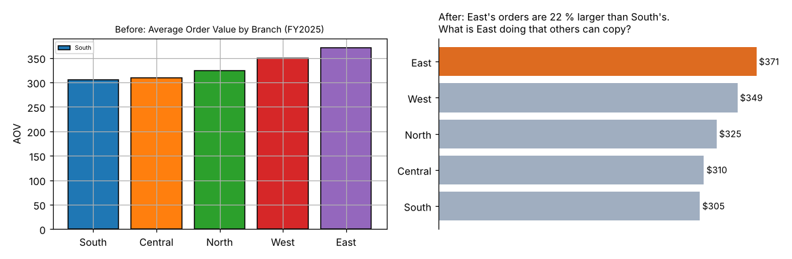

# Module 04 — Data Story Telling and Decision Science

Turn results into a message people act on, make the decision in a structured way, guard against predictable biases, and plan a career in analytics.

## Objectives

- Build a data story with a clear message, the right chart and a call to action.
- Explain how decisions are made in organizations and where analytics fits.
- Apply decision-making models, including expected value, to an analytics result.
- Recognize common cognitive biases and data biases, and use counter-measures.
- Map analytics roles and skills, and plan your next development step.

## Data Storytelling including Data Visualization

A **data story** combines three things: **data** (the evidence), **visuals** (to make it easy to see) and **narrative** (why it matters and what to do). Without narrative, a chart is just information. Without data, a story is just opinion.

**Story structure (situation, complication, resolution)**

| Part | Pinecrest example |
|---|---|
| Situation | Five branches, similar processes, $1.33M revenue in 2025 |
| Complication | East's average order is 22 % larger than South's (*p* < 0.001), and the spread is the same, so this isn't a few lucky orders |
| Resolution / ask | Spend two weeks finding what East does differently (customer mix, PPE kit sales, rep habits) and pilot it in South |

**Before and after.** The same data shown two ways:



| Before | After |
|---|---|
| Title names the chart ("Average Order Value by Branch") | Title states the message and the question |
| Five colours mean nothing; a stray legend | One highlight colour on the point that matters; others grey |
| Gridlines and axis compete with the data | Direct labels; no clutter |
| Reader must work out the point | Point is read in seconds |

**Choosing a chart**

| Message | Chart |
|---|---|
| Compare categories | Horizontal bar, sorted |
| Change over time | Line |
| Distribution | Histogram or box plot |
| Relationship | Scatter, with a fitted line if useful |
| Part of a whole (few parts) | Stacked bar; a pie only for 2–3 parts |
| Single key number | Big number with comparison ("$1.33M, +6 % vs plan") |

**Rules of thumb**: one message per chart; start bar axes at zero; label directly; use colour for meaning, not decoration; state uncertainty where it matters ("+2.4 points, plausibly 0–5"); end with the decision you want. For written and spoken delivery, see [Technical Communications](../../../technical-skills/technical-communications/README.md).

## Introduction to Decision Making

A **decision** is an irreversible commitment of resources. Analytics informs decisions; it doesn't make them. A useful split by type:

| Type | Frequency | Example | How analytics helps |
|---|---|---|---|
| Strategic | Rare, big, hard to reverse | Open a sixth branch | Scenarios, market sizing, simulation |
| Tactical | Periodic | Quarterly marketing split, staffing | Models, forecasts, experiments |
| Operational | Daily, many | Which customers to call today; credit hold release | Rules and models built into systems |

Operational decisions are where models scale best: a churn score in the CRM affects hundreds of calls a month. A good decision is judged by the **process and information** used, not only by the outcome, because chance affects outcomes.

## Decision Making Models

| Model | How it works | Fits when |
|---|---|---|
| **Rational (classical)** | Define the problem, list options and criteria, evaluate, choose the best | Important decisions with time and data |
| **Bounded rationality / satisficing** (Herbert Simon; training memory; unverified) | Search until an option is "good enough" | Limited time and information, which is most of the time |
| **Recognition-primed** (Gary Klein; training memory; unverified) | Experts match the situation to patterns and mentally test one option | Fast, familiar situations with experienced people |
| **Data-driven / evidence-based** | Use measured evidence and experiments; update as data arrives | Repeatable decisions with measurable outcomes |
| **Group methods** | Structured discussion, voting, nominal group, Delphi | Buy-in matters; expertise is spread out |

**Worked example: expected value of the churn call list.** Assumptions (illustrative): a call costs $40; a churner who is called is saved with probability 0.30; a saved customer is worth $1,500 of margin a year. Using the test-set results from Module 03:

| Threshold | Calls | Churners reached | Expected saves | Value | Cost | Net |
|---|---|---|---|---|---|---|
| 0.50 | 6 | 5 | 1.5 | $2,250 | $240 | **$2,010** |
| 0.15 | 108 | 31 | 9.3 | $13,950 | $4,320 | **$9,630** |

At these assumptions the lower threshold is worth almost five times as much, despite its lower accuracy. If the save rate were only 5 %, the 0.15 list would net $2,325 − $4,320 = −$1,995, a loss. So the **save rate is the number to test** before scaling up. For more decision tools (decision matrices, decision trees, sensitivity analysis), see [Engineering Decision Making](../../../operations-research-decision-analysis/engineering-decision-making/README.md).

## Biases in Decision Making

**Cognitive biases** (several described by Tversky and Kahneman, 1974, *Science*; training memory; unverified):

| Bias | What happens | Analytics example | Counter |
|---|---|---|---|
| Confirmation | Seek data that supports what you believe | Only testing the branch you suspect | Write the hypothesis and the test **before** looking |
| Anchoring | First number sticks | Last year's budget becomes this year's | Build the estimate from drivers first |
| Availability | Vivid or recent events seem common | One angry customer drives a policy | Check the frequency in the data |
| Overconfidence | Intervals too narrow | Forecast with no range | Report intervals; track forecast accuracy |
| Sunk cost | Keep going because of what was spent | Keep a failing model "after all that work" | Judge only future costs and benefits |
| Groupthink | Group converges too early | No one challenges the dashboard | Assign a devil's advocate; collect views independently |

**Data and analysis biases**

| Bias | What happens | Counter |
|---|---|---|
| **Survivorship** | Only the records that "survived" are analysed | Include the failures and drop-outs |
| Selection / sampling | The sample doesn't represent the population | Randomize; compare sample to population |
| Simpson's paradox | A trend reverses when groups are combined | Break down by key groups |
| Data dredging (*p*-hacking) | Many tests, report the "significant" ones | Pre-register; correct for multiple tests |
| Historical / algorithmic | Model learns past unfairness | Check outcomes by group; review inputs |

**Survivorship example from the churn data.** If you only look at current customers:

| Measure | Current customers only | All customers (incl. churned) | Churned |
|---|---|---|---|
| Average tenure (years) | 7.82 | 7.63 | — |
| Average support tickets | 1.42 | — | 1.82 |

Looking only at survivors overstates tenure, and it hides the link between tickets and leaving entirely: churned customers had 28 % more tickets (1.82 vs 1.42). A "customer health" report built from active accounts alone would never show it.

## Managing your careers in Data Analytics

**Common roles** (titles vary by company):

| Role | Focus | Core skills |
|---|---|---|
| Business / data analyst | Answer business questions with data; reports and dashboards | SQL, spreadsheets, BI tools, statistics, communication |
| Analytics engineer / data engineer | Reliable pipelines and data models | SQL, data modelling, Python, cloud, testing |
| Data scientist | Predictive and statistical models, experiments | Statistics, ML, Python or R, experimentation |
| ML engineer | Put models into production and keep them running | Software engineering, MLOps, monitoring |
| Analytics translator / product owner | Link business problems to analytics teams | Domain knowledge, problem framing, change management |
| Analytics manager / leader | Portfolio, people, value | Prioritization, governance, communication |

**Skills that compound**, whatever the role:

1. **Domain knowledge**: knowing how the process works (Module 01's process map) is often the advantage over a stronger technical analyst.
2. **Data fundamentals**: SQL, data quality, a scripting language.
3. **Statistics**: variation, testing, regression; enough to know when a result is noise.
4. **Communication**: storytelling, writing, presenting to decision-makers.
5. **Delivery**: finishing, documenting, making results reproducible.

**Building a career plan**: rate yourself 1–5 on each skill; pick one gap per quarter; prove it with a real project that has a measured business result; keep a portfolio (a short write-up per project: question, data, method, result, decision, value). Industrial and continuous-improvement engineers already have the process knowledge; adding data skills is often the shortest path into analytics roles.

## Summary and Wrap-up

| Module | Key idea | Pinecrest result |
|---|---|---|
| 01 Foundations | Start from a decision and the process; fix data quality first | Timeliness 28.9 %, the worst dimension |
| 02 Descriptive | Describe with robust statistics; find associations; test before acting | PPE trio rule (lift 2.52); A/B lift +2.4 points (*p* = 0.046) |
| 03 Predictive | Validate on unseen data; beat a baseline; the threshold is a business choice | MLR RMSE 24.8 vs 54.8 naive; churn AUC 0.81 |
| 04 Story and decision | Message first; expected value; check for bias | Call list at 0.15 nets ~$9.6k per test sample; survivorship hides the tickets signal |

**Five habits to take away**

1. Name the decision before touching the data.
2. Profile and fix data quality before trusting any result.
3. Always compare against a baseline and report uncertainty.
4. Separate "what the data shows" from "what we should do", and make the second explicit.
5. Close the loop: put the result into a system, and measure whether it changed the outcome.

The [capstone](05-capstone.md) puts these habits together in one project.

## Run it

```bash
python tools/dalkit.py bias
python tools/make_figures.py
```

## Check yourself

1. Rewrite the chart title "Monthly Churn Rate 2025" as a message title, assuming churn rose from 9 % to 13 % after a price change in May.
2. At what save rate does the 0.15-threshold call list break even (call $40, saved customer $1,500)?
3. A manager says "our best customers all use the web portal, so let's push everyone to the portal." Which bias may be at work?
4. Which decision-making model best describes an experienced dispatcher rerouting a truck in seconds?

<details><summary>Answers</summary>

1. For example: "Churn rose from 9 % to 13 % after the May price change. Review pricing for at-risk accounts."
2. Net = 31 × *s* × 1,500 − 4,320 = 0, so *s* = 4,320 / 46,500 = **9.3 %**.
3. Survivorship and selection: best customers may use the portal *because* they're large and active, not the reverse. Confusing correlation with causation too.
4. Recognition-primed decision making.

</details>
