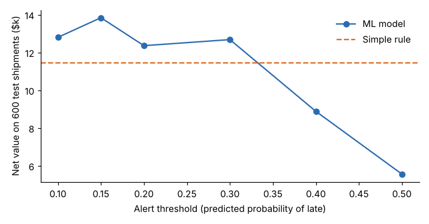

# Module 03 — Cross Functional Use Cases

Examples across operations, finance, customer service, supply chain, and knowledge repositories.

## Objectives

- Recognize where AI typically adds value in each function, and where it typically doesn't.
- Evaluate a predictive use case against a simple rule, using business value rather than accuracy.

## Use cases by function

| Function | Pain point | Fit | Notes |
|---|---|---|---|
| **Operations** | Unplanned machine stops | ML predictive maintenance | High value, but needs sensor history and failure records (data often missing) |
| | Visual inspection | Computer vision | Needs many labelled defect images and stable lighting; validate against measurement system analysis |
| | Long changeovers | **Not AI first**: SMED | AI scheduling on top of a 90-minute changeover optimizes waste |
| **Finance** | Invoice/PO matching | ML + rules | Rules handle exact matches; ML suggests likely matches for exceptions |
| | Unusual expense claims | Anomaly detection | Flags for review; never auto-reject |
| **Customer service** | Ticket triage and routing | ML classification | Needs past tickets with correct final categories |
| | Drafting replies | GenAI with human review | Agent edits and sends; measure edit rate |
| **Supply chain** | Demand forecasting | ML / statistical forecasting | Compare with a simple forecast before claiming value |
| | Late supplier deliveries | ML classification | See the worked example below |
| **Knowledge repositories** | Finding work instructions, specs, lessons learned | GenAI retrieval (RAG) | Only as good as the document library: outdated or duplicate documents give wrong answers |
| | Summarizing complaints for 8D reports | GenAI summarization | Human checks every summary against the source |

## Worked example: predicting late deliveries

`data/shipments.csv` holds 2,000 past shipments: distance, carrier, order lines, supplier score, Friday dispatch, and whether each arrived late (24.7 % did in the test set). The decision is whether to **expedite or call ahead** on a shipment.

- Intervening costs **$40**.
- A late arrival costs **$400**.
- Intervening prevents **60 %** of the lateness cost.



| Approach | Flagged | Late caught | Precision | Recall | Net value (600 test shipments) |
|---|---|---|---|---|---|
| Logistic regression, threshold 0.15 | 422 | 128 of 148 | 0.30 | 0.86 | **$13,840** |
| Simple rule: Carrier C or > 1,500 km | 314 | 100 of 148 | 0.32 | 0.68 | $11,440 |

Lessons:

- **Accuracy is the wrong yardstick.** Predicting "never late" is 75 % accurate and worth $0.
- **Choose the threshold by business value**, not by a default 0.5. At 0.5 the model's value drops to $5,560.
- **A simple rule captures most of the value** here ($11.4k of $13.8k). The model adds about 21 %. Try the rule first; use the model if its gain justifies building and maintaining it.

## Run it

```bash
python tools/aikit.py predict
```

## Check yourself

1. Why does the best threshold flag many shipments that turn out on time?
2. What must exist before you can train a ticket-routing model?

<details><summary>Answers</summary>

1. A missed late shipment costs far more ($400 × 0.6 = $240 avoidable) than an unnecessary intervention ($40), so it pays to over-flag.
2. Historical tickets with the **correct final category** recorded (labels), in enough volume for each category, and consistent category definitions (see Module 06).

</details>
