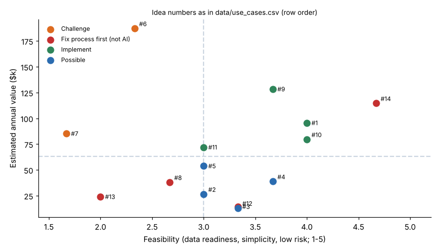

# Module 04 — AI and Lean Six Sigma Integration

Using Lean principles to prioritize the right problems, avoid waste, and drive practical implementation.

## Objectives

- Use Lean thinking to choose and scope AI work.
- Prioritize a portfolio of ideas with a PICK chart.
- Run AI pilots as small, measured improvement cycles (DMAIC / PDCA).

## Lean principles applied to AI

| Lean principle | Applied to AI |
|---|---|
| **Value from the customer's view** | Start from the problem and the customer of the process (Module 02), not the tool |
| **Map the value stream** | Map the process first. AI on a step that shouldn't exist is waste |
| **Eliminate waste before automating** | Automating waste makes it faster and harder to see |
| **Flow and pull** | Pilot where the output is used immediately; avoid "models nobody consumes" |
| **Go and see (gemba)** | Watch the work; check that the data reflects what really happens |
| **Standard work** | The AI-assisted step needs a defined method: who reviews, when to override |
| **Error-proofing (poka-yoke)** | Human-in-the-loop checks, confidence thresholds, validation rules |
| **PDCA / small experiments** | Small pilots with a baseline and a success measure; scale only what works |

## Wastes in AI initiatives

The 8 wastes, seen in AI projects:

| Waste | AI example |
|---|---|
| Overproduction | Building models or dashboards nobody asked for |
| Waiting | Waiting months for data access or approvals |
| Transport | Copying data between tools by hand for every run |
| Over-processing | A complex model where a rule would do (Module 03) |
| Inventory | A backlog of pilots that never go into production |
| Motion | Users switching between systems to use the AI output |
| Defects | Wrong predictions or answers that nobody catches |
| Unused talent | Ignoring the frontline experts who know the process and the data |

## Prioritizing: a PICK chart

Halvorsen's 14 ideas (`data/use_cases.csv`) are scored on:

- **estimated annual value** (Module 02 formula)
- **feasibility** = average of data readiness, simplicity (6 − complexity) and low risk (6 − risk), each on a 1–5 scale

Ideas with a simpler non-AI fix are marked separately.



| Category | Ideas |
|---|---|
| **Implement** (high value, feasible) | #9 demand forecasting ($128k), #1 invoice matching ($96k), #10 late-delivery prediction ($80k), #11 work-instruction search ($72k) |
| **Possible** (lower value, feasible) | #5 draft replies, #4 ticket triage, #2 expense anomalies, #12 complaint summaries |
| **Challenge** (high value, hard) | #6 predictive maintenance ($187k, feasibility 2.3), #7 visual inspection |
| **Fix process first (not AI)** | #14 quoting (rules configurator), #8 changeover (SMED), #13 applicant screening (bias and legal risk), #3 approval chasing (workflow fix) |

The thresholds are the median value ($62,900) and feasibility 3.0.

The highest-value idea, predictive maintenance, is **not** a first pilot. Its data isn't ready. The right first step is a data-collection project.

## Running AI work with DMAIC

| DMAIC phase | For an AI pilot |
|---|---|
| Define | Problem statement, customer, success measure, scope |
| Measure | Baseline the current process (time, errors, cost); assess data readiness (Module 06) |
| Analyze | Root causes. Is AI the right countermeasure? Simple rule vs model |
| Improve | Pilot with human-in-the-loop; compare with the baseline; adjust the threshold |
| Control | Standard work, monitoring (accuracy, drift, usage), owner, retraining plan |

See the [Kaizen Leader](../../../lean-six-sigma/kaizen-leader/README.md) and [Lean Methods Accelerator](../../../lean-six-sigma/lean-methods-accelerator/README.md) courses for the Lean tools.

## Run it

```bash
python tools/aikit.py portfolio
```

## Check yourself

1. Why is predictive maintenance (#6) in "Challenge" despite the highest value?
2. Compute idea #1's feasibility (readiness 4, complexity 2, risk 2).

<details><summary>Answers</summary>

1. Feasibility 2.33: data readiness 2 (little failure history), complexity 4, risk 3. Build the data foundation first.
2. (4 + (6 − 2) + (6 − 2)) / 3 = **4.0**.

</details>
