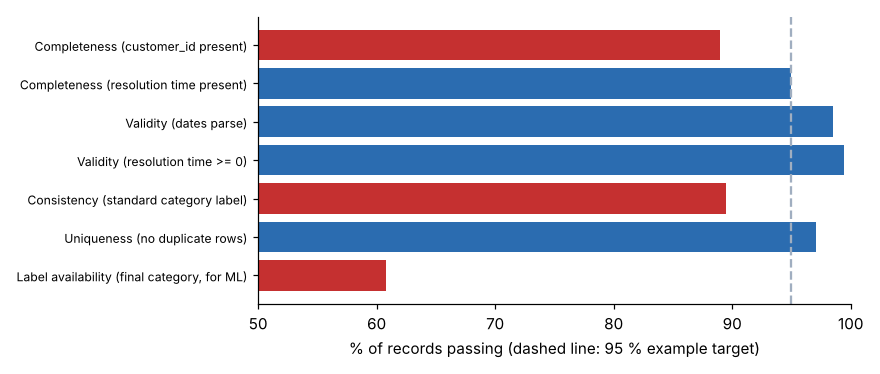

# Module 06 — Data Readiness

What data is required, how to evaluate quality and accessibility, and common pitfalls.

## Objectives

- Identify the data an AI use case needs.
- Audit data quality along standard dimensions, and assess accessibility.
- Recognize the common pitfalls before committing to a pilot.

## What data is required

| Use case type | Needs |
|---|---|
| ML prediction or classification | Historical examples **with outcomes** (labels): enough of them, covering the cases you care about, with the features known **at decision time** |
| Anomaly detection | Representative "normal" history; a way to confirm flagged cases |
| Forecasting | Consistent time series, with known events (promotions, stock-outs) |
| GenAI over documents | Current, approved, de-duplicated documents with clear ownership and access rights |
| Computer vision | Labelled images under production conditions (lighting, angles, defect types) |

## Evaluating quality

The customer-service ticket extract (`data/tickets.csv`, 618 rows) was audited for the ticket-routing idea (#4):



| Dimension | Check | Result |
|---|---|---|
| Completeness | customer_id present | **89.0 %** (68 missing) |
| Completeness | resolution time present | 95.0 % (31 missing) |
| Validity | dates parse as dates | 98.5 % (9 invalid, e.g. "2026-13-02") |
| Validity | resolution time ≥ 0 | 99.4 % (4 negative) |
| Consistency | standard category label | **89.5 %**: 11 label variants for 5 real categories ("Billing", "billing", "Invoice"…) |
| Uniqueness | no duplicate rows | 97.1 % (18 duplicates) |
| **Label availability** | final category recorded at closure | **60.8 %** (376 of 618) |

The most serious gap is **labels**. A routing model needs the *correct final category*, and 39 % of tickets never got one. Fix the **process**, by making the final category mandatory at closure, and collect a few months of clean data before training. That is a Lean countermeasure, not a data-science one.

## Accessibility

- **Where** does the data live (systems, spreadsheets, paper)? Who owns it?
- **Can we get it**, legally and technically? Consider privacy, contracts and IT security.
- **How fresh** is it? The latest ticket here is 2026-09-21. Is an export enough, or do we need a live feed?
- **Is the meaning documented?** For example, what counts as "resolved"?

## Common pitfalls

| Pitfall | Effect |
|---|---|
| Using data not available at decision time ("leakage") | Great in testing, useless in use |
| Labels defined inconsistently over time | The model learns noise |
| Training on a period that doesn't represent today (new products, new process) | Drift from day one |
| Cleaning by hand once, with no process fix | The problem returns with the next extract |
| Ignoring rare but important cases | The model misses what matters most |
| Personal or confidential data in uncontrolled tools | Privacy and security incidents |

## Run it

```bash
python tools/aikit.py readiness
```

## Check yourself

1. Why is "label availability" the deciding dimension for the routing model?
2. The data team proposes a one-off cleanup of the 11 category labels. What else is needed?

<details><summary>Answers</summary>

1. Supervised learning needs examples with the correct answer. Without the final category, those tickets can't teach the model. With only 61 % labelled, and possibly a biased subset, quality and coverage suffer.
2. A process fix so the problem doesn't return: a fixed category list (drop-down), a mandatory final category at closure, and an owner who reviews the definitions.

</details>
