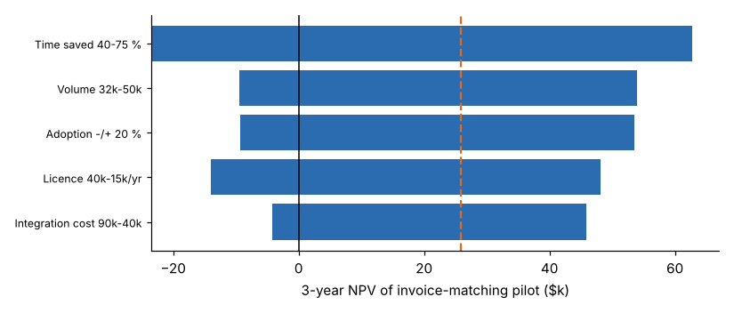

# Module 07 — From Ideas to Roadmap

Translating opportunities into a prioritized, phased roadmap with clear success measures.

## Objectives

- Build a simple business case with sensitivity for a pilot.
- Turn the prioritized portfolio into a phased roadmap.
- Define success measures and governance.

## Business case for a pilot: invoice matching (#1)

Assumptions:

- 42,000 invoices a year, 4 minutes each, 60 % time saved, $48/h, $15,000 of discounts recovered
- adoption 50 % / 85 % / 90 % over 3 years
- integration $60,000
- licence $24,000 a year and support $12,000 a year

| Year | 0 | 1 | 2 | 3 |
|---|---|---|---|---|
| Net cash flow | −$60,000 | $11,820 | $45,294 | $50,076 |

**3-year NPV at 10 % = $25,801. Payback in year 3.**



| Factor (range) | NPV low | NPV high |
|---|---|---|
| Time saved 40–75 % | −$23,475 | $62,759 |
| Volume 32k–50k | −$9,396 | $53,959 |
| Adoption −/+ 20 % | −$9,264 | $53,538 |
| Licence $40k–$15k a year | −$13,988 | $48,183 |
| Integration $90k–$40k | −$4,199 | $45,801 |

Every factor can turn the NPV negative. The case is **real but thin**. Treat time saved and adoption as the pilot's main questions: measure them in the pilot before scaling. Negotiate the licence on proven volume.

## The phased roadmap

| Phase | Ideas | Purpose |
|---|---|---|
| **Now: process fixes, no AI** | Quote configurator (rules), approval workflow, SMED for changeovers, structured applicant screening | Remove waste first; often the largest fast gains |
| **Phase 1 (0–3 months): pilots** | Demand forecasting, invoice matching, late-delivery prediction, work-instruction search (after the document cleanup and re-test, Module 05) | Prove value with baselines and success measures |
| **Phase 1–2: quick wins** | Ticket triage (after the labelling fix), draft replies, expense anomalies, complaint summaries | Low cost; build skills and trust |
| **Phase 2–3 (3–18 months): foundations** | Predictive maintenance (sensor and failure data collection), visual inspection (image library, lighting standard) | Build data and capability for the high-value, hard cases |

## Success measures

Define these for each initiative **before** starting:

| Type | Example (invoice matching) |
|---|---|
| Business outcome | Manual matching hours −60 %; lost discounts = $0 |
| Process | Exceptions resolved per day; cycle time from invoice receipt to approval |
| Model or tool quality | Suggested-match precision ≥ 95 %; override rate |
| Adoption | % of invoices processed through the tool; user satisfaction |
| Risk | Errors that reach payment = 0; audit findings |

## Governance (lightweight)

- **Portfolio owner:** keeps the PICK chart current, quarterly.
- **For each initiative:** a business owner (not IT alone), a process expert and a data owner.
- **Gates:** problem statement → data readiness → pilot results against criteria → scale decision.
- **Standards:** approved tools, data classification, human-review rules for high-risk uses.

## Run it

```bash
python tools/aikit.py roi
python tools/aikit.py roadmap
```

## Check yourself

1. Which two assumptions should the invoice pilot measure first, and why?
2. Why does the roadmap start with non-AI fixes?

<details><summary>Answers</summary>

1. Time saved and adoption. They are the largest uncertainties within the team's control to measure, and each alone can make the NPV negative.
2. They remove waste quickly and cheaply, often deliver the largest gains, and stop AI being applied to steps that shouldn't exist.

</details>
