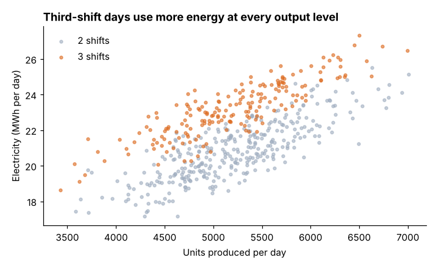
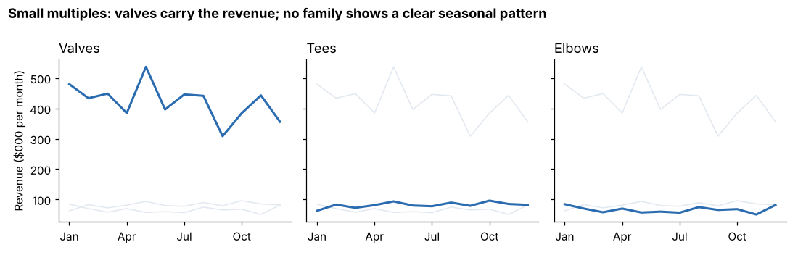

# Module 01 — Visualization and Interaction

## Objectives

- Choose a visualization strategy that matches the analytical question.
- Use encodings (position, length, color) and techniques (small multiples, highlighting) effectively.
- Design interactive dashboards that support exploration without overwhelming users.

## Two jobs for visualization

| Exploratory | Explanatory |
|---|---|
| for you, to find patterns | for others, to communicate a finding |
| many quick charts | few polished charts |
| all variables, all angles | one message per chart, stated in the title |

Both start the same way: **what question am I answering?**

## Choose the encoding

People read some visual encodings more accurately than others. From most to least accurate for quantitative comparison (a ranking based on classic perception research — see further reading):

1. position on a common scale (dot, line, scatter)
2. length (bars)
3. angle, slope
4. area
5. color intensity / hue

So: use position and length for the numbers that matter; use color to **group** or **highlight**, not to carry precise values.

## Worked examples

**Relationship between two variables + a category.** Daily electricity vs output, colored by the number of shifts:



The pattern jumps out: at any output level, three-shift days sit higher. That observation becomes the hypothesis tested with regression in Module 04.

**Comparing many series: small multiples.** Revenue by month for each product family (from the SQLite database):



Each panel highlights one family against the others in light gray; all share one scale. This beats a single chart with three colored lines and a legend, and it scales to dozens of series.

## Interaction

Interactive tools (BI dashboards, spreadsheets with slicers, notebook widgets) let users answer their own follow-up questions. Common interactions:

| Interaction | Use |
|---|---|
| Filter / slicer | focus on a region, product, time window |
| Drill-down | from plant to line to machine |
| Details on demand (tooltips) | exact values without cluttering the chart |
| Linked views | selecting a segment in one chart highlights it in all others |
| Parameter controls | what-if: change a price or a threshold and see the effect |

A long-standing design guideline for exploration is "**overview first, zoom and filter, then details on demand**."

## Dashboard design

- **Start from decisions and users**, not available data. A maintenance planner and a plant manager need different dashboards.
- **Top-left = most important** (people scan from there in left-to-right languages).
- **5–9 visuals** at most per screen; group related metrics.
- **Consistent scales, colors and definitions** across views.
- **Show comparison** (target, prior period) for every number.
- **Show data freshness** ("as of 06:00 today").
- **Performance**: a dashboard that takes 30 seconds to load won't be used.

## In a spreadsheet

Scatter with categories: create one series per category. Small multiples: build one chart, fix the axis bounds, then copy and change the data range. Slicers on a pivot table give simple interactivity.

## Run it

```bash
python tools/make_figures.py
```

## Check yourself

1. Which encoding would you use to show 12 months of OEE for 8 machines so a manager can spot the worst performer?
2. A dashboard has 22 charts and every KPI in red or green. What would you change first?

<details><summary>Answers</summary>

1. Small multiples of line charts (one per machine, same scale), or a single line chart with all machines in gray and the plant average or worst machine highlighted.
2. Cut to the few metrics tied to the users' decisions; use color only for exceptions (and not red/green alone — add symbols for color-vision deficiency); add targets and trends.

</details>
