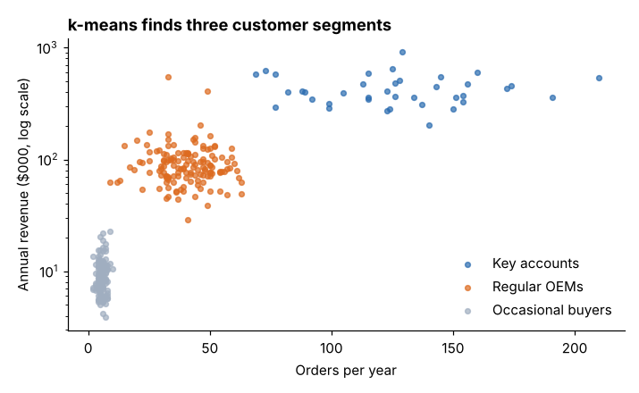
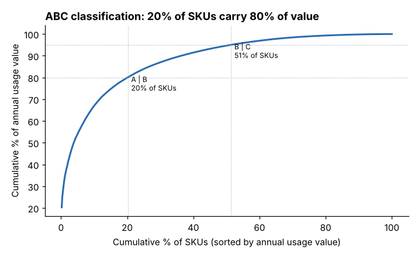
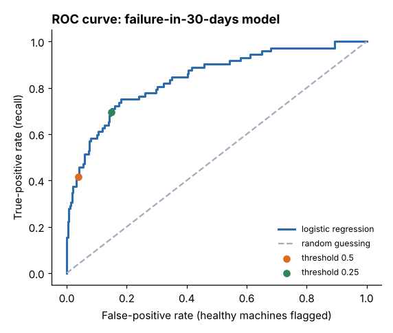

# Module 03 — Segmentation and Classification

## Objectives

- Segment customers with clustering and judge how many segments to use.
- Classify inventory with ABC analysis.
- Build a classification model to predict machine failures, and measure its accuracy correctly.

## Segmentation vs classification

| | Segmentation (clustering) | Classification |
|---|---|---|
| Learning type | unsupervised — no labels | supervised — learns from labeled examples |
| Question | what natural groups exist? | which known class does this item belong to? |
| Example | customer segments | will this machine fail in 30 days? |

## 1. Customer segmentation with k-means

**k-means** places k cluster centers and assigns each item to the nearest one, iterating until stable. Practical steps:

1. Choose features that reflect behavior: annual revenue, orders per year, return rate, days since last order.
2. **Transform skewed features** (log of revenue) and **standardize** all features — otherwise revenue in dollars swamps the rest.
3. Try several k; compare with the **silhouette score** (how well items fit their own cluster vs the next; closer to 1 is better).
4. **Profile** each cluster and name it in business terms.

Silhouette by k: 2: 0.578 · **3: 0.584** · 4: 0.522 · 5: 0.514 · 6: 0.516 → three segments.

| Segment | Customers | Median revenue | Median orders/yr | Median return rate | Median days since last order | Share of revenue |
|---|---|---|---|---|---|---|
| Key accounts | 38 | $400,250 | 126 | 1.0 % | 21 | 52.7 % |
| Regular OEMs | 142 | $84,800 | 40 | 2.1 % | 32 | 43.6 % |
| Occasional buyers | 120 | $8,600 | 6 | 4.6 % | 141 | 3.6 % |



Because the data is simulated, we can check against the hidden "true" segments: adjusted Rand index **0.983** (1 = perfect agreement). Real data is messier; clusters are a **useful simplification**, not a law of nature.

**Value:** 38 key accounts bring over half the revenue — they warrant dedicated service and stock commitments; occasional buyers (40 % of customers, 3.6 % of revenue) suit a low-touch web channel, and their high return rate deserves a look.

## 2. ABC inventory classification

Rank SKUs by **annual usage value** (units × unit cost), then classify by cumulative share: **A** = top 80 % of value, **B** = next 15 %, **C** = last 5 %.

| Class | SKUs | % of SKUs | % of value |
|---|---|---|---|
| A | 100 | 20.0 | 79.9 |
| B | 156 | 31.2 | 15.1 |
| C | 244 | 48.8 | 5.0 |



One SKU (F0332) alone is 20 % of value. **Use:** A items get frequent review, tight forecasts and supplier partnerships; C items get simple rules (two-bin kanban, bulk ordering). Combine with criticality (a $2 part that stops the line is not "C" in practice) and demand variability (XYZ analysis) for a fuller picture.

In a spreadsheet: add a value column, sort descending, add a running total with `=SUM($D$2:D2)/SUM($D:$D)`, and an `IF` for the class.

## 3. Classifying machines: will it fail in 30 days?

`machine_health.csv`: 1,200 snapshots with age, vibration, bearing temperature, motor current, hours/day and whether the machine failed within 30 days (20.1 % did).

**Split** into training (70 %) and test (30 %) data; judge the model only on the test set.

**Logistic regression** (standardized inputs): AUC **0.843**. Standardized coefficients: vibration 1.12, bearing temperature 0.46, age 0.34, hours/day 0.27, motor current −0.04 (no real effect).

### Measures of accuracy

| | Threshold 0.5 | Threshold 0.25 |
|---|---|---|
| True positives (failures caught) | 30 | 50 |
| False positives (healthy machines flagged) | 11 | 43 |
| False negatives (failures missed) | 42 | 22 |
| True negatives | 277 | 245 |
| Accuracy | 85.3 % | 81.9 % |
| Precision (flagged that really fail) | 73.2 % | 53.8 % |
| Recall (failures caught) | 41.7 % | 69.4 % |

A model that always says "won't fail" scores **80.0 %** accuracy and catches nothing. **Accuracy alone is misleading when classes are unbalanced.** Use the confusion matrix, precision, recall and AUC (area under the ROC curve: 0.5 = guessing, 1 = perfect).



**Pick the threshold with costs.** If a missed failure costs $8,000 and an inspection $300 (illustrative):

- threshold 0.5: 42 × 8,000 + 41 × 300 = **$348,300**
- threshold 0.25: 22 × 8,000 + 93 × 300 = **$203,900**

The lower threshold is far cheaper even though its accuracy is lower.

A depth-3 **decision tree** reaches AUC 0.812 — slightly lower, but its rules ("vibration > x and age > y") are easy to explain. Interpretability often matters as much as a few points of AUC.

## Run it

```bash
python tools/anlkit.py segment
python tools/anlkit.py abc
python tools/anlkit.py classify
```

## Check yourself

1. Why standardize features before k-means?
2. Compute precision and recall for threshold 0.25 from the counts.
3. Would you use this model to decide which machines to skip PM on? Why or why not?

<details><summary>Answers</summary>

1. k-means uses distances; unscaled, the feature with the biggest numbers (revenue) dominates and the others are ignored.
2. Precision = 50 / (50 + 43) = 53.8 %; recall = 50 / (50 + 22) = 69.4 %.
3. Not on its own — it still misses 30 % of failures at 0.25. Use it to prioritize inspections, not to remove protection; monitor its performance over time.

</details>
