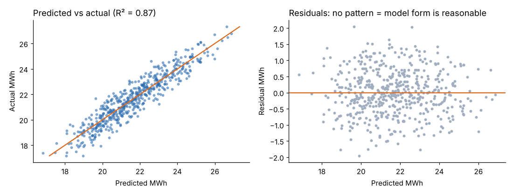

# Module 04 — Regression Techniques and a Case Study

## Objectives

- Fit simple and multiple linear regression and interpret coefficients.
- Check model fit with R², residual plots and prediction intervals.
- Work a full case study from question to decision.

## Regression in brief

Linear regression models a response as a weighted sum of predictors:

y = b₀ + b₁x₁ + b₂x₂ + … + error

- **Coefficient bᵢ**: change in y for a one-unit change in xᵢ, holding the other predictors constant.
- **R²**: share of the variation in y explained by the model; **adjusted R²** penalizes extra predictors.
- **Residual SD**: typical size of prediction error.
- **Prediction interval**: range for a single new observation — wider than the confidence interval for the mean.

Predictors can be continuous, **indicator (dummy)** variables (third shift = 1/0), or transformed features (distance from a comfortable temperature).

## Case study: what drives Ridgeway's electricity use?

**Business question.** The energy bill rose. Operations wants to know what drives daily consumption so it can (1) set a fair energy budget that flexes with output and (2) decide whether running a third shift is worth the energy cost.

**Data.** 522 workdays (`plant_energy.csv`): units produced, number of shifts, outdoor temperature, kWh.

**Exploration.** The scatter in Module 01 showed kWh rising with output and three-shift days sitting higher. Heating and cooling suggest a V-shaped effect of outdoor temperature around a comfortable point, so we create **temp_dev = |outdoor temp − 15 °C|**.

**Simple model** (units only): kWh = … + 2.056 × units; R² **0.45**; residual SD 1,456 kWh. Output explains less than half the variation.

**Multiple model:**

| Term | Coefficient | Meaning |
|---|---|---|
| Intercept | 8,908 kWh | base load (lighting, compressors, HVAC, idle machines) |
| units_produced | 2.12 kWh per unit | marginal energy per unit |
| third_shift | 2,362 kWh | extra per three-shift day |
| temp_dev | 89.05 kWh per °C | heating/cooling load |

All p-values are far below 0.001. R² **0.873** (adjusted 0.872); residual SD **702 kWh**.



Residuals show no curve or funnel, so the linear form is reasonable.

**Prediction.** A three-shift day producing 6,000 units, 20 °C away from 15 °C (a hot or cold day):

- predicted **25,769 kWh**; 95 % prediction interval **24,381 to 27,157 kWh**.

**Decisions supported:**

1. **Flexible energy budget**: budget = 8,908 + 2.12 × units + 2,362 × (third-shift days) + 89 × temp_dev — the variance report now separates "we made more parts" from "we used energy badly."
2. **Third-shift economics**: about 2,360 kWh a day of extra fixed load. At an illustrative $0.11/kWh, about $260 a day — compare with the margin on the extra output.
3. **Base load is 8,900 kWh/day** — about 41 % of an average day. An off-hours walkthrough (compressed-air leaks, idle equipment) is the next action.

## Cautions

- **Correlation is not causation.** Regression on observational data shows association; process knowledge and, ideally, experiments confirm cause.
- **Don't extrapolate** beyond the data range (e.g. 9,000 units/day).
- **Multicollinearity**: when predictors are strongly correlated, coefficients become unstable (Module 05 shows one remedy).
- **Validate** on data not used to fit the model, especially with many predictors.

## In a spreadsheet

Use the Analysis ToolPak's Regression tool (or `LINEST`) with columns for units, a 0/1 third-shift column and `=ABS(temp−15)`.

## Run it

```bash
python tools/anlkit.py regress
```

## Check yourself

1. Interpret the 2.12 coefficient in plain language.
2. Why use |temp − 15| rather than temperature itself?
3. The prediction interval is ±1,390 kWh, but the residual SD is 702. Why the factor of about 2?

<details><summary>Answers</summary>

1. Each additional unit produced adds about 2.1 kWh of electricity, other things equal.
2. Both cold days (heating) and hot days (cooling) raise consumption; a straight line in temperature would cancel the two effects.
3. A 95 % interval spans about ±1.96 standard deviations of prediction error (plus a small allowance for coefficient uncertainty).

</details>
