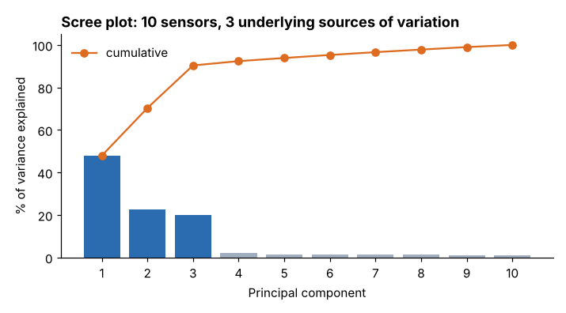
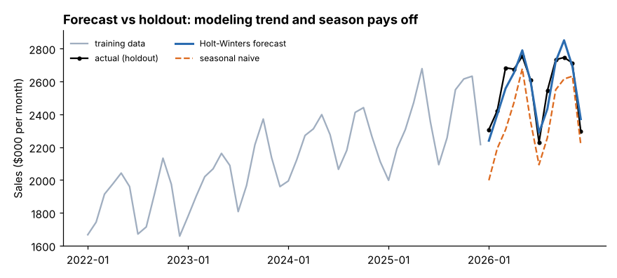

# Module 05 — Predictive Analytics: Principal Components and Forecasting

## Objectives

- Use principal component analysis (PCA) to compress many correlated variables.
- Use principal components for prediction and know the pitfalls.
- Build, test and compare forecasting methods for a seasonal time series.

## 1. Principal component analysis

When many sensors move together, they carry overlapping information. PCA finds new variables — **principal components (PCs)** — that are uncorrelated combinations of the originals, ordered by how much variation they explain.

Steps: standardize the variables, compute PCs, look at the **scree plot** (variance per PC), interpret the **loadings** (weights of each original variable).

**Ridgeway coating line**: 400 batches, 10 process sensors, plus yield (`process_batches.csv`). Ten sensor pairs have |correlation| > 0.7.

| PC | % of variance | Cumulative |
|---|---|---|
| 1 | 47.9 | 47.9 |
| 2 | 22.4 | 70.3 |
| 3 | 20.0 | 90.4 |
| 4 | 2.0 | 92.4 |



Three PCs capture 90 % of the variation of ten sensors — the process has about **three underlying sources of variation**. Loadings help name them: PC2 contrasts the zone temperatures (positive) with speed/tension/feed and humidity/dryer variables (negative); PC3 contrasts the humidity–dryer–coolant group with the speed–tension group.

## 2. Using PCs for prediction (principal component regression)

Regressing yield on PCs avoids the unstable coefficients caused by correlated predictors. Cross-validated R² (5-fold) by number of PCs used:

| PCs | 1 | 2 | 3 | 5 | 10 (all) |
|---|---|---|---|---|---|
| CV R² | 0.035 | 0.556 | **0.827** | 0.827 | 0.824 |

Two lessons:

- **The first PC explained 48 % of sensor variation but almost none of the yield** (R² 0.035). PCA ranks components by variance in X, not by relevance to y — check predictive value, don't assume it.
- **Three PCs predict as well as all ten sensors** — a simpler, more stable model for monitoring (and the basis of multivariate SPC).

## 3. Forecasting

**Monthly sales**, Jan 2022 – Dec 2026 (company-wide, `monthly_sales.csv`), show a rising trend and a repeating seasonal pattern (dips in July and December).

**Method.** Fit on the first 48 months; forecast the last 12 (the **holdout**); compare with the mean absolute percentage error, **MAPE** = average |actual − forecast| / actual.

| Method | Idea | MAPE |
|---|---|---|
| Naive | next month = last month | 12.93 % |
| Seasonal naive | next month = same month last year | 7.69 % |
| 3-month moving average | average of last 3 months | 7.33 % |
| Simple exponential smoothing | weighted average, recent months weigh more | 12.93 % |
| **Holt-Winters** | exponential smoothing with trend and seasonality | **2.21 %** |



Simple exponential smoothing ends up identical to the naive forecast here: with a strong trend, its best weight is nearly all on the last month. **Match the method to the pattern**: trend and seasonality need a model that includes them.

Refitting Holt-Winters on all 60 months gives the next three months: **$2,417k, $2,573k, $2,772k**.

Good practice:

- Always compare against a **naive benchmark**.
- Use a **holdout** (or rolling-origin) test — in-sample fit flatters every model.
- Report a **range**, not just a point; forecast error grows with the horizon.
- Re-forecast regularly and track accuracy.

## In a spreadsheet

PCA is impractical in a basic spreadsheet; use a free tool (Python, R). For forecasting, recent spreadsheet versions include an exponential-smoothing forecast function and a "forecast sheet" feature (check your version); moving averages are simple formulas.

## Run it

```bash
python tools/anlkit.py pca
python tools/anlkit.py forecast
```

## Check yourself

1. Why standardize before PCA?
2. A forecast has MAPE 9 % and the seasonal naive has 7 %. What do you conclude?
3. Why is in-sample fit a poor guide to forecast accuracy?

<details><summary>Answers</summary>

1. Otherwise variables with large units (e.g. power in kW vs. a ratio) dominate the components purely because of scale.
2. The model is worse than a trivial benchmark — don't use it; find out what it's missing.
3. A model can fit past noise (overfit); only performance on data it hasn't seen shows how it will forecast.

</details>
