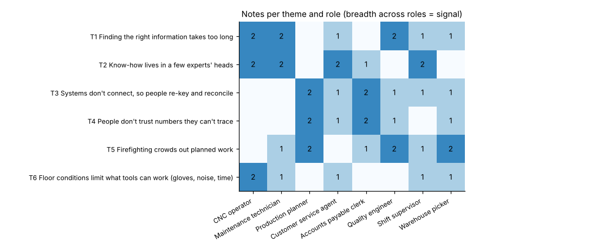

# Module 03 — From Insights to Themes

Using divergent and convergent thinking to identify patterns across user needs, pain points and goals.

## Objectives

- Synthesize interview notes into themes by affinity grouping.
- Use divergent then convergent thinking deliberately.
- Weigh themes by breadth across roles, not by how loudly they were stated.

## Divergent then convergent

| Divergent (open up) | Convergent (narrow down) |
|---|---|
| Put every observation on the wall, one per note | Group notes that share an underlying need |
| No judging; add more notes as you remember them | Name each group as a statement in the user's terms |
| Look for surprises and contradictions | Check that each theme is supported by several people |

Separate the two modes in time. Mixing them kills ideas too early, or never reaches a decision.

## Affinity grouping

1. Read the notes aloud; place similar ones together **in silence**.
2. Move notes freely; split groups that get too large.
3. **Name each group as a theme**, a short sentence such as "Know-how lives in a few experts' heads", not a category label like "knowledge".
4. Check: is each theme supported by several people and roles? Are workarounds explained by a theme?

## Halvorsen's six themes



| Theme | Notes | Roles | Workarounds |
|---|---|---|---|
| T1 Finding the right information takes too long | 9 | 6 of 8 | 0 |
| T5 Firefighting crowds out planned work | 9 | 6 | 0 |
| T3 Systems don't connect, so people re-key and reconcile | 8 | 6 | 3 |
| T2 Know-how lives in a few experts' heads | 9 | 5 | **4** |
| T4 People don't trust numbers they can't trace | 7 | 5 | 1 |
| T6 Floor conditions limit what tools can work | 6 | 5 | 0 |

- **Breadth across roles** is a stronger signal than note count.
- **Workarounds** show where people already invest effort. T2 has the most, which makes it a strong signal of unmet need.
- T6 is a **constraint**, not a problem to solve: it shapes every solution.

## Can AI do the grouping for us?

A word-based clustering of the same 48 notes (TF-IDF and k-means, 6 clusters) barely matches the human themes: **adjusted Rand index 0.02** (1 = perfect, 0 = chance) and purity 0.35. Notes about the same need use different words ("notebook of offsets", "texts photos to a retired colleague"), and notes with similar words can mean different things.

Machines can help sort large volumes of text, but **humans must judge meaning**. Treat machine groupings as a first draft at most, and check them against the notes.

## Run it

```bash
python tools/hcdkit.py themes
python tools/hcdkit.py machine_clusters
```

## Check yourself

1. Why name a theme as a sentence rather than a label?
2. Which theme would you weight most heavily from the table, and why?

<details><summary>Answers</summary>

1. A sentence carries the user's need and its tension ("…lives in a few experts' heads"). A label ("knowledge") is too vague to frame an opportunity.
2. T1 or T2 are both defensible. T1 has the widest spread across roles (6 of 8). T2 has the most workarounds (4), showing people already working hard around the problem. Breadth plus workarounds are better signals than raw note count.

</details>
