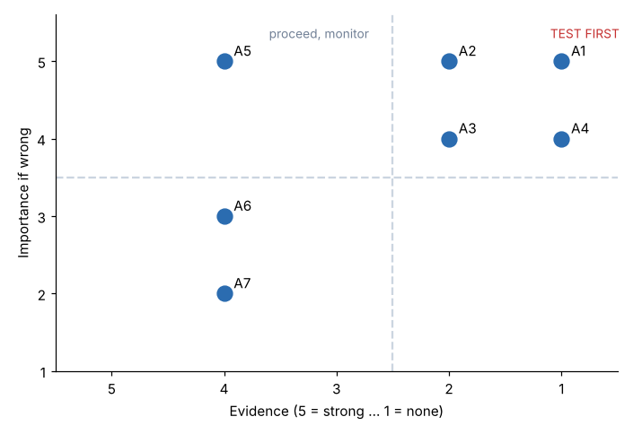
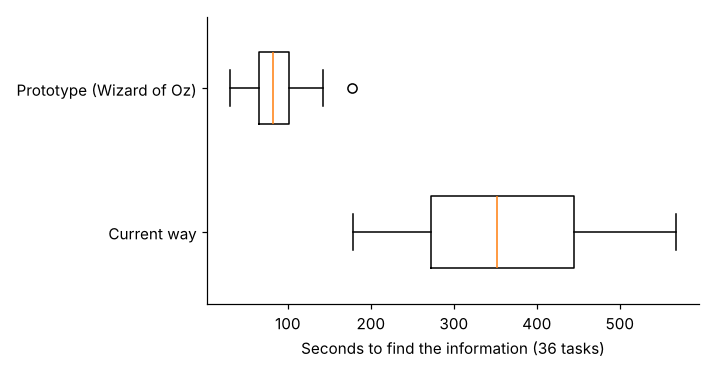

# Module 05 — Bridge to Design Sprints and Prototyping

How framed opportunities become inputs to design sprints, rapid experimentation and early AI concept testing.

## Objectives

- Turn a framed opportunity into a design sprint brief.
- Map assumptions and choose the riskiest ones to test first.
- Pick quick prototypes that learn fast and de-risk assumptions, and read the results.

## From opportunity to sprint brief

A **design sprint** is a short, time-boxed process (often described as five days: understand, sketch, decide, prototype, test with users). The opportunity statement and the research become its inputs:

| Sprint brief field | Halvorsen O1 |
|---|---|
| Opportunity (HMW) | Help technicians get the right information for this job, at the machine, in seconds |
| Users | CNC operators, maintenance technicians (both shifts) |
| Insights | 6 of 8 roles lose time finding information; experts are bottlenecks; gloves and noise; trust needs sources |
| Constraints | Gloves, noise, small screens, no training time during shifts |
| Success looks like | Answer found in under 2 minutes, at the machine, with its source shown; used daily |
| Riskiest assumptions | See below |

`templates/sprint-brief.md`

## Assumption mapping

List what must be true for the idea to work. Rate each assumption's **importance** (how bad it would be if wrong) and **evidence** (how much we already know):



| ID | Assumption | Importance | Evidence | Quadrant |
|---|---|---|---|---|
| A1 | Technicians will use a question-answering tool at the machine during a job | 5 | 1 | **Test first** |
| A2 | Answers can come from current, approved work instructions and repair records | 5 | 2 | **Test first** |
| A4 | Experts will review and correct answers in the first months | 4 | 1 | **Test first** |
| A3 | A rugged tablet can be used with gloves | 4 | 2 | **Test first** |
| A5 | Faster information access cuts setup and repair time | 5 | 4 | Proceed, monitor |
| A6 | IT can connect the document and maintenance systems | 3 | 4 | Ignore for now |
| A7 | Supervisors allow a 20-minute introduction | 2 | 4 | Ignore for now |

## Rapid prototyping

**Test the riskiest assumptions with the cheapest prototype that can answer them**, before building any AI:

| Prototype type | What it is | Tests |
|---|---|---|
| **Wizard of Oz** | Users interact with what looks like the tool, but a person produces the answers | Will they use it, and is the interaction right? (A1) |
| **Concierge** | A person delivers the service manually, openly | Is the value real? |
| **Paper or cardboard mock-up** | Sketches and physical mock-ups in the real environment | Gloves, screen size, placement (A3) |
| **Data audit** | Check whether the needed content actually exists | Can answers come from approved sources? (A2) |
| **Fake door** | A button or poster that measures interest before the feature exists | Demand |

### Wizard-of-Oz result (A1)

Twelve technicians did three information-lookup tasks each, the current way and with a tablet "assistant" answered live by an engineer from the documents (`data/wizard_of_oz_test.csv`):



| Measure | Current way | Prototype |
|---|---|---|
| Median time | 352 s | **82 s** |
| Typical time ratio (geometric mean) | | **0.24** (about 76 % faster), paired p ≈ 3 × 10⁻¹⁹ |
| Task success | 91.7 % | 91.7 % |

Survey of the 12 technicians (`data/prototype_survey.csv`):

- **5 of 12** would use it daily (rated 4–5)
- **6 of 12** trust the answers (rated 4–5)
- **12 of 12** want the **source shown** with every answer

**What we learned:**

- The speed gain is large.
- Adoption is **not** yet assured. Trust is the gap.
- The next prototype iteration shows the source passage and revision with every answer (as T4 predicted).
- Test the experts' review loop (A4) before any build.

All of this was learned without writing AI code.

## Run it

```bash
python tools/hcdkit.py assumptions
python tools/hcdkit.py prototype
```

## Check yourself

1. Why test A1 with a Wizard-of-Oz prototype rather than building the AI first?
2. The prototype was 76 % faster, but only 5 of 12 would use it daily. What do you do next?

<details><summary>Answers</summary>

1. It tests the riskiest assumption (will technicians use it at the machine?) in days, at almost no cost, and the result would be the same whatever AI was behind it. If they won't use it, building the AI is waste.
2. Investigate why: ask the 7 who wouldn't. The survey points to trust: everyone wants sources shown. Iterate the prototype (show the source and revision, expert-verified answers) and re-test adoption and trust before building.

</details>
