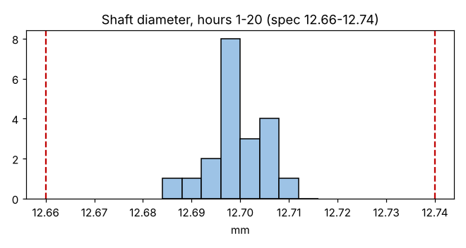

# Module 2 — Distributions & Histograms

**Time:** 45 min · **Data:** `data/shaft_diameter.csv`

## Learning objectives

1. Build a histogram and choose a sensible bin width.
2. Describe a distribution by center, spread and shape.
3. Use the normal distribution as a reference model — and know its limits.

## 1. What a histogram shows

A histogram groups values into bins and shows how often each bin occurs — the **relative frequency** of observations in each category. It answers: *where is the process centered, how wide is it, and what shape does it have?* It does **not** show time order, so it cannot tell you whether the process was stable while the data were collected. Always pair a histogram with a time-ordered chart.

## 2. Building one by hand

1. Find min and max. Shaft diameter, hours 1–20: min 12.6848, max 12.7112.
2. Pick a bin count. A starting point is √n (√20 ≈ 4.5) or Sturges' rule 1 + log₂(n) ≈ 5.3. Use 5–20 bins; adjust so bin edges fall on round numbers.
3. Bin width = range / bins ≈ 0.0264 / 6 ≈ 0.004 mm.
4. Count values per bin; draw bars that touch (the scale is continuous).
5. Add the specification limits (12.66 and 12.74) as vertical lines.

**Read it:** centered near 12.70, all values inside a spread of about 0.026 mm, far inside the 0.08 mm tolerance. Shape is roughly mound-shaped; with 20 points you cannot say more.

## 3. Describing shape

| Shape | Common cause in manufacturing |
|---|---|
| Symmetric, single peak | Many small independent sources of variation |
| Skewed right | Physical lower bound at zero (roughness, runout, flatness, cycle time) |
| Two peaks (bimodal) | Two machines, cavities, shifts or material lots mixed — stratify! |
| Flat-topped | Drifting mean (tool wear) mixed over time |
| Cliff edge / truncated | Parts sorted out at a spec limit |
| Spike at one value | Rounding, or values "adjusted" to just pass |

## 4. The normal distribution as a reference

The normal (Gaussian) curve is defined by its mean μ and standard deviation σ. For a normal distribution:

| Interval | Share of values |
|---|---|
| μ ± 1σ | ≈ 68.3% |
| μ ± 2σ | ≈ 95.4% |
| μ ± 3σ | ≈ 99.73% |

Useful, but be careful:

- **Process behavior charts do not require normality.** Shewhart chose three-sigma limits because they work well across a wide range of distribution shapes; for most mound-shaped or skewed distributions, 98–100% of values fall within ±3σ (Wheeler, *Normality and the Process Behavior Chart*, 2000). Module 13 covers this.
- **Capability estimates (ppm out of spec) *do* depend on the tail shape.** That is where normality, or a better model, matters.

## Exercise 2.1

Run `python tools/spc.py xmr data/roughness_ra.csv value` and build a histogram of `data/roughness_ra.csv` (spreadsheet or Python). Describe its center, spread and shape. What physical reason could explain the shape?

## Check yourself

1. Why can't a histogram alone tell you if a process is stable?
2. A histogram of hole diameters has two peaks. What should you do next?
3. True or false: you must prove data are normal before plotting a process behavior chart.

Answers

1. It discards time order; a drifting process and a stable one can produce the same histogram.
2. Stratify by likely sources (machine, spindle, cavity, shift) and plot each separately.
3. False.

