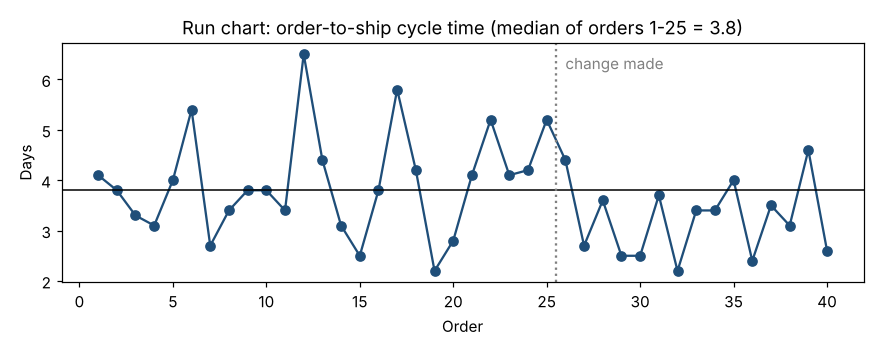

# Module 4 — Run (Trend) Charts

**Time:** 40 min · **Data:** `data/cycle_time.csv`

## Learning objectives

1. Plot data in time order with a median line.
2. Apply simple run rules to detect non-random patterns.
3. Use a run chart to evaluate a before/after change.

## 1. What a run chart is

A run chart (trend chart) is a line plot of a metric in time order with a center line, usually the **median**. It requires no calculation of sigma and works for any kind of data. It is the right first chart when you have fewer than ~15–20 points or are just starting to look at a process.



## 2. Run rules

A **run** is a sequence of consecutive points on the same side of the median (points exactly on the median are skipped — they neither break nor extend a run).

| Pattern | Typical rule | Meaning |
|---|---|---|
| **Shift** | A long run on one side of the median | The center has moved |
| **Trend** | 6 or more points continuously increasing or decreasing | Gradual drift (tool wear, learning, fatigue) |
| **Too few / too many runs** | Number of runs outside the expected range for n points | Mixing (too many) or clustering (too few) |
| **Astronomical point** | One point obviously different | Investigate |

Conventions for the shift length vary between 6 and 9 points; healthcare improvement literature commonly uses 6, many SPC references use 8. Pick one before you look at the data and use it consistently. This course uses **8**, matching Detection Rule 4 in Module 7.

## 3. Worked example: did the change help?

Order-to-ship cycle time (days), 40 orders. A process change was made after order 25.

- Median of orders 1–25 = **3.8 days**.
- Sign of each order relative to 3.8 (`+` above, `−` below, `0` on):

```
orders  1-20:  + 0 - - + + - - 0 0 - + + - - 0 + + - -
orders 21-40:  + + + + + + - - - - - - - - + - - - + -
```

- Orders 27–34 are **8 consecutive points below** the baseline median → a shift signal.
- Median of orders 26–40 = 3.4 days.

**Conclusion:** the data support a real reduction in cycle time after the change. Note what the run chart does *not* tell you: how much routine variation remains (orders still range from about 2 to 5 days). For that you need limits — Module 5.

Also note orders 21–26: six points above the median. Under a 6-point rule this would be a signal too. That is why you choose the rule in advance.

## 4. Good practice

- Label the axes and annotate changes on the chart.
- Use the baseline median to judge a change; don't recompute the median with post-change data mixed in.
- Don't connect points across a known break (new gauge, new product) without marking it.

## Exercise 4.1

Make a run chart of `data/fill_weight.csv` (ignore the `head` column). Count the runs. Are there too many runs? What could cause alternating up/down patterns? (Hint: Module 11.)

<details><summary>Answer</summary>

The values alternate high/low almost every point — far more runs than expected for random data. The samples alternate between two filler heads with different averages.
</details>

## Check yourself

1. Which center line does a run chart normally use, and why?
2. A point falls exactly on the median. Does it break a run?

<details><summary>Answers</summary>

1. The median — robust to outliers and makes the run rules distribution-free.
2. No; skip it.
</details>
