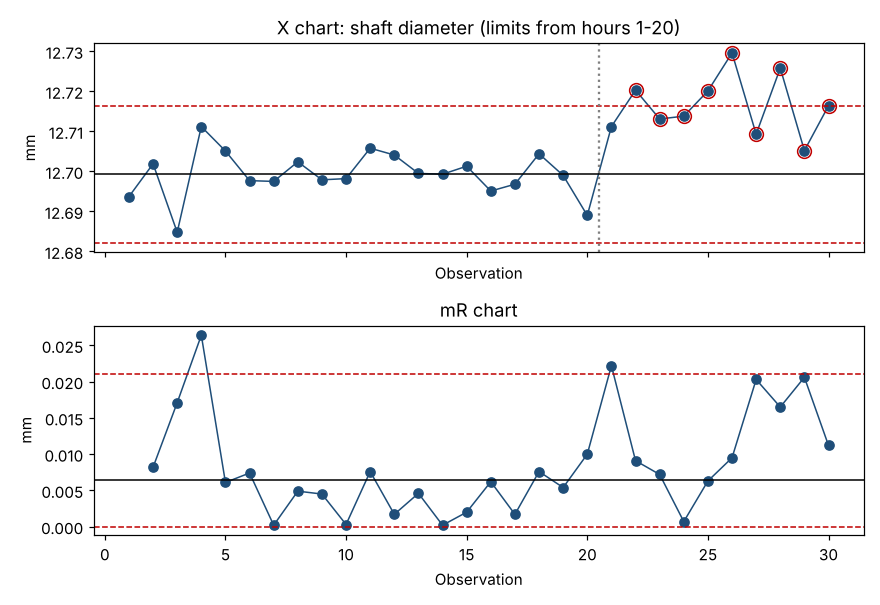

# Module 6 — The XmR Chart (Individuals & Moving Range)

**Time:** 60 min · **Data:** `data/shaft_diameter.csv`

## Learning objectives

1. Compute XmR limits by hand and with the toolkit.
2. Interpret both the X chart and the mR chart.
3. Extend frozen limits to new data and detect a shift.

## 1. When to use it

The XmR chart is the most versatile chart: one value per time period, any kind of measurement — dimensions, cycle times, daily totals, monthly KPIs, even counts. Wheeler calls it the "Swiss army knife" of charts. Use it whenever measurements are expensive, infrequent, or naturally one-at-a-time.

## 2. Formulas

For k individual values x₁…x_k:

| | Formula | Note |
|---|---|---|
| Moving ranges | mRᵢ = \|xᵢ − xᵢ₋₁\| | k − 1 of them |
| Center line (X) | X̄ = average of x | |
| Natural process limits | X̄ ± **2.66** · mR̄ | 2.66 = 3 / 1.128 |
| Center line (mR) | mR̄ | |
| Upper range limit | **3.268** · mR̄ | D₄ for n = 2; no lower limit |

The center line may use the median and the median moving range (with scaling factors 3.145 and 3.865) when the baseline contains a few extreme values; this course uses averages.

## 3. Worked example — baseline (hours 1–20)

Shaft diameter, spec 12.70 ± 0.04 mm, one part per hour.

First moving ranges: |12.7019 − 12.6937| = 0.0082, then 0.0171, 0.0264, 0.0061, 0.0074, …

| Statistic | Value (mm) |
|---|---|
| X̄ | 12.6992 |
| mR̄ (19 ranges) | 0.006426 |
| σ̂ = mR̄ / 1.128 | 0.00570 |
| UNPL = 12.6992 + 2.66 × 0.006426 | **12.7163** |
| LNPL = 12.6992 − 2.66 × 0.006426 | **12.6821** |
| URL (mR) = 3.268 × 0.006426 | **0.0210** |

```bash
python tools/spc.py xmr data/shaft_diameter.csv value --first 20
```

**Interpretation:** no X value is outside the limits and no runs signal. The mR chart has one range above the URL: the jump from hour 3 to hour 4 (0.0264). That is a signal of a sudden change between consecutive parts. Investigate (was hour 4's part measured differently? a different bar of material?). If no cause is found, it is reasonable to keep the baseline as-is — but log it.

## 4. Extending the limits (hours 21–30)

Freeze the baseline limits and plot new data.



| Hour | Value | Beyond UNPL 12.7163? |
|---|---|---|
| 21 | 12.7112 | no |
| 22 | 12.7203 | **yes** |
| 23 | 12.7131 | no |
| 24 | 12.7138 | no |
| 25 | 12.7201 | **yes** |
| 26 | 12.7296 | **yes** |
| 27 | 12.7093 | no |
| 28 | 12.7258 | **yes** |
| 29 | 12.7052 | no |
| 30 | 12.7164 | **yes** (by 0.0001) |

Five points beyond the upper limit, and every point from 21 onward is above the center line. The mR chart also flags hour 21 (range 0.0222 > 0.0210) — the moment of the jump.

**Conclusion:** the process mean shifted upward at about hour 21 by roughly 0.015 mm. Parts are still inside spec (max 12.7296 < 12.74), but the process is no longer predictable — and the shift has used up much of the margin. Find the cause now, while it's cheap.

## 5. Common pitfalls

- **Computing limits from all 30 points.** That gives UNPL 12.7275, inflated by the shift, and only one point (26) falls outside. Baseline first, then extend.
- **Using the standard deviation of all the data instead of mR̄.** Overall s = 0.0104 → limits about 80% wider than the correct ones. The shift almost disappears.
- **Ignoring the mR chart.** It catches sudden jumps the X chart can miss.

## Exercise 6.1

Build an XmR chart for `data/cycle_time.csv`, orders 1–25 as baseline, then extend to 26–40. Which detection rules (Module 7) fire after the change?

## Check yourself

1. mR̄ = 0.50, X̄ = 20.0. Compute the natural process limits and the URL.
2. Why is 2.66 used rather than 3?

<details><summary>Answers</summary>

1. 20.0 ± 2.66 × 0.50 = 18.67 to 21.33; URL = 3.268 × 0.50 = 1.634.
2. 2.66 = 3/1.128; it converts mR̄ to σ̂ and multiplies by 3 in one step.
</details>
