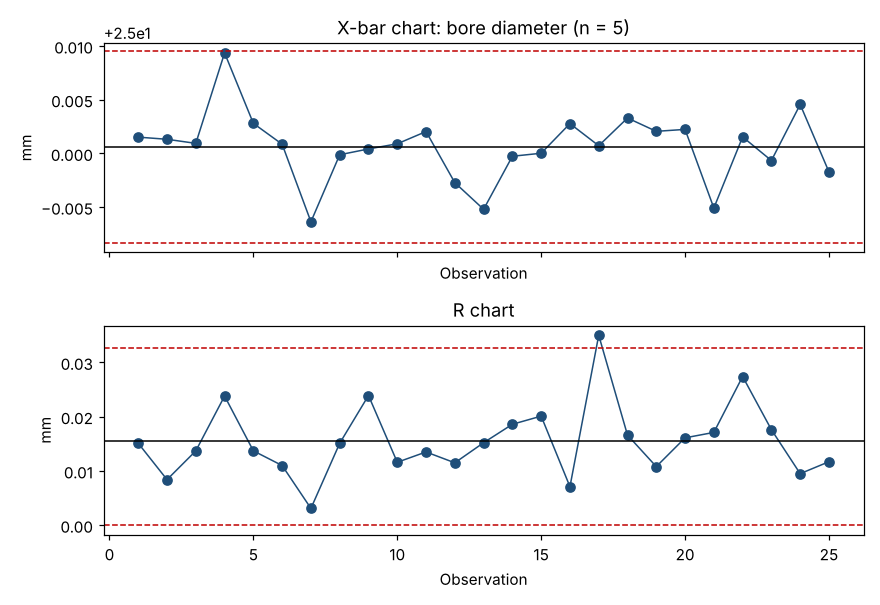

# Module 8 — Rational Subgrouping & the X̄–R Chart

**Time:** 60 min · **Data:** `data/bore_subgroups.csv`

## Learning objectives

1. Develop a sub-grouping strategy for a process.
2. Compute and interpret X̄ and R chart limits.
3. Recognize subgrouping mistakes from the chart's appearance.

## 1. Rational subgrouping

A **subgroup** is a small set of measurements (typically 2–6) taken under essentially the same conditions. Shewhart's rule: organize data so that **variation within subgroups is only routine (common-cause) variation**, and any special causes show up **between** subgroups.

The R chart measures within-subgroup variation; it sets the width of the X̄ limits. The X̄ chart then asks: *do the subgroup averages vary more than the within-subgroup noise predicts?*

### Designing subgroups — ask three questions

1. **What sources of variation do I want to detect?** (shift change, tool change, material lot, warm-up)
2. **Which sources should be inside a subgroup?** Only short-term noise. Example: 5 consecutive parts from one spindle.
3. **How often?** Often enough to catch changes before they're expensive: e.g., every 2 hours, every setup, every lot.

### Good and bad subgroups

| Situation | Subgroup choice | Verdict |
|---|---|---|
| 1 spindle, 5 consecutive parts every 2 h | Consecutive parts | ✅ Rational |
| 4-cavity mold, one part from each cavity per shot | Cavities mixed in one subgroup | ❌ Cavity differences inflate R, X̄ limits get too wide → chart hugs the center line |
| 5 parts pulled at random from a shift's bin | Spans the whole shift | ❌ Drifts within the shift inflate R |
| One lab test per batch | Subgroup of 1 | Use XmR instead |

**Diagnostic:** if almost all X̄ points crowd the center line (rarely leaving Zone C), suspect that the subgroups mix sources — the limits are too wide.

## 2. Formulas (subgroup size n, k subgroups)

| Chart | Center | Limits |
|---|---|---|
| X̄ | X̿ = average of subgroup averages | X̿ ± A₂R̄ |
| R | R̄ = average of subgroup ranges | LCL = D₃R̄, UCL = D₄R̄ |

| n | A₂ | D₃ | D₄ | d₂ |
|---|---|---|---|---|
| 2 | 1.880 | 0 | 3.267 | 1.128 |
| 3 | 1.023 | 0 | 2.574 | 1.693 |
| 4 | 0.729 | 0 | 2.282 | 2.059 |
| 5 | 0.577 | 0 | 2.114 | 2.326 |
| 6 | 0.483 | 0 | 2.004 | 2.534 |
| 7 | 0.419 | 0.076 | 1.924 | 2.704 |
| 8 | 0.373 | 0.136 | 1.864 | 2.847 |
| 9 | 0.337 | 0.184 | 1.816 | 2.970 |
| 10 | 0.308 | 0.223 | 1.777 | 3.078 |

(A₂ = 3/(d₂√n). Values verified by `tools/check_constants.py`.)

Use X̄–R for n ≤ ~10. For larger subgroups use X̄–S (Module 14).

## 3. Worked example — bore diameter

25 subgroups of 5 consecutive parts, every 2 hours.

```bash
python tools/spc.py xbar data/bore_subgroups.csv
```

| Statistic | Value (mm) |
|---|---|
| X̿ | 25.0006 |
| R̄ | 0.0155 |
| X̄ UCL = 25.0006 + 0.577 × 0.0155 | 25.0095 |
| X̄ LCL | 24.9917 |
| R UCL = 2.114 × 0.0155 | 0.0327 |
| R LCL | 0 |
| σ̂ within = R̄ / 2.326 | 0.0067 |



**Interpretation:**

- **R chart:** subgroup 17 has R = 0.0350 > 0.0327. Within that subgroup, values were 24.9901, 24.9928, 24.9857, 25.0143, 25.0207 — the last two parts jumped by about 0.03 mm. Something happened *during* that subgroup (in this data set: a chipped tool).
- **X̄ chart:** no signals. Subgroup 17's average (25.0007) looks perfectly normal because the high and low parts cancel out. **This is why you always read the R chart first** — if the R chart isn't stable, X̄ limits (which are built from R̄) are not trustworthy.
- **Action:** investigate subgroup 17. If the cause is found and fixed, drop that subgroup and recompute the limits.

## Exercise 8.1

A machine has 2 spindles. You currently take 4 parts per subgroup: 2 from each spindle. The X̄ chart has every point within ±1σ of the center line for 40 subgroups. Explain what is happening and redesign the subgroups.

<details><summary>Answer</summary>

Spindle-to-spindle difference sits inside each subgroup, inflating R̄ and widening the X̄ limits; the X̄ chart can't see anything. Fix: separate charts (or separate subgroups) per spindle, e.g., 4 consecutive parts from spindle 1 and, separately, from spindle 2.
</details>

## Check yourself

1. Why read the R chart before the X̄ chart?
2. n = 4, X̿ = 50.00, R̄ = 2.0. Compute all limits.

<details><summary>Answers</summary>

1. X̄ limits are calculated from R̄; if within-subgroup variation is unstable, the X̄ limits are meaningless.
2. X̄: 50.00 ± 0.729 × 2.0 → 48.54 to 51.46. R: LCL 0, UCL 2.282 × 2.0 = 4.564.
</details>
