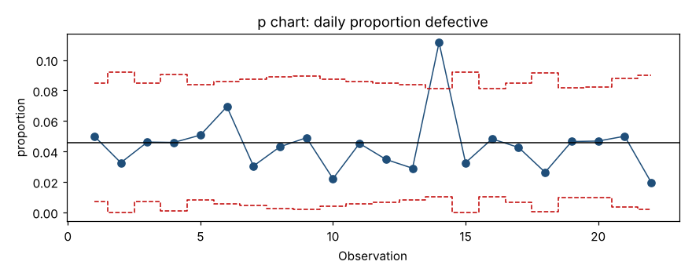
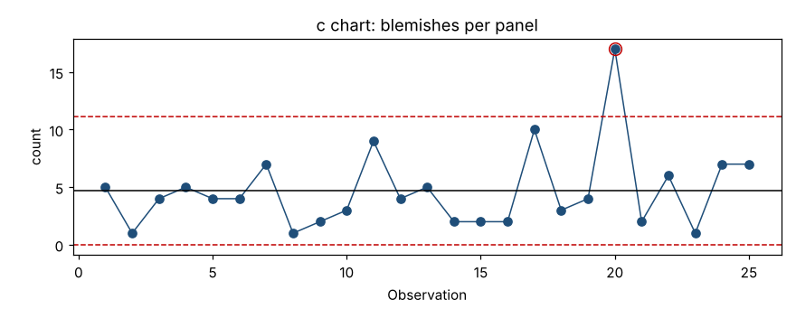

# Module 9 — Attribute Charts: p, np, c, u

**Time:** 60 min · **Data:** `data/daily_defectives.csv`, `data/panel_blemishes.csv`, `data/sheet_blemishes.csv`

## Learning objectives

1. Choose the correct attribute chart.
2. Construct and interpret p and c charts, including variable limits.
3. Know when an XmR chart is a safer choice for count data.

## 1. Choosing the chart

```
Counting…
├── defectives (unit is good/bad)  ── binomial model
│     ├── sample size varies  → p chart (proportion)
│     └── sample size constant → np chart (count)
└── defects (many per unit)        ── Poisson model
      ├── area/opportunity constant → c chart (count)
      └── area/opportunity varies   → u chart (rate)
```

| Chart | Plots | Center | Limits |
|---|---|---|---|
| p | pᵢ = dᵢ/nᵢ | p̄ = Σd / Σn | p̄ ± 3√[p̄(1−p̄)/nᵢ] |
| np | dᵢ (n constant) | np̄ | np̄ ± 3√[np̄(1−p̄)] |
| c | cᵢ (equal area) | c̄ | c̄ ± 3√c̄ |
| u | uᵢ = cᵢ/aᵢ | ū = Σc / Σa | ū ± 3√(ū/aᵢ) |

A negative lower limit is set to 0 (no lower limit). Note p̄ is the **total** defectives over the **total** inspected — not the average of daily percentages.

## 2. Worked example — p chart

Final inspection, 22 days, 180–319 parts inspected per day.

```bash
python tools/spc.py p data/daily_defectives.csv
```

p̄ = **0.0458** (4.58%). Limits are recomputed for each day because nᵢ varies — the chart has a "stepped" limit line. For day 14 (n = 314 → ±3 × √(0.0458 × 0.9542 / 314) = ±0.0354): UCL = 0.0812.



Day 14: p = 0.1115 (35 of 314) > 0.0812 → **signal**. All other days are within their limits.

**Action:** what was different on day 14? (In this data set: a bad material lot.) If the cause is found and removed, recompute p̄ without day 14.

## 3. Worked example — c chart

Blemishes on 25 painted panels of identical size.

c̄ = **4.68**, UCL = 4.68 + 3√4.68 = **11.17**, LCL = 4.68 − 6.49 < 0 → 0.



Panel 20 has 17 blemishes → **signal**. Panel 17 (10) is high but inside the limit.

## 4. u chart

When opportunity varies — sheets of different area, invoices with different line counts — divide by the opportunity. `data/sheet_blemishes.csv`: ū = 1.636 blemishes/m²; limits vary by sheet area. No sheet signals.

```bash
python tools/spc.py u data/sheet_blemishes.csv
```

## 5. When to prefer an XmR chart for counts

p, np, c and u limits come from a **theoretical** model (binomial or Poisson) which assumes each unit or defect is independent with a constant probability. When that's not true — defects cluster, the rate varies day to day for routine reasons — the theoretical limits are too narrow and the chart fires constantly.

**Check:** plot the same data on an XmR chart (limits from the data's own moving ranges). If XmR limits are much wider than the p/c limits, the model assumptions fail; trust the XmR chart. Wheeler recommends this check routinely; with large sample sizes (thousands per day) it is almost always needed.

## Exercise 9.1

Run an XmR chart on the `p` values from `data/daily_defectives.csv` (compute p = defective/inspected per day). Compare its limits with the p chart's. Does day 14 still signal?

## Check yourself

1. Number of scratches per car door, same door model every time. Which chart?
2. Why is p̄ computed as Σd/Σn instead of averaging the daily p values?
3. Your p chart has 40% of points outside the limits, but nothing seems to be wrong in the process. What's the likely issue?

<details><summary>Answers</summary>

1. c chart.
2. Days with more inspected parts carry more information; Σd/Σn weights them properly.
3. Overdispersion — the binomial model doesn't fit. Use an XmR chart on the proportions.
</details>
