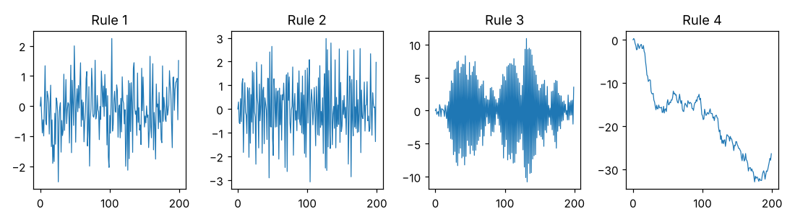

# Module 10 — Tampering: Deming's Funnel Experiment

**Time:** 30 min · **Tool:** `tools/funnel.py`

## Learning objectives

1. Explain why adjusting a stable process in response to each result increases variation.
2. Recognize the four funnel rules in real-world behavior.

## 1. The experiment

Deming used this demonstration in his four-day seminars (described in *Out of the Crisis*, 1986, and *The New Economics*, 1993). A marble is dropped through a funnel held above a target on a table. It lands somewhere near the target — common-cause variation. The question: how should you move the funnel to get the marbles closer to the target?

| Rule | Adjustment after each drop | Everyday equivalent |
|---|---|---|
| 1 | Never move the funnel (it's aimed at the target) | Leave a stable process alone |
| 2 | Move the funnel by the opposite of the last error, **from its current position** | Operator offsets the tool by the last part's deviation |
| 3 | Set the funnel opposite to the last error, **measured from the target** | Over-correcting: "it was 2 high, so aim 2 low" |
| 4 | Move the funnel over the spot where the last marble landed | Using the last part as the master for the next; training the trainer; copying last month's budget |

## 2. Simulation

```bash
python tools/funnel.py
```

Noise SD = 1 for every rule; 1000 drops each:

| Rule | SD of landing spots | Behavior |
|---|---|---|
| 1 | 0.94 | Smallest possible variation (equal to the noise) |
| 2 | 1.31 | Variation ≈ √2 × noise — **40% worse** |
| 3 | 30.7 (and growing) | Oscillates with ever-larger swings |
| 4 | 26.0 (drifting) | Random walk — wanders away from the target |



Rule 2 is the one that fools people: it *feels* like good control, and the average stays on target — but the spread grows by about 41% (variance doubles). That's the theoretical result: adding an adjustment equal to the last error adds a second, independent copy of the noise.

## 3. The lesson

- If the process is **predictable**, adjusting for individual results (Rules 2–4) can only make it worse. The only way to improve is to change the system (Rule 1 plus fundamental improvement).
- Adjust only on a **signal** from a process behavior chart. That is what the chart is for.
- Watch for Rule 4 in organizations: work instructions copied from copies, standards set from last period's performance, operators training operators with no reference.

## Check yourself

1. An operator adjusts a lathe offset after every part by the amount the last part was off nominal. Which rule, and what happens to variation?
2. When is an adjustment justified?

<details><summary>Answers</summary>

1. Rule 2; standard deviation increases by about 41%.
2. When a chart shows a signal (special cause), or as part of a planned change to the system.
</details>
