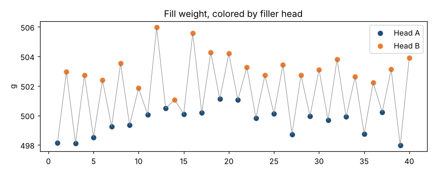

# Module 11 — Stratifying with Stage Variables

**Time:** 40 min · **Data:** `data/fill_weight.csv`

## Learning objectives

1. Use stage (grouping) variables to split data by source.
2. Recognize charts that hide structure because sources are mixed.

## 1. What stratification is

**Stratifying** means separating data by a factor that might affect results — machine, head, cavity, shift, operator, supplier, material lot, product family — and charting or summarizing each group separately. When you plot one chart with a break or a color for each group, the grouping column is called a **stage variable**.

Mixed sources produce misleading charts:

- **Alternating sources** (A, B, A, B…) inflate moving ranges → limits far too wide → the chart looks "too good."
- **Sources in blocks** (all A in the morning, all B after lunch) → apparent shifts that are really just a different machine.

## 2. Worked example — two filler heads

40 fill-weight samples (g), alternating between head A and head B.

**Combined XmR chart:**

| | Value |
|---|---|
| X̄ | 501.42 g |
| mR̄ | 3.64 g |
| Natural process limits | 491.73 – 511.12 g |

Every point is inside these wide limits; the run chart (Exercise 4.1) shows a saw-tooth pattern of far too many runs.

**Stratified by head:**

| Head | Mean | mR̄ | Natural process limits |
|---|---|---|---|
| A | 499.57 | 0.71 | 497.70 – 501.45 |
| B | 503.27 | 1.35 | 499.69 – 506.85 |

The heads differ by about 3.7 g, and each head's routine variation is a fraction of what the combined chart suggested. The combined chart's limits (±9.7 g) were mostly measuring the head-to-head difference.

**Action:** recenter head B (a system change), then chart each head separately (or chart A − B difference per cycle).

## 3. Which variables to stratify by

Brainstorm with a cause-and-effect (fishbone) diagram using the 6Ms: Machine, Method, Material, Man/people, Measurement, Mother nature (environment). Then make sure those factors are **recorded with every data point** (Module 1).

## Exercise 11.1

Compute the XmR limits for head A and head B yourself from `data/fill_weight.csv`. Then compute σ̂ for the combined data from mR̄ and compare it with the per-head values.

## Check yourself

1. A chart of all three shifts combined shows points hugging the center line, with many up-and-down alternations. What should you try?
2. Why is it important to record machine/cavity/lot with each measurement?

Answers

1. Stratify by shift (and other alternating sources); chart separately.
2. You cannot stratify afterward without it.

