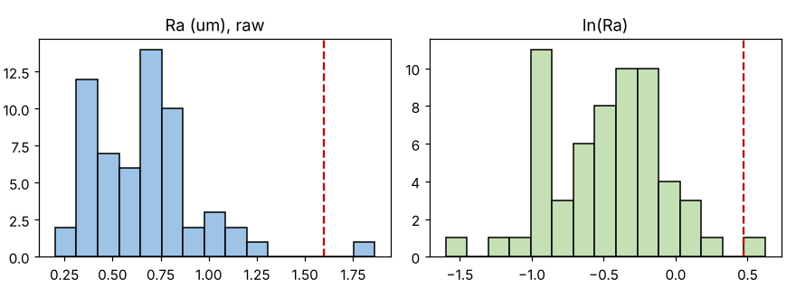

# Module 13 — Non-Normal Data & Transformations

**Time:** 45 min · **Data:** `data/roughness_ra.csv`

## Learning objectives

1. Decide when distribution shape matters and when it doesn't.
2. Apply a log (or Box-Cox) transformation for capability on skewed data.
3. Avoid transforming data for the process behavior chart without a reason.

## 1. Where shape matters

| Task | Does shape matter? | Why |
|---|---|---|
| Process behavior chart (detecting signals) | **Rarely** | Three-sigma limits cover ~98–100% of values for most unimodal distributions; the chart is a practical tool, not a probability test |
| Capability index as a *ratio* | Somewhat | Comparability across processes |
| Predicting **ppm** out of spec | **Yes** | ppm comes from the tail; the tail is exactly where models differ most |

Wheeler (*Normality and the Process Behavior Chart*, 2000) shows that transforming data to "make the chart valid" can hide real signals; he advises charting the original data. Some other authors prefer transformation for strongly skewed data to reduce false alarms. Both positions are in the literature — know which you're using and why.

## 2. Natural reasons for skew

Quantities bounded at zero and with the process running near that bound are skewed right: surface roughness, runout, flatness, concentricity, particle counts, cycle and waiting times, impurity levels. The skew is the physics, not a defect.

## 3. Worked example — surface roughness

60 parts, Ra (µm), one-sided spec **USL = 1.6 µm**.

| Statistic | Value |
|---|---|
| Mean / median | 0.670 / 0.655 |
| s | 0.275 |
| Skewness | 1.45 (strong right skew) |
| Max | 1.862 (1 of 60 parts > USL) |
| Shapiro–Wilk p (raw) | 0.0001 → not normal |
| Shapiro–Wilk p (ln Ra) | 0.42 → consistent with normal |

**Chart:** XmR on raw data: UNPL = 1.44; part 22 (1.862) is beyond it. With a skewed distribution, an occasional point beyond the upper limit can be routine. Investigate it like any signal — but expect that sometimes you will find nothing.

**Capability — two answers:**

| Model | Ppk (upper) | Predicted ppm > 1.6 |
|---|---|---|
| Normal on raw data | 1.13 | ≈ 360 |
| Normal on ln(Ra), USL → ln 1.6 | 0.79 | ≈ 8,600 |
| Observed | — | 1 in 60 ≈ 16,700 (very imprecise with n = 60) |

The normal model on raw data **understates the risk ~24×** because it gets the right tail wrong. The lognormal model is consistent with what was observed.

## 4. Options for skewed data

1. **Fit the right distribution** (lognormal, Weibull, gamma) and compute capability from its percentiles. Equivalent ("percentile") indices: Ppk = (USL − median) / (P₉₉.₈₆₅ − median).
2. **Transform** (log, Box-Cox λ), compute the index on the transformed scale with transformed spec limits.
3. **Report observed nonconforming** when n is large.

Always report which method you used.

## Exercise 13.1

Compute ln(Ra) for every row, then compute the mean, s, and Ppk against ln(1.6) = 0.470. Confirm the table above.

## Check yourself

1. Your flatness data are skewed right. Do you need to transform before plotting an XmR chart?
2. Why can the normal-model Cpk be badly wrong for ppm on skewed data?

Answers

1. No, not to detect signals. Chart the original data; consider a transformation for capability/ppm estimates.
2. ppm depends on the extreme tail; a right-skewed distribution has a much heavier upper tail than the normal model assumes.

