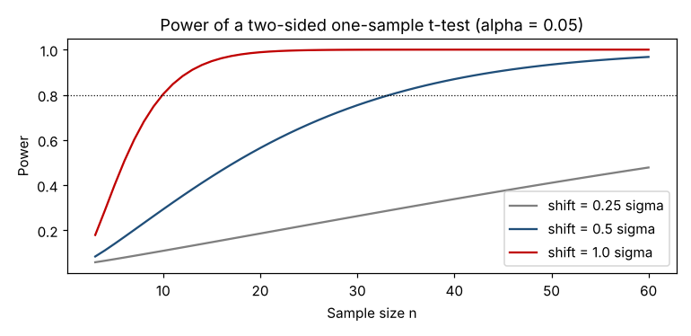

# Module 3 — Power and Sample Size

**Time:** 60 min

## Learning objectives

1. Name the four factors that determine power.
2. Determine an appropriate sample size before collecting data.
3. Read a power curve.

## 1. The four factors

| Factor | Power goes up when… | Can you control it? |
|---|---|---|
| **Effect size δ** — the smallest difference worth detecting | δ is larger | You *choose* it from the business/engineering need |
| **Noise σ** | σ is smaller | Partly: better gauges, blocking, pairing, stable process |
| **Sample size n** | n is larger | Yes — this is the usual lever |
| **Significance level α** | α is larger | Yes, but it trades against false alarms |

Plus: a one-sided test has more power in its direction than a two-sided test; a paired design has more power when units differ a lot from each other (Module 11).

## 2. Sample size for a mean — formula

For a one-sample or paired t-test (normal approximation):

  n ≈ [(z₁₋α/₂ + z₁₋β) · σ / δ]²

with z₀.₉₇₅ = 1.960 (α = 0.05 two-sided) and z₀.₈₀ = 0.842 (80% power). Round up, then add 1–2 because the t distribution has fatter tails than the normal; `tools/htest.py` (`n_for_mean`) iterates on the exact noncentral t.

For comparing two independent means, each group needs about **twice** that n (`n_per_group_two_means`).

## 3. Worked example

You want to detect whether a lathe is off nominal by **0.004 mm** or more. Historical σ ≈ 0.006 mm. α = 0.05, power 80%.

n ≈ [(1.960 + 0.842) × 0.006 / 0.004]² = (4.203)² = 17.7 → 18; exact noncentral t → **n = 20** (power = 0.81).

That's the sample size used in `data/bearing_od.csv` (Module 10).

## 4. Power curves

Power of a two-sided one-sample t-test, α = 0.05, as a function of n:

| n | Shift = 0.5σ | Shift = 1σ |
|---|---|---|
| 5 | 0.14 | 0.40 |
| 10 | 0.29 | 0.80 |
| 20 | 0.56 | 0.99 |
| 30 | 0.75 | >0.99 |
| 50 | 0.93 | >0.99 |

Halving the shift you want to detect roughly **quadruples** the sample size (n ∝ 1/δ²).

### Rules of thumb (two-sample t, α = 0.05, 80% power)

| Shift / σ | n per group |
|---|---|
| 1.0 | 17 |
| 0.5 | 64 |

## 5. Practical guidance

- **Decide δ first.** "Any difference" is not a δ. Ask: what difference would change our decision?
- **Get σ from history** — a process behavior chart's σ̂ (mR̄/1.128) is ideal.
- **Do the power analysis before collecting data.** After-the-fact ("post hoc") power computed from the observed effect adds nothing to the p-value; report a confidence interval instead (Module 5).
- If the required n is unaffordable: reduce σ (pairing, better gauge), accept a larger δ, or accept lower power — consciously.

## Exercise 3.1

Comparing two suppliers' hardness: σ ≈ 1.2 HRC, you care about a 1.4 HRC difference. How many bars per supplier for 80% power? What if you only care about 2.0 HRC?

Answer

1.4/1.2 = 1.17σ → 13 per group (exact noncentral t, `n_per_group_two_means(1.4, 1.2)`). For 2.0 HRC, 2.0/1.2 = 1.67σ → about 7 per group. Run the function to confirm.

## Check yourself

1. You double n. Does the detectable shift halve?
2. Name two ways to raise power without increasing n.

Answers

1. No — it shrinks by √2 (≈ 29%).
2. Reduce σ (pairing, blocking, better measurement), increase α, use a one-sided test when justified.

