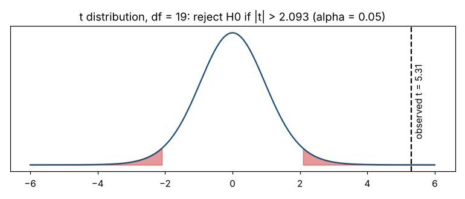

# Module 4 — The Test Procedure, p-Values, and Practical Significance

**Time:** 60 min · **Data:** `data/bearing_od.csv`

## Learning objectives

1. Follow the six-step procedure for any test.
2. Interpret a p-value correctly — and recognize the common misreadings.
3. Distinguish statistical significance from practical significance.

## 1. The six steps

1. **State the question** and the parameter (mean, proportion, variance).
2. **Write H₀ and Hₐ**; choose one- or two-sided (Module 1).
3. **Choose α and n** — from consequences and a power analysis (Modules 2–3).
4. **Collect and plot the data.** Check the assumptions of the test you plan to use.
5. **Compute the test statistic and p-value** (and a confidence interval).
6. **Decide and translate** back into a practical conclusion.

## 2. Test statistics share one shape

  test statistic = (estimate − hypothesized value) / standard error

It measures how many standard errors the sample result is from what H₀ predicts. The t, z, χ² and F statistics in this course are all variations on that idea.

## 3. What a p-value is

**p-value:** the probability, *assuming H₀ is true*, of getting a result at least as extreme as the one observed.

Small p → the data would be surprising if H₀ were true → evidence against H₀.

**Rule:** p < α → reject H₀; p ≥ α → fail to reject H₀.

### What a p-value is not

The American Statistical Association's 2016 statement on p-values (Wasserstein & Lazar, *The American Statistician* 70(2)) lists these principles; paraphrased:

| Misreading | Why it's wrong |
|---|---|
| "p = 0.03 means a 3% chance H₀ is true" | p is computed *assuming* H₀ is true; it's not the probability of H₀ |
| "p < 0.05 means the effect is important" | p mixes effect size with sample size; tiny effects become significant with large n |
| "p = 0.20 means there's no effect" | It may mean too little data |
| "The decision should rest on p alone" | Use the effect size, the confidence interval and process knowledge too |

## 4. Worked example — is the lathe on nominal?

20 bearing outer diameters; nominal 25.000 mm; α = 0.05, two-sided. (Full test in Module 10.)

```bash
python tools/htest.py one-mean
```

| | Value |
|---|---|
| x̄ | 25.00715 mm |
| s | 0.00602 mm |
| SE = s/√n | 0.00135 mm |
| t = (25.00715 − 25.000)/0.00135 | 5.31 |
| Critical t (df 19) | ±2.093 |
| p | 0.00004 |
| 95% CI | 25.0043 to 25.0100 mm |



**Statistical conclusion:** reject H₀; the process mean is not 25.000.

## 5. Statistical vs practical significance

Statistical significance asks *is it real?* Practical significance asks *does it matter?*

Suppose the tolerance is 25.000 ± 0.015 mm. The process is about 0.007 mm off-center — roughly half the tolerance on one side. With σ ≈ 0.006, the upper tail is at 25.007 + 3 × 0.006 = 25.025, beyond the 25.015 limit. **Practically significant:** re-center the lathe.

If instead the tolerance were ± 0.100 mm, the same 0.007 mm offset would be statistically significant but practically irrelevant — no action needed.

| | Practically important | Not important |
|---|---|---|
| **Statistically significant** | Act | Note it; usually no action (common with large n) |
| **Not significant** | Underpowered? Get more data before concluding | No action |

Always report the **size** of the effect with a confidence interval, not just "p < 0.05."

## Check yourself

1. p = 0.12, α = 0.05. State the conclusion in words a supervisor understands.
2. A test on 50,000 records finds average order value differs by $0.02 between two websites (p < 0.001). Significant? Important?

<details><summary>Answers</summary>

1. "The data don't give strong enough evidence of a difference. That's not proof there's none — the study may have been too small to see it."
2. Statistically significant, almost certainly not practically important.
</details>
