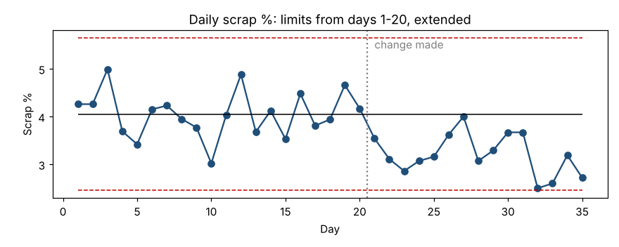

# Module 6 — Treatment Comparisons with Process Behavior Charts

**Time:** 40 min · **Data:** `data/daily_scrap.csv`

## Learning objectives

1. Use a process behavior chart to judge a before/after change.
2. Explain why a test on unstable data can mislead.

## 1. Why start with a chart

Every test in this course assumes the data in each group come from **one stable process** — the same distribution throughout. If the "before" data contain a drift or a shift, a t-test compares a moving target. A process behavior chart checks that assumption *and* shows the change in time order, which is how the people who run the process think.

(See *Charting Process Behavior* in this repository for XmR details.)

## 2. Worked example — did the scrap reduction work?

Daily scrap % for 35 days; a process change was made after day 20.

**Step 1 — baseline limits (days 1–20):** X̄ = 4.05%, mR̄ = 0.598, natural process limits 4.05 ± 2.66 × 0.598 = **2.46% to 5.64%**. No signals in the baseline: it's a stable "before" process.

**Step 2 — extend the limits to days 21–35:**

- All 15 points after the change are **below the baseline center line**. Detection Rule 3 (4 of 5 beyond 1σ) fires first, at day 25; Rule 4 (8 in a row on one side) confirms at day 28.
- No single point is below the lower limit; the improvement is a moderate shift, not a dramatic one.

**Step 3 — quantify:** mean after = 3.20%; difference 0.85 points. Welch t-test before vs after: t = 5.45, p < 0.0001, 95% CI for the reduction 0.53 to 1.16 points.

**Conclusion:** the chart shows the change worked *and held* for three weeks; the test and CI put a size on it. Now compute new limits from the "after" data and use them going forward.

## 3. Chart or test?

| Use a chart when… | Use a test when… |
|---|---|
| Data arrive over time | Data come from a one-off experiment |
| You want to see *when* a change happened and whether it holds | You need a formal decision with stated α |
| The audience is the shop floor | You need a CI for the size of the effect |

Best practice: do both. The chart validates the test's assumptions; the test quantifies the chart's signal.

## Check yourself

1. Your "before" data show an upward drift. Why is a two-sample t-test before vs after questionable?
2. What detection rule usually catches a moderate, sustained improvement first?

Answers

1. The "before" period isn't one stable process; the mean you're comparing against depends on which part of the drift you sampled.
2. A run of points on one side of the center line (Rule 4), or Rules 2–3.

