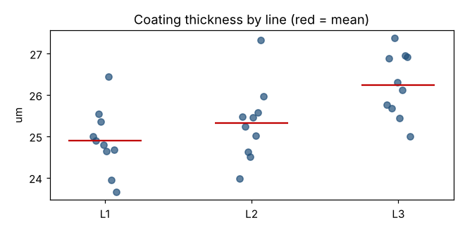

# Module 12 — Comparing Several Means: One-Way ANOVA

**Time:** 60 min · **Data:** `data/coating_thickness.csv`

## Learning objectives

1. Explain why ANOVA is used instead of many t-tests.
2. Build and read an ANOVA table.
3. Follow up a significant result with multiple comparisons.

## 1. Why not just run t-tests?

With 3 groups there are 3 pairwise t-tests; with 6 groups, 15. Each at α = 0.05 inflates the chance of at least one false alarm (with 15 independent tests, about 1 − 0.95¹⁵ ≈ 54%). ANOVA asks one question first: *is there any difference among the means?*

## 2. The idea

Split total variation into:

- **Between groups (SSB):** how far group means are from the grand mean
- **Within groups (SSW):** noise inside each group

  F = MSB / MSW = [SSB/(k − 1)] / [SSW/(N − k)]

If the groups don't differ, F ≈ 1. Large F → reject H₀.

**Assumptions:** independent samples, each group roughly normal, **similar variances** (check with Levene's test or the "largest SD < 2 × smallest SD" rule of thumb).

## 3. Worked example — three plating lines

10 parts per line, coating thickness (µm).



H₀: μ₁ = μ₂ = μ₃ Hₐ: at least one mean differs α = 0.05

| Source | SS | df | MS | F | p |
|---|---|---|---|---|---|
| Between lines | 9.52 | 2 | 4.76 | **6.92** | **0.004** |
| Within lines | 18.58 | 27 | 0.688 | | |
| Total | 28.10 | 29 | | | |

Line means: L1 = 24.89, L2 = 25.32, L3 = 26.24 µm. Levene's test p = 0.91 (no evidence of unequal variances). Critical F₀.₉₅(2, 27) = 3.35.

```bash
python tools/htest.py anova
```

**Effect size:** η² = SSB/SST = 0.34 — line accounts for about a third of the thickness variation.

## 4. Which lines differ? — Tukey HSD

Tukey's honestly significant difference test compares all pairs while keeping the family-wise error rate at 5%:

| Pair | Difference (µm) | 95% CI | p |
|---|---|---|---|
| L2 − L1 | 0.42 | −0.50 to 1.34 | 0.50 |
| L3 − L1 | 1.35 | 0.43 to 2.27 | **0.003** |
| L3 − L2 | 0.92 | 0.005 to 1.85 | **0.049** |

(`scipy.stats.tukey_hsd`.)

**Conclusion:** L3 plates thicker than L1 and (just) L2; L1 and L2 can't be distinguished. Investigate L3's current density, bath chemistry and dwell time.

## Check yourself

1. ANOVA gives p = 0.30. Should you run Tukey comparisons?
2. One group's SD is 4× the others'. What's the concern and an alternative?

<details><summary>Answers</summary>

1. Generally no — there's no overall evidence of a difference to follow up.
2. Unequal variances violate an ANOVA assumption. Use Welch's ANOVA or Kruskal–Wallis (Module 16), and ask why that group is so variable.
</details>
