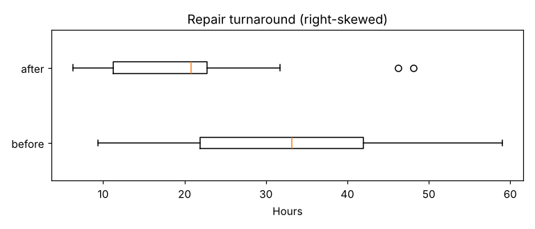

# Module 16 — Nonparametric Toolset

**Time:** 60 min · **Data:** `data/repair_turnaround.csv`, `data/discomfort_scores.csv`, `data/coating_thickness.csv`

## Learning objectives

1. Perform Mann–Whitney, Wilcoxon signed-rank, sign and Kruskal–Wallis tests.
2. Compare their results with the parametric equivalents.

## 1. Mann–Whitney (two independent groups)

Rank all observations together; if one group tends to have larger values, its ranks will be larger. The U statistic counts how often a value from one group exceeds one from the other.

### Worked example — repair turnaround after a kanban change

18 repairs before, 18 after (hours). Turnaround is right-skewed (a few repairs wait for parts).



| | Before | After |
|---|---|---|
| Median | 33.2 h | 20.8 h |
| Mean | 32.2 h | 21.5 h |

H₀: the two distributions are the same. Hₐ: one tends to be larger. α = 0.05.

- Mann–Whitney: U = 236, **p = 0.020** → reject
- For comparison: Welch t on raw data p = 0.016; Welch t on log(hours) p = 0.016

```bash
python tools/htest.py mann-whitney
```

All three agree: turnaround dropped by about a third. With 18 per group and moderate skew, the methods converge; with 6 per group and one extreme value, they wouldn't.

## 2. Wilcoxon signed-rank and sign test (paired)

**Sign test:** count positive and negative differences; under H₀ each is equally likely (binomial, p = 0.5). Uses only direction.
**Wilcoxon signed-rank:** ranks the absolute differences, then sums the ranks of positive differences. Uses direction *and* magnitude; assumes the differences are symmetric.

Zero differences are dropped in both.

### Worked example — operator discomfort score after a fixture change

14 operators rated discomfort (0–10) before and after. Ordinal data → nonparametric.

| Operator | 1 | 2 | 3 | 4 | 5 | 6 | 7 | 8 | 9 | 10 | 11 | 12 | 13 | 14 |
|---|---|---|---|---|---|---|---|---|---|---|---|---|---|---|
| Before | 8 | 8 | 8 | 5 | 5 | 4 | 6 | 8 | 4 | 6 | 7 | 8 | 8 | 6 |
| After | 6 | 5 | 7 | 4 | 3 | 4 | 5 | 7 | 4 | 4 | 7 | 9 | 5 | 3 |

11 non-zero differences: 10 improved, 1 got worse. Median change: −1 point.

| Test | Result |
|---|---|
| Sign test | 1 + vs 10 −, **p = 0.012** |
| Wilcoxon signed-rank | W = 3, **p = 0.007** |

```bash
python tools/htest.py wilcoxon
python tools/htest.py sign
```

**Conclusion:** the new fixture reduced reported discomfort.

## 3. Kruskal–Wallis (several groups)

Rank-based analogue of one-way ANOVA. On the coating data (Module 12): medians L1 = 24.84, L2 = 25.34, L3 = 26.21 µm; **H = 10.36, p = 0.006** — the same conclusion as ANOVA (p = 0.004). Follow up with pairwise Mann–Whitney tests with a multiplicity correction (e.g., Bonferroni: compare each p with 0.05/3), or Dunn's test.

**Mood's median test** is an even more robust alternative (counts above/below the grand median in each group), useful with outliers, at the cost of power.

## Exercise 16.1

Run a paired t-test on the discomfort scores. Does it agree? Is it appropriate for 0–10 ratings?

<details><summary>Answer</summary>

Paired t gives a small p-value too, so the conclusion agrees. But rating scales are ordinal — "8 to 6" isn't necessarily the same change as "4 to 2" — so the Wilcoxon or sign test is the defensible primary analysis.
</details>

## Check yourself

1. What does Mann–Whitney test, strictly?
2. When would you choose the sign test over Wilcoxon signed-rank?

<details><summary>Answers</summary>

1. Whether a randomly chosen value from one group tends to exceed one from the other (stochastic dominance); it's a test of medians only if the two distributions have the same shape.
2. When the differences are clearly asymmetric, or only the direction of change is trustworthy.
</details>
