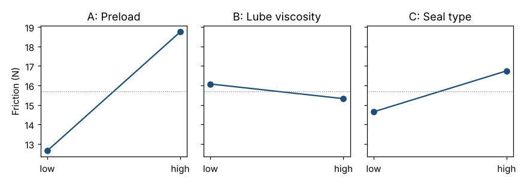

# Module 9 — Transfer Functions and Designed Experiments

**Time:** 6 h · **Phase:** Design

## Learning objectives

1. Explain what a transfer function is and where it comes from.
2. Run and analyze a 2³ full factorial experiment.
3. Use a transfer function to set design parameters and resolve trade-offs.

## 1. Y = f(X)

A **transfer function** predicts a CTQ (Y) from design or process parameters (Xs). Sources, from best to weakest:

| Source | Example |
|---|---|
| Physics / engineering equations | Beam deflection, Hertz contact stress, flow equations |
| Simulation (FEA, CFD, process simulation) | Stiffness from an FEA model |
| **Designed experiments (DOE)** | Friction as a function of preload, lubricant and seal |
| Historical regression | Data from similar products (beware correlation ≠ causation) |

With a transfer function you can predict the mean **and** the variation of Y from the variation of the Xs (Module 10).

## 2. Why designed experiments?

Changing one factor at a time (OFAT) is slow, misses interactions, and can mislead. A **factorial design** changes several factors together in a balanced pattern, so each effect is estimated from all runs.

## 3. Worked example — 2³ factorial on carriage friction

Factors (coded −1 / +1): **A** preload (light/heavy), **B** lube viscosity (low/high), **C** seal type (single-lip/double-lip). Response: friction force (N). One run per combination, randomized run order.

| Run (std order) | A | B | C | Friction (N) |
|---|---|---|---|---|
| 1 | − | − | − | 12.1 |
| 2 | + | − | − | 17.9 |
| 3 | − | + | − | 11.4 |
| 4 | + | + | − | 17.2 |
| 5 | − | − | + | 14.0 |
| 6 | + | − | + | 20.3 |
| 7 | − | + | + | 13.1 |
| 8 | + | + | + | 19.6 |

**Effect** of a factor = mean at + minus mean at −.

A: (17.9 + 17.2 + 20.3 + 19.6)/4 − (12.1 + 11.4 + 14.0 + 13.1)/4 = 18.75 − 12.65 = **6.10 N**

| Term | Effect (N) |
|---|---|
| **A (preload)** | **+6.10** |
| **C (seal)** | **+2.10** |
| B (viscosity) | −0.75 |
| AC | +0.30 |
| AB, BC, ABC | ±0.05 |



```bash
python tools/dfss.py doe
```

With one replicate there's no direct error estimate. Judge significance with a normal probability (or Pareto) plot of effects, or Lenth's method: A and C stand far out; B is modest; the interactions are noise-sized.

**Transfer function** (coded units, coefficient = effect/2):

  Friction ≈ 15.70 + 3.05·A − 0.375·B + 1.05·C

Check: A = −1, B = +1, C = −1 → 15.70 − 3.05 − 0.375 − 1.05 = 11.2 N (run 3 observed 11.4).

## 4. Using it

Target: friction ≤ 15 N, but the stiffness requirement wants **more** preload (the QFD roof conflict from Module 2).

- Single-lip seal (C = −1), high viscosity (B = +1): friction = 14.28 + 3.05·A. To stay ≤ 15 N: A ≤ 0.24 in coded units — i.e., preload a little above the midpoint.
- Next: a stiffness experiment (or FEA) on preload gives the other side of the trade-off. Pick the preload that satisfies both, with margin for variation (Module 10).
- Confirm with **confirmation runs** at the chosen settings before committing.

## 5. Beyond 2³

- **Fractional factorials** screen many factors in fewer runs (at the cost of confounding interactions).
- **Center points** detect curvature; **response surface designs** (central composite, Box–Behnken) model it.
- **Robust design** (Taguchi's idea) adds noise factors (temperature, material lot) to find settings where Y is insensitive to them.

## Check yourself

1. Why not test one factor at a time?
2. In the model, what does the coefficient 3.05 mean in physical terms?

<details><summary>Answers</summary>

1. OFAT needs more runs for the same precision, can't detect interactions, and may find a false optimum.
2. Moving preload from the middle setting to "heavy" adds about 3.05 N of friction (half the 6.10 N low-to-high effect).
</details>
