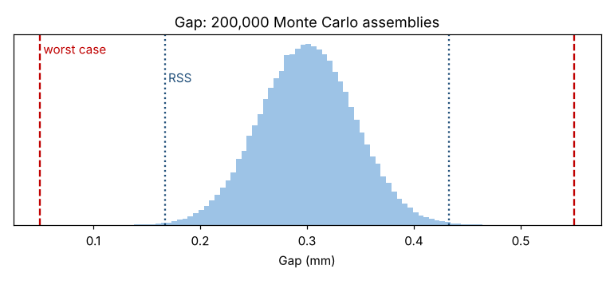

# Module 10 — Tolerance Design and Monte Carlo Simulation

**Time:** 4 h · **Phase:** Optimize

## Learning objectives

1. Analyze a tolerance stack-up by worst case, root sum of squares (RSS) and Monte Carlo.
2. Use Monte Carlo simulation to propagate variation through any transfer function.
3. Choose tolerances that balance function and cost.

## 1. The stack-up problem

Axial gap in the carriage = housing bore depth − (bearing width + spacer + retaining ring). Requirement: **0.10 to 0.50 mm**.

| Dimension | Nominal (mm) | Tolerance (±) | Sign |
|---|---|---|---|
| Housing bore depth | 30.00 | 0.10 | + |
| Bearing width | 15.00 | 0.06 | − |
| Spacer | 12.00 | 0.05 | − |
| Retaining ring | 2.70 | 0.04 | − |

Nominal gap = 30.00 − 15.00 − 12.00 − 2.70 = **0.30 mm**.

## 2. Three methods

| Method | Assumption | Gap range | Meets 0.10–0.50? |
|---|---|---|---|
| **Worst case** | Every part at its worst limit simultaneously | 0.30 ± 0.25 → **0.05 to 0.55** | ✗ |
| **RSS** | Independent, normal, centered; tolerance = ±3σ | 0.30 ± √(0.10² + 0.06² + 0.05² + 0.04²) = 0.30 ± 0.133 → **0.167 to 0.433** | ✓ |
| **Monte Carlo** (200,000 assemblies) | Same as RSS, simulated | Mean 0.300, σ 0.0443; P(gap < 0.10) ≈ 3 ppm | ✓ |

```bash
python tools/dfss.py stackup
```



Worst case says "tighten every tolerance" — expensive. RSS and Monte Carlo say the design is fine — **if** each dimension really is centered, independent and capable at ±3σ. If a supplier runs 0.03 mm off-center, or a part has Cpk < 1, RSS is optimistic. Practitioners sometimes inflate RSS (e.g., by ~1.5×) to allow for this; better, use real process data in the Monte Carlo.

| Use worst case when | Use RSS / Monte Carlo when |
|---|---|
| Few parts in the stack | Many parts (≥ 4–5) |
| Failure is safety-critical | Occasional out-of-tolerance assemblies are acceptable or caught |
| Part processes are not controlled | Part processes are stable and capable |

## 3. Monte Carlo for any transfer function

Monte Carlo works for nonlinear functions too: sample each X from its distribution, compute Y, repeat thousands of times, look at the distribution of Y.

Example using the friction model (Module 9): if preload (A) varies with σ = 0.3 coded units around A = 0, then friction σ from preload alone ≈ 3.05 × 0.3 ≈ 0.9 N. Simulate it with the code pattern in `tools/dfss.py` (`stackup` shows the method) — and the target of ≤ 15 N then needs a mean around 15 − 3 × 0.9 ≈ 12.3 N for a 3σ margin.

## 4. Allocating tolerances

Variance contribution of each part in the RSS stack:

| Part | Tol² | Share of variance |
|---|---|---|
| Housing depth | 0.0100 | **56%** |
| Bearing width | 0.0036 | 20% |
| Spacer | 0.0025 | 14% |
| Retaining ring | 0.0016 | 9% |

Tightening the housing depth gives the most benefit; tightening the retaining ring is almost pointless. Spend tolerance where it's cheapest and most effective.

## Check yourself

1. Why does worst case become very conservative for long stacks?
2. What must be true about the parts for an RSS result to hold?

<details><summary>Answers</summary>

1. All parts being at their worst limits simultaneously is extremely unlikely when many independent parts are involved.
2. Dimensions are independent, roughly normal, centered on nominal, and the tolerance reflects about ±3σ of a stable process.
</details>
