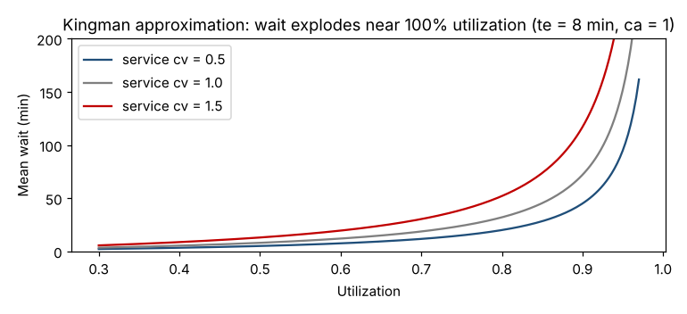

# Module 11 — Building a Process Model: Performance, Capacity and Queues

**Time:** 3 h · **Phase:** Optimize

## Learning objectives

1. Model a process with Little's law and utilization.
2. Predict waiting time with the Kingman approximation.
3. Explain why variability and high utilization destroy flow.

## 1. Process performance measures

| Measure | Definition |
|---|---|
| Throughput (TH) | Units completed per unit time |
| Work in process (WIP) | Units started but not finished |
| Flow time (lead time, FT) | Time from start to finish for one unit |
| Utilization (u) | Busy time / available time = arrival rate × service time |
| Capacity | Maximum sustainable throughput (set by the bottleneck) |

**Little's law** (John Little, 1961): for a stable system, on average

  **WIP = TH × FT**

It needs no assumptions about distributions. Example: a cell completes 0.1 units/min with 4.6 units in process → average flow time = 4.6/0.1 = **46 min**.

## 2. Why queues form

If work arrived perfectly evenly and every job took exactly the same time, a station at 90% utilization would never have a queue. Real arrivals and service times vary — and variability plus high utilization creates waiting.

**Kingman (VUT) approximation** for the mean wait in queue at a single station:

  Wq ≈ **V** × **U** × **T** = [(cₐ² + cₑ²)/2] × [u/(1 − u)] × tₑ

where cₐ and cₑ are the coefficients of variation (σ/mean) of the time between arrivals and of the service time, and tₑ is the mean service time.

### Worked example — drilling station

Jobs arrive every 10 min on average (random, cₐ = 1); drilling takes 8 min (cₑ = 0.5).

| Scenario | u | cₑ | Mean wait (min) |
|---|---|---|---|
| Baseline | 0.80 | 0.5 | **20** |
| Drill time rises to 9 min | 0.90 | 0.5 | **51** |
| Drill time variability rises | 0.80 | 1.5 | **52** |

```bash
python tools/dfss.py queue
```



**Design lessons:**

- Wait time explodes as utilization approaches 100% — designing stations to run at 95% "efficiency" guarantees long lead times.
- Reducing variability (standard work, setup reduction, preventive maintenance, smoother release of work) cuts waiting as effectively as adding capacity.

## 3. Bottleneck

The station with the highest utilization limits the line. In design, size every station for the target throughput with utilization margin (often 75–85%), and put the most capacity margin where variability is highest.

## Check yourself

1. A warehouse ships 200 orders/day with 1,000 orders in process. Average lead time?
2. A station runs at u = 0.95. Roughly how much longer is the wait than at u = 0.80, other things equal?

<details><summary>Answers</summary>

1. 1,000 / 200 = 5 days.
2. u/(1 − u): 19 vs 4 → about 4.75× longer.
</details>
