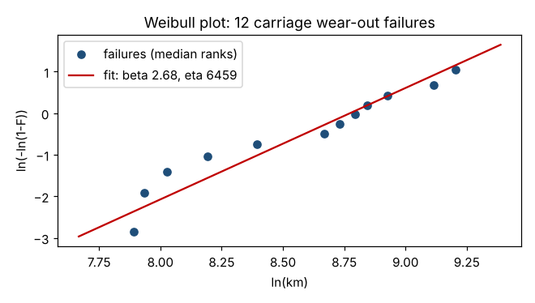

# Module 15 — Achieving Reliability Through Testing; Project Close-Out

**Time:** 3 h · **Phase:** Verify

## Learning objectives

1. Define reliability and plan a success-run (zero-failure) test.
2. Fit a Weibull model to life-test data and compute B10 life.
3. Close out a design project.

## 1. Reliability

**Reliability** R(t) = probability a product performs its function for time (or distance, cycles) t under stated conditions. It's quality over time — and a must-be customer need.

The **Weibull distribution** is the workhorse of life data:

  R(t) = exp[−(t/η)^β]

- η (scale): the life by which 63.2% have failed.
- β (shape): β < 1 early failures (infant mortality); β ≈ 1 random failures; β > 1 wear-out.
- **B10 life**: the life by which 10% have failed: B10 = η × (−ln 0.9)^(1/β).

## 2. Worked example — carriage wear life

12 carriages run on a test rig until wear failure (km):

2,671 · 2,794 · 3,059 · 3,614 · 4,414 · 5,818 · 6,184 · 6,587 · 6,922 · 7,520 · 9,096 · 9,950

Maximum-likelihood Weibull fit: **β = 2.68** (wear-out), **η = 6,459 km**, **B10 = 2,789 km**.



```bash
python tools/dfss.py reliability
```

**Verdict:** the requirement was a 10,000 km lube interval. Ten percent of carriages wear out before 2,800 km. The design fails verification — back to the Design phase (seal and lubricant retention). Finding this on a test rig is far cheaper than finding it in the field.

## 3. Success-run (zero-failure) testing

To demonstrate reliability R with confidence C, test n units for the required life with **zero failures**:

  n = ln(1 − C) / ln(R)

| Demonstrate | n (zero failures) |
|---|---|
| R = 0.90 at 90% confidence | **22** |
| R = 0.95 at 90% confidence | **45** |
| R = 0.99 at 95% confidence | **299** |

High-reliability demonstrations get expensive fast. Ways to reduce cost: test longer than the required life (with a known Weibull β, one unit tested to 2× life counts for more), accelerated life testing (higher load, speed or temperature with a validated acceleration model), and using prior data.

## 4. Project close-out

| Item | Content |
|---|---|
| Results vs charter | Each CTQ: target, predicted, verified |
| Final scorecard | Cpk / DPMO / RTY by step |
| Handover | Control plan, standard work, FMEA, drawings and specs to process owner |
| Documentation | Transfer functions, DOE and test data, simulation models — for the next design |
| Lessons learned | What would you do differently? |
| Recognition | Thank the team |

The process owner, not the project team, owns ongoing performance after handover.

## Check yourself

1. A Weibull fit gives β = 0.7. What kind of failures dominate, and what's the likely fix?
2. How many units must pass a zero-failure test to show R = 0.95 at 95% confidence?

<details><summary>Answers</summary>

1. Early-life (infant mortality) failures — typically manufacturing or assembly defects; fix with process controls or burn-in, not by redesigning for wear.
2. n = ln(0.05)/ln(0.95) = 58.4 → 59 units.
</details>
