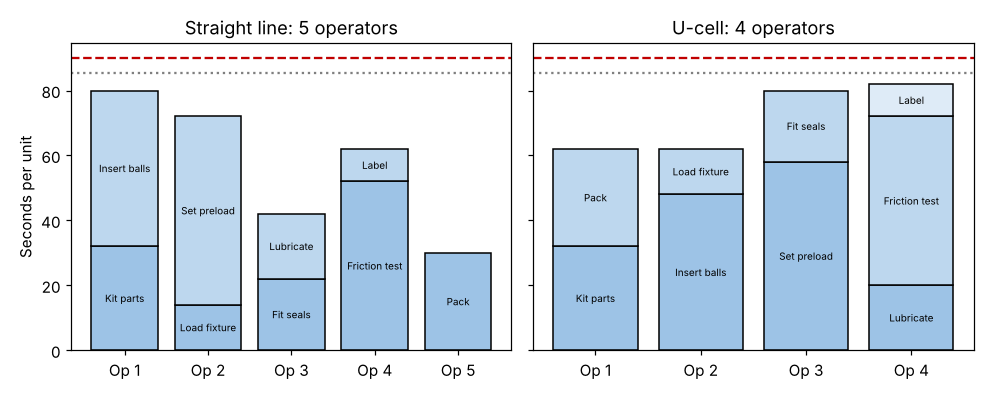

# Module 8 — Days 3–4: Continuous Flow, Line Balancing and Pull

**Time:** 2.5 h

## Learning objectives

1. Design a continuous-flow cell paced to takt.
2. Balance work across operators with a yamazumi chart.
3. Size a kanban pull loop.

## 1. Days 3–4 schedule

Mostly hands-on: move equipment, build fixtures and racks, try new methods ("try-storming": build it rough, run it, fix it, run again), time it, adjust. Each sub-team reports at noon and at 16:30.

## 2. Continuous flow

Move units one (or a few) at a time from step to step without waiting in batches. Benefits: lead time drops, defects are found immediately, less space and handling. Requirements: steps close together, balanced to takt, reliable equipment, quick changeover.

A **U-shaped cell** puts the start and end of the process next to each other, so one operator can handle the first and last steps and staffing can flex with demand.

## 3. Line balancing — case

After waste removal (fixture loading moved off preload, point-of-use parts), the work elements are:

| Element | Kit | Insert balls | Load fixture | Set preload | Fit seals | Lubricate | Friction test | Label | Pack |
|---|---|---|---|---|---|---|---|---|---|
| Time (s) | 32 | 48 | 14 | 58 | 22 | 20 | 52 | 10 | 30 |

Total work content = **286 s**; takt = 90 s; plan to 95% of takt (85.5 s) to leave room for variation.
Theoretical minimum = ⌈286 / 90⌉ = **4 operators**.

```bash
python tools/kaizen.py balance
```

**Straight line, elements in sequence:** 5 stations — 80, 72, 42, 62, 30 s; balance efficiency 286 / (5 × 90) = **63.6%**. Stations 3 and 5 are badly underloaded.

**U-cell:** the operator at the start also does the last step:

| Operator | Elements | Load (s) |
|---|---|---|
| 1 | Kit parts + Pack | 62 |
| 2 | Insert balls + Load fixture | 62 |
| 3 | Set preload + Fit seals | 80 |
| 4 | Lubricate + Friction test + Label | 82 |

**4 operators, all under 85.5 s; balance efficiency 286 / (4 × 90) = 79.4%.**



The same people now meet takt with one fewer position — the freed operator becomes the relief/water-spider for the constraint (Module 6) rather than being let go (Module 3).

## 4. Pull scheduling and kanban

Instead of pushing work to each step on a schedule, a downstream step **pulls**: it signals what it used, and the upstream step replaces only that.

**Kanban sizing** (common formula):

  Number of cards = daily demand × replenishment lead time × (1 + safety factor) ÷ container quantity

Kitting → cell: demand 560/day, replenishment 0.5 day, safety 20%, containers of 40:

  560 × 0.5 × 1.2 / 40 = 8.4 → **9 cards** (maximum 360 units between kitting and the cell, vs 1,800 before).

```bash
python tools/kaizen.py kanban
```

Rules: no card, no production; never send defects; the number of cards is reduced over time to expose problems.

## Check yourself

Takt drops to 75 s. Does the 4-operator U-cell still work?

<details><summary>Answer</summary>

No — operators 3 and 4 (80 and 82 s) exceed 75 s. Rebalance: 286/75 → at least 4 operators still in theory, but you'd need 5 in practice, or remove more work.
</details>
