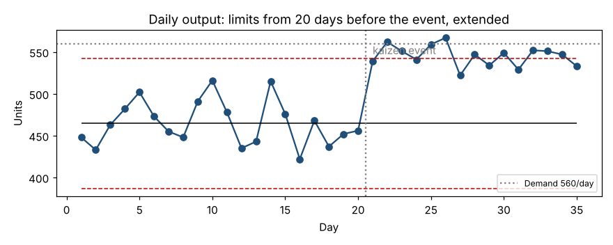

# Module 12 — Day 5: Control Charts Revisited, 5S and Visual Management

**Time:** 90 min

## Learning objectives

1. Use a process behavior chart to show whether the kaizen changed performance.
2. Implement 5S in the new area and audit it.
3. Design visual management so anyone can see the cell's status in seconds.

## 1. Control charts revisited — did it work?

Daily output for 20 days before the event and 15 days after, with XmR limits computed from the "before" period and extended:

```bash
python tools/kaizen.py xmr
```

| | Before (days 1–20) | After (days 21–35) |
|---|---|---|
| Mean | **464.6** | **545.5** |
| Average moving range | 29.3 | 16.4 |
| Natural process limits | 386.8 – 542.5 | 501.8 – 589.2 |



- All 15 days after the event are above the "before" mean, and 9 are above the old upper limit — a clear, sustained signal (see *Charting Process Behavior*, Module 7).
- Day-to-day variation halved (mR̄ 29 → 16): the cell is also more predictable.
- **But** the new average (545.5) is still below demand (560), and some days will fall as low as ~500. The kaizen closed most of the gap, not all — which is why the follow-up actions (preload uptime) matter.

Compute new limits from the "after" data and use them going forward.

## 2. 5S

| S | Japanese | Meaning | In the cell |
|---|---|---|---|
| Sort | Seiri | Remove what isn't needed | Red-tag 40 unused fixtures, old paperwork, broken tools |
| Set in order | Seiton | A place for everything, at point of use | Shadow boards, labeled locations, parts within reach |
| Shine | Seiso | Clean and inspect | Daily 5-minute clean of fixtures; find leaks and wear |
| Standardize | Seiketsu | Make the first three routine | Checklists, photos of the standard condition |
| Sustain | Shitsuke | Keep it going | Weekly audits, leadership walks |

**Audit (0–5 per S):**

| S | Before | After event |
|---|---|---|
| Sort | 2 | 4 |
| Set in order | 1 | 4 |
| Shine | 2 | 3 |
| Standardize | 1 | 3 |
| Sustain | 1 | 3 |
| **Total /25** | **7** | **17** |

Sustain only scores 3 at the end of the week — it can only be proven over months.

## 3. Visual management

The cell should tell its status at a glance:

- **Hour-by-hour board:** target per hour (40 at takt 90 s), actual, reason for misses.
- **Andon:** light or signal to call help; response standard.
- **WIP limits:** marked squares between stations — empty means starved, full means stop upstream.
- **Kanban cards and supermarket labels.**
- **Floor marking:** walkways, locations, red-tag area.
- **Standard work posted at each station.**

The test: can a visitor tell within 30 seconds whether the cell is on plan, and if not, why?

## Check yourself

A manager says "output is up — we're done." What does the chart say?

<details><summary>Answer</summary>

Output is up and more stable, but the new average (≈ 546) and its lower limit (≈ 502) are below demand (560). Further improvement is needed to meet demand every day.
</details>
