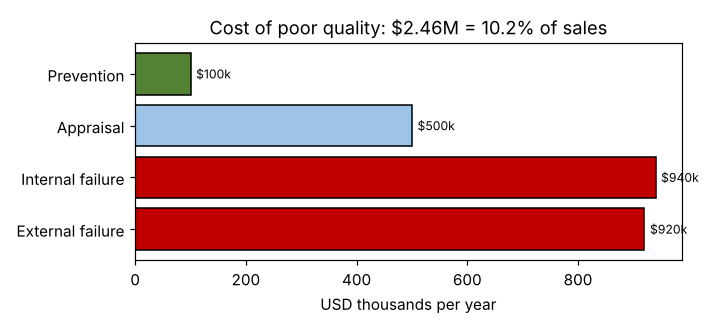

# Module 1 — The Cost of Poor Quality

**Time:** 35 min

## Learning objectives

1. Classify quality costs into prevention, appraisal, internal failure and external failure.
2. Estimate the cost of poor quality (COPQ) and use it to build the case for improvement.

## 1. The four categories

The prevention–appraisal–failure model goes back to Armand Feigenbaum (*Total Quality Control*) and Joseph Juran's work in the 1950s.

| Category | Definition | Examples |
|---|---|---|
| **Prevention** | Stopping defects from happening | Training, FMEA, design reviews, supplier development, error-proofing |
| **Appraisal** | Finding defects | Inspection, testing, audits, calibration |
| **Internal failure** | Defects found before the customer | Scrap, rework, re-test, downtime caused by defects, expediting |
| **External failure** | Defects found by the customer | Warranty, returns, field service, penalties, lost business |

COPQ is often defined as **all four**; some authors count only failure costs (and sometimes appraisal) as "poor quality." Say which definition you use.

## 2. Case — manifold plant (annual)

```bash
python tools/lean.py copq
```

| Category | USD |
|---|---|
| Prevention (training, FMEA, supplier program) | 100,000 |
| Appraisal (incoming inspection, leak test, final audit, calibration) | 500,000 |
| Internal failure (scrap, rework, expediting, defect downtime) | 940,000 |
| External failure (warranty, field service, penalties, lost orders est.) | 920,000 |
| **Total** | **2,460,000 = 10.2% of sales** |



**Reading:** 76% of COPQ is failure; prevention is 4%. Shifting spending toward prevention typically lowers total cost — a dollar of prevention avoids several of failure.

## 3. Hidden costs

The visible part (scrap, warranty) is the tip of the iceberg. Hidden: engineering time on firefighting, excess inventory held "just in case," overtime, lost customer goodwill and future orders. "Lost orders" above is an estimate — label estimates as such, and get finance to agree the numbers before using them.

## 4. Using COPQ

- Choose projects: the biggest failure costs are the best Lean Six Sigma targets.
- Make the case: express problems in money — the language of the business.
- Track progress: COPQ as % of sales over time.

## Check yourself

Classify: (a) 100% visual inspection before packing; (b) a mistake-proofing fixture; (c) a credit note for a wrong shipment; (d) re-machining a bore.

<details><summary>Answers</summary>

(a) Appraisal. (b) Prevention. (c) External failure. (d) Internal failure.
</details>
