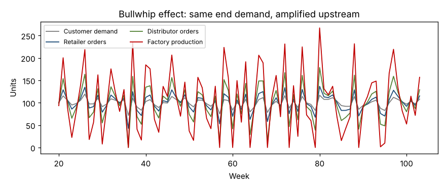

# Module 12 — Design for Six Sigma and Design for Lean: Supply Chain Dynamics

**Time:** 60 min

## Learning objectives

1. Explain when to design (DFSS) rather than improve (DMAIC).
2. Explain the bullwhip effect and design supply chains that dampen it.

## 1. Design for Six Sigma

DMAIC improves an existing process. When the process doesn't exist yet — or its design is the limit — use a design roadmap such as **DMADV** (Define, Measure, Analyze, Design, Verify) or **DCDOV** (Define, Concept, Design, Optimize, Verify): capture customer needs, choose a concept, predict performance, design out variation and waste, then verify. Building quality and flow into the design is far cheaper than fixing them later.

**Design for Lean** applies the same thinking to flow: design products and processes for small batches, quick changeovers, standard parts, and levelled demand. The full method is in *Design for Six Sigma* in this repository.

## 2. Supply chain dynamics: the bullwhip effect

Small changes in end-customer demand become larger swings in orders at each step upstream. Jay Forrester described it in *Industrial Dynamics* (1961); MIT's "Beer Game" demonstrates it; Lee, Padmanabhan and Whang (1997) named four causes:

| Cause | Mechanism | In the manifold chain |
|---|---|---|
| Demand forecast updating | Each tier forecasts from the orders it receives, not end demand | Distributors and the plant forecast from orders |
| Order batching | Monthly ordering | Distributors order once a month |
| Price fluctuation | Promotions cause forward buying | Quarter-end discounts |
| Rationing / shortage gaming | Customers over-order when supply is short | During CNC shortages, distributors pad orders |

### Simulation

Three tiers — retailer, distributor, factory — each forecast with exponential smoothing and use an order-up-to policy (lead time 2 weeks, review weekly). End demand averages 100/week with a standard deviation of 10.

```bash
python tools/lean.py bullwhip
```

| Tier | Variance of orders | Ratio to end demand |
|---|---|---|
| Customer demand | 100 | 1.0 |
| Retailer orders | 390 | **3.9×** |
| Distributor orders | 1,531 | **15.3×** |
| Factory production | 5,132 | **51.1×** |



The exact amplification depends on the parameters (lead times, smoothing, policy), but the direction is robust: each tier's forecasting and safety-stock logic multiplies variability.

### Dampening it

- **Share point-of-sale / end-customer demand** with every tier.
- **Shorten lead times** (fewer weeks of forecast to cover).
- **Smaller, more frequent orders** (kanban replenishment instead of monthly POs).
- **Stable pricing** (everyday low price vs promotions).
- **Allocate shortages by past sales**, not current orders.
- **Vendor-managed inventory** at distributors.

## Check yourself

Why does shortening lead time reduce the bullwhip?

<details><summary>Answer</summary>

Order-up-to targets scale with lead time; each forecast change is multiplied by fewer periods, so order swings are smaller.
</details>
