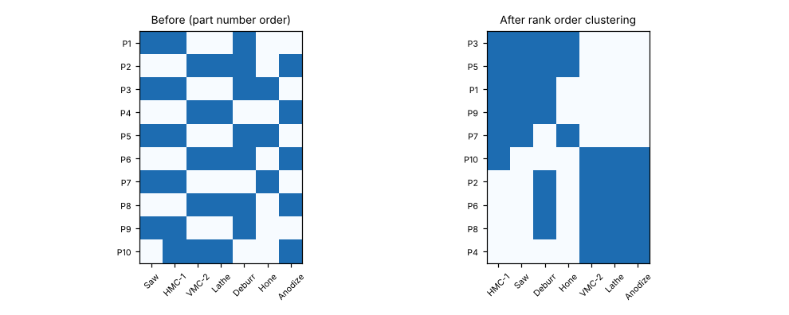

# Module 14 — Continuous Flow and Cellular Processing

**Time:** 60 min

## Learning objectives

1. Explain the benefits and prerequisites of continuous flow.
2. Form product families and cells with a product–process matrix.
3. Lay out a cell.

## 1. Continuous flow

Move one piece (or a small, fixed quantity) at a time from step to step, with no waiting in between.

| Batch and queue | Continuous flow |
|---|---|
| Lead time = sum of batch waits | Lead time ≈ sum of cycle times |
| Defects found late, in whole batches | Defects found on the next piece |
| Lots of floor space and handling | Compact cell |

**Prerequisites:** steps balanced near takt; reliable equipment; quick changeovers; capable processes; steps physically close.

**Simple illustration:** 3 steps of 1 min each, batch of 20 → first good part after 41 min, last after 60. One-piece flow → first part after 3 min, last after 22.

## 2. Cellular processing — finding families

A cell dedicates a group of machines to a family of parts with similar routings. The **product–process matrix** (parts × machines) reveals families.

**Rank order clustering** (King, 1980): read each row as a binary number, sort rows by value; repeat for columns; iterate until stable. Blocks appear on the diagonal.

```bash
python tools/lean.py cells
```



| Family | Parts | Machines |
|---|---|---|
| **1 — Block manifolds** | P1, P3, P5, P7, P9 | Saw, HMC-1, Deburr, Hone |
| **2 — Round manifolds** | P2, P4, P6, P8 | VMC-2, Lathe, Deburr, Anodize |
| **Exception** | P10 | HMC-1 + VMC-2 + Lathe + Anodize |

**Decisions:** Deburr is needed by both families — duplicate it (it's a cheap bench). P10 crosses cells: route its HMC operation through cell 1 as a planned exception, or redesign it so it doesn't need the HMC.

## 3. Cell layout

- **U-shape**: start and end next to each other, operators work inside the U, staffing flexes with takt.
- Machines close together, in process order, with one-piece flow fixtures and small WIP spots.
- Operators move **with** the part ("chaku-chaku": load-load) while machines run automatically.
- Standard work defines each operator's loop (Module 20).

## Check yourself

Why duplicate the deburr station rather than share it between cells?

<details><summary>Answer</summary>

Sharing would reconnect the cells through a common queue and force batching; a cheap duplicate keeps each cell flowing independently.
</details>
