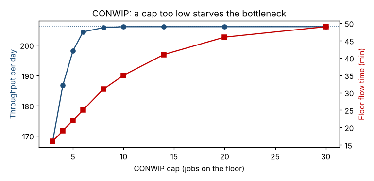

# Module 17 — Pull Systems: Types, WIP Caps (CONWIP) and Pull Scheduling

**Time:** 90 min

## Learning objectives

1. Distinguish push and pull, and the main types of pull systems.
2. Size and use a WIP cap (CONWIP) and a kanban loop.
3. Build a leveled pull schedule with a heijunka sequence.

## 1. Push vs pull

| Push | Pull |
|---|---|
| Work is released to a schedule or forecast (e.g., MRP) | Work is released when downstream consumption signals a need |
| WIP is whatever the schedule creates | WIP is capped by design |
| Lead time grows when things go wrong | Lead time stays bounded |

Hopp and Spearman's definition (*Factory Physics*): a pull system is one that **explicitly limits WIP**.

## 2. Types of pull systems

| Type | How it works | Best for |
|---|---|---|
| **Replenishment (supermarket) pull** | Each item has a fixed stock; consumption triggers replacement (kanban) | High-volume, repeating items (runners) |
| **Sequential pull** | Make-to-order released in a set sequence; FIFO lanes with max quantity between steps | Many variants, low volume (strangers) |
| **Mixed pull** | Supermarkets for runners, sequential for low-volume items | Most real plants |
| **CONWIP (WIP cap)** | A fixed number of jobs allowed on the floor; a new job enters only when one leaves | Job shops, varied routings, office processes |

## 3. Core process pull with a WIP cap (CONWIP)

Simulation of the three-step machining route (bottleneck at 91% utilization, random arrivals and service times):

```bash
python tools/lean.py conwip
```

| Release rule | Throughput/day | Floor WIP | Floor flow time | Order lead time (incl. waiting to be released) |
|---|---|---|---|---|
| Push (release on arrival) | 204.7 | 11.6 | 50 min | 50 min |
| CONWIP cap 20 | 204.7 | 10.7 | 46 min | 50 min |
| CONWIP cap 10 | 204.7 | 8.1 | 35 min | 58 min |
| CONWIP cap 4 | **185.4** | 4.0 | 19 min | **4,984 min** |



**Reading:**

- A sensible cap (≈ 8–10) cuts floor WIP and floor flow time with **no loss of throughput**.
- A cap that's too low **starves the bottleneck**: throughput drops below demand and the order backlog explodes. Size the cap with data and lower it gradually.
- In this simulation, work arrives randomly and push WIP stays modest. In real plants, MRP often releases work far ahead of need — the 2,800 units in the VSM — and then the cap removes far more WIP.

## 4. Kanban sizing

  Kanban cards = daily demand × replenishment lead time (days) × (1 + safety factor) ÷ container quantity

Finished-goods supermarket for family A: demand 110/day, replenishment 1 day, safety 25%, containers of 11 → 110 × 1 × 1.25 / 11 = 12.5 → **13 cards**.

**Rules:** no card, no production; produce in the order cards arrive; never send defects; reduce cards over time to expose problems.

## 5. Pull scheduling with heijunka

Schedule only the pacemaker (assembly), with a leveled sequence.

- **Pitch** = pack quantity × takt = 11 × 4.0 = **44 min** (one container's worth of work).
- 880 min / 44 = **20 pitches per day**.
- Daily mix: A 110, B 77, C 33 → 10, 7 and 3 containers.

Goal-chasing sequence (always pick the family furthest behind its ideal pace):

```bash
python tools/lean.py pull
```

  **A B A C B A A B A B C A B A A B C A B A**

A **heijunka box** has a column per pitch and a row per family; the material handler collects one kanban per pitch, so the pace and the mix are visible and level all day.

## Check yourself

Why can't heijunka work with 90-minute changeovers?

<details><summary>Answer</summary>

Changing families every few pitches would consume more time than is available; quick changeover is a prerequisite for a level mix.
</details>
