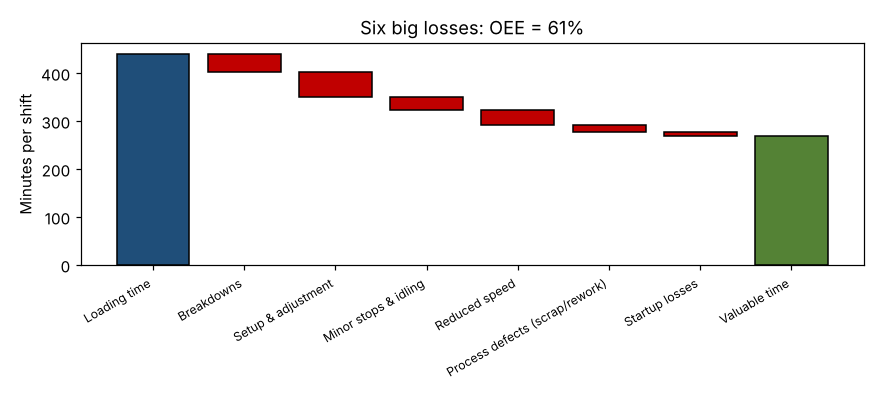

# Module 19 — Total Productive Maintenance (TPM)

**Time:** 75 min

## Learning objectives

1. Explain TPM's objectives and benefits.
2. Calculate MTBF, MTTR, availability and OEE, and analyze the six big losses.
3. Describe TPM maintenance activities.

## 1. Objectives and benefits

TPM, developed in Japan and set out by Seiichi Nakajima (*Introduction to TPM*, 1988), aims for **zero breakdowns, zero defects and zero accidents** through operator involvement and planned maintenance. It's proactive and preventive: keep equipment in its designed condition rather than fixing it after it fails.

**Benefits:** more capacity at constraints, stable flow (prerequisite for pull), fewer defects, lower maintenance cost, safer equipment, operators who know their machines.

## 2. Metrics

### MTBF, MTTR, availability — CNC-1, 4 weeks

320 h planned; 14 failures; 31.5 h of repair.

```bash
python tools/lean.py tpm
```

| Metric | Formula | Value |
|---|---|---|
| MTBF | Operating time ÷ failures = (320 − 31.5) / 14 | **20.6 h** |
| MTTR | Repair time ÷ failures = 31.5 / 14 | **2.25 h** |
| Inherent availability | MTBF ÷ (MTBF + MTTR) | **0.902** |

Raise MTBF with prevention (cleaning, lubrication, tool-life limits); cut MTTR with spares at point of use, standard repair procedures, and quick diagnostics.

### OEE and the six big losses — one shift, 440 min loading time

| Loss | Category | Minutes |
|---|---|---|
| Breakdowns | Availability | 38 |
| Setup and adjustment | Availability | 52 |
| Minor stops and idling | Performance | 27 |
| Reduced speed | Performance | 31 |
| Process defects (scrap/rework) | Quality | 14 |
| Startup losses | Quality | 9 |
| **Total losses** | | **171** |

Valuable operating time = 440 − 171 = 269 min → **OEE = 269 / 440 = 61.1%**.



Setup (Module 15) and breakdowns are the largest losses at the constraint.

## 3. TPM maintenance activities

| Pillar / activity | What it is | CNC example |
|---|---|---|
| **Autonomous maintenance** | Operators clean, inspect, lubricate, tighten; spot abnormalities early | 10-min start-of-shift checklist: coolant level and concentration, way-lube, chip conveyor, air pressure |
| **Planned maintenance** | Scheduled, time- or condition-based work by maintenance | Spindle vibration check monthly; filter changes |
| **Focused improvement** | Teams eliminate specific losses | Kaizen on tool breakage (30% of downtime) |
| **Early equipment management** | Design new equipment for maintainability | Specify chip management and access panels for the new cell |
| **Quality maintenance** | Keep conditions that produce zero defects | Tool-life limits, spindle runout checks |
| **Training** | Operators and maintenance skills | Operator certification on checks |
| **Safety and environment** | Safe equipment, safe maintenance | Lockout/tagout standard |
| **Office TPM** | Apply loss elimination to support processes | Faster spare-parts ordering |

Start with autonomous maintenance on the constraint: initial cleaning (it's inspection), fix sources of contamination, set cleaning and lubrication standards.

## Check yourself

Availability 0.85, performance 0.90, quality 0.97. OEE? Which loss first?

<details><summary>Answer</summary>

OEE = 0.742. Availability (15% loss) is the biggest — attack breakdowns and setups first.
</details>
