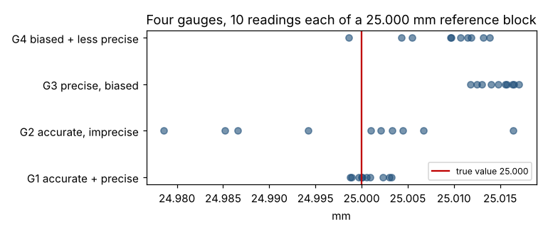

# Module 4 — Selecting the Best Measurement: Accuracy vs Precision

**Time:** 35 min · **Data:** `data/gauge_reference.csv`

## Learning objectives

1. Choose a measurement that reflects what the customer cares about.
2. Explain the difference between accuracy and precision.
3. Write an operational definition.

## 1. What makes a good measurement

| Criterion | Question |
|---|---|
| **Relevant** | Does it reflect the CTQ? (Measure what matters, not what's easy.) |
| **Continuous if possible** | Can we measure instead of count? (Module 3) |
| **Operationally defined** | Would two people get the same number on the same item? |
| **Accurate** | Does it read true on average? |
| **Precise** | Does it give the same reading when repeated? |
| **Adequate resolution** | Can it distinguish values at least ~1/10 of the tolerance or process spread? |
| **Practical** | Is it fast and cheap enough to do as often as needed? |

## 2. Operational definition

> "Measure diameter at 10 mm from the shoulder with the 0–25 mm digital micrometer (0.001 mm resolution), two readings 90° apart, record the average, first part off each hour."

It specifies *what, how, where, when* and *the decision rule* — so the number means the same thing every time.

## 3. Accuracy vs precision

- **Accuracy (bias):** how close the *average* reading is to the true value.
- **Precision (repeatability):** how close repeated readings are to *each other*.

### Worked example — four gauges on a 25.000 mm reference block

Each gauge measured the block 10 times:

| Gauge | Mean (mm) | Bias | SD (mm) | Verdict |
|---|---|---|---|---|
| G1 | 25.0007 | +0.0007 | 0.0016 | Accurate and precise |
| G2 | 24.9979 | −0.0021 | 0.0115 | Accurate (on average), **imprecise** |
| G3 | 25.0147 | **+0.0147** | 0.0018 | Precise but **biased** |
| G4 | 25.0089 | **+0.0089** | 0.0047 | Biased and less precise |

```bash
python tools/describe.py summary data/gauge_reference.csv mm --by gauge
```



**Which is worse, G2 or G3?** G3's bias can be corrected (recalibrate or offset). G2's scatter can't be corrected for a single reading — every individual measurement is unreliable. In practice an imprecise gauge is often the bigger problem; a biased one is the more dangerous if no one notices.

Formal assessment of measurement systems (bias, linearity, stability, gauge R&R) is called Measurement Systems Analysis (MSA).

## Check yourself

1. A scale always reads exactly 0.5 kg heavy. Accurate? Precise?
2. Why is a gauge with 0.01 mm resolution inadequate for a ±0.02 mm tolerance?

<details><summary>Answers</summary>

1. Precise but not accurate (consistent bias).
2. It can only show about 4–5 distinct values across the tolerance; the guideline is roughly 10 or more.
</details>
